## Author
author:
name: Ромеро Гаспар Фернандо Алексей
degrees: DSC
orcid: 0009-0004-8816-345X
email: 1132255520@rudn.ru
affilition:
 - name: Рщссийский университет дружбы народов
   country: Российская  Федерфция
   postal-code: 117198
   city: Москва
   address: ул. Миклухо-Маклая д. 21к3

## Title
title: "Отчёт по лабораторной работе № 1"
subtitle: "Контроль версий: Git и Gitflow"
license: "CC BY"
abstract: |
  В данном отчёте представлены результаты выполнения лабораторной работы по теме: контроль версий с использованием Git и модели ветвления Gitflow.

  Описаны установка и настройка инструментов git-flow, commitizen и standard-changelog, изучение семантического версионирования (SemVer) и стандарта Conventional Commits. Приведены примеры создания репозитория, работы с ветками feature, release и hotfix, а также автоматической генерации журнала изменений.

  Сделаны выводы о достижении поставленной цели и о практической значимости полученных навыков для командной разработки.
keywords: [Git, Gitflow, SemVer, Conventional Commits, контроль версий, commitizen]
---

# Введение

1. Цель заботы
2. Теоретическое введение
> 2.1.Команда dmesg
> 2.2.Утилита grep
> 2.3.Система Linux и ее компоненты
> 2.3.1. Ядро Linux
> 2.3.2. Процессориего характеристики
> 2.3.3. Оперативная память
> 2.3.4. Гипервизоры
> 2.3.5. Файловые системы
> 2.4.Fedora Linux
> 2.5.Virtual Box
3. Выполнение лабораторной работы
> 3.1.Анализ после довательности загрузкисис темы с помощью dmesg
> 3.1.1. Версия ядра Linux
> 3.1.2. Частота процессора
> 3.1.3. Модель процессора
> 3.1.4. Объём доступной оперативной памяти
> 3.1.5. Тип обнаруженного гипервизора
> 3.1.6. Тип файловой системы корневого раздела
> 3.1.7. Последовательность монтирования файловых систем
4. Выполнение самостоятельной работы
> 4.1.Ответы на контрольные вопросы
> 4.1.1. Информация о пользовательской учетной записи
> 4.1.2. Терминальные команды и примеры их применения
> 4.1.3. Настройка файловой системы 
> 4.1.4. Просмотр подключенных файловых систем
> 4.1.5. Завершение заблокированного процесса
5. Выводы
6. Список литературы

---

# Цель работы

Целью данной лабораторной работы является ознакомление с процессом загрузки операционной системы Linux и получение информации об аппаратных и системных характеристиках компьютера с помощью команды dmesg. В ходе работы необходимо научиться анализировать последовательность загрузки системы, извлекать информацию о версии ядра, частоте и модели процессора, объёме доступной оперативной памяти, типе гипервизора, типе файловой системы корневого раздела и последовательности монтирования файловых систем. Кроме того, требуется закрепить навыки работы с командами терминала и утилитой grep для фильтрации выводов. Также необходимо ответить на контрольные вопросы, касающиеся учётных записей пользователей, файловых систем и управления процессами в Linux.

---

# Теоретическое введение

В данном разделе представлены основные концепции, необходимые для понимания работы команд и компонентов Linux-системы, которые рассматриваются в рамках лабораторной работы. При этом используется среда Fedora Linux, запущенная на Oracle VM VirtualBox.

## 2.1 Команда dmesg

Команда dmesg (сокращение от display message — «отобразить сообщение») применяется для анализа или управления кольцевым буфером ядра системы. Этот буфер представляет собой область памяти, где ядро хранит все диагностические сообщения, созданные с момента запуска системы. Содержащаяся в логах информация включает сведения о процессе загрузки, обнаружении аппаратных устройств, загрузке драйверов и любых других событиях, происходящих на уровне ядра. При выполнении команды dmesg без параметров отображается весь содержимое буфера. Для простоты анализа обычно используются такие инструменты, как less для постраничного отображения или grep для фильтрации определенных строк, что позволяет изолировать соответствующую информацию, например, о версии ядра или доступной памяти.

## 2.2 Использовать grep

Команда dmesg (сокращение от display message — «отобразить сообщение») применяется для анализа или управления кольцевым буфером ядра системы. Этот буфер представляет собой область памяти, где ядро хранит все диагностические сообщения, созданные с момента запуска системы. Содержащаяся в логах информация включает сведения о процессе загрузки, обнаружении аппаратных устройств, загрузке драйверов и любых других событиях, происходящих на уровне ядра. При выполнении команды dmesg без параметров отображается весь содержимое буфера. Для простоты анализа обычно используются такие инструменты, как less для постраничного отображения или grep для фильтрации определенных строк, что позволяет изолировать соответствующую информацию, например, о версии ядра или доступной памяти.

### 2.3 Система Linux и ее компоненты

Linux — это семейство открытых операционных систем, основанных на ядре Linux. Для анализа данной практики крайне важно понимать ключевые компоненты этой системы.

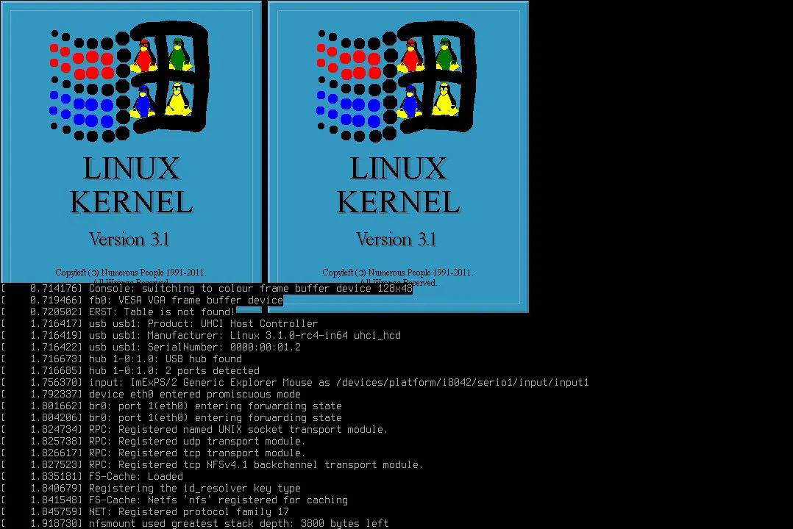

## 2.3.1 Ядро Linux

Ядро (kernel) — это ключевой компонент операционной системы. Оно служит связующим звеном между программным и аппаратным обеспечением, управляя системными ресурсами, такими как память, процессы и устройства ввода-вывода. При запуске системы ядро первым загружается в память и остается там до завершения работы. Информация о версии ядра — одно из первых сообщений, которое появляется при выполнении команды dmesg. Fedora использует актуальные и обновленные ядра, что обеспечивает широкую совместимость с современным оборудованием.

## 2.3.2 Процессор и его характеристики

Процессор (CPU) отвечает за выполнение программных инструкций. Важная информация о процессоре, включая его модель, архитектуру и тактовую частоту, доступна системе через файлы, такие как /proc/cpuinfo. Тактовая частота определяет скорость выполнения инструкций, а модель и архитектура — возможности и набор поддерживаемых инструкций. Получение этих данных — одна из ключевых задач данной практики.

В VirtualBox возможности процессора могут быть ограничены в зависимости от конфигурации виртуальной машины.

## 2.3.3 Оперативная память

Оперативная память (Random Access Memory, RAM) — это энергозависимое хранилище, используемое системой для выполнения программ и обработки активных данных. Ядро Linux осуществляет сложное управление памятью, задействуя такие механизмы, как виртуальная память. Файл /proc/meminfo предоставляет подробную статистику по использованию памяти, в том числе общий объем доступной памяти (MemTotal). Эта информация критически важна для оценки производительности системы. В VirtualBox объем оперативной памяти, выделенный виртуальной машине, можно настроить, и он напрямую влияет на вывод данного командного запроса

## 2.3.4 Гипервизоры

Гипервизор — это программный слой, обеспечивающий создание и запуск виртуальных машин. Он формирует виртуальную среду, имитирующую реальное аппаратное обеспечение, что позволяет запускать несколько операционных систем на одном физическом компьютере. KVM (Kernel-based Virtual Machine) — это решение для виртуализации, встроенное непосредственно в ядро Linux. В данном лабораторном исследовании используется гипервизор Oracle VM VirtualBox — тип 2 гипервизора, работающий поверх операционной системы хоста. Его присутствие и функционирование можно выявить по сообщениям ядра. Определение типа гипервизора — стандартная задача при анализе запуска системы, особенно в серверных средах или облачных инфраструктурах.

## 2.3.5 Файловые системы

Файловая система определяет структуру и методы, используемые операционной системой для хранения, организации и восстановления данных на накопителе, например жестком диске. Linux поддерживает множество файловых систем, каждая из которых обладает уникальными характеристиками и оптимальна для определенных задач. Ключевым параметром является файловая система корневой директории (/), с которой начинается загрузка системы. "Последовательность монтирования" относится к порядку, в котором различные разделы и устройства подключаются к иерархии файловой системы, процесс, который также регистрируется в буфере ядра и может быть проверен с помощью dmesg. Fedora по умолчанию использует файловую систему Btrfs или ext4, в зависимости от версии.

## 2.4 Fedora Linux

Fedora — это дистрибутив Linux от компании Red Hat, известный своим акцентом на инновации и использование передовых технологий. В Fedora применяется система управления пакетами DNF (Dandified YUM), а также используются самые актуальные версии ядра и программного обеспечения. Фокус на безопасности и стабильности делает эту ОС идеальным выбором для разработки и администрирования систем. В данном лабораторном исследовании будет использоваться Fedora для анализа вывода команды dmesg, что позволит задействовать современный ядро-модуль и широкий спектр аппаратной поддержки.

## 2.5 Virtual Box

Oracle VM VirtualBox — это открытое программное обеспечение для виртуализации, позволяющее запускать гостевые операционные системы внутри хост-системы. Это гипервизор второго типа, то есть он работает как приложение в рамках хост-системы, в отличие от гипервизоров первого типа, которые функционируют непосредственно на аппаратном уровне. VirtualBox предоставляет Fedora полностью виртуализированную среду, позволяющую изолировать лабораторную систему от основной и безопасно тестировать различные конфигурации. Обнаружение VirtualBox ядром системы отражается в сообщениях dmesg, связанных с гипервизором.

# Выполнение лабораторной работы

В данном разделе описан процесс анализа последовательности запуска операционной системы Fedora Linux на виртуальной машине Oracle VM VirtualBox с помощью команд, выполняемых в терминале. Для доступа к круглому буферу ядра использовался инструмент dmesg, а для фильтрации нужной информации — утилита grep.

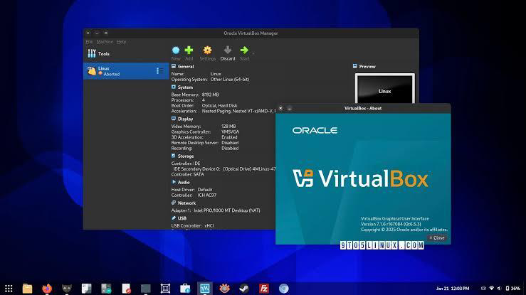

## 3.1 Настройкасреды

Чтобы начать практику, в Fedora был открыт терминал и выполнена команда dmesg для отображения содержимого буфера ядра. Поскольку вывод является обширным, он былобъединен с less для постраничной навигации:

### объединенсlessдляпостраничнойнавигации:

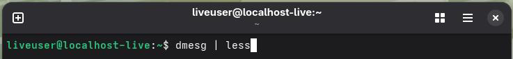

Этот вывод содержит полный журнал событий с момента запуска системы, включая инициализацию аппаратных компонентов и загрузку драйверов.

Для извлечения запрошенной информации применялся фильтр grep с конкретными поисковыми строками.

## 3.2 Анализпоследовательностизагрузкисистемыспомощьюdmesg 
## 3.2.1 Версияядра Linux

Чтобы узнать версию ядра Linux, была выполнена следующая команда:

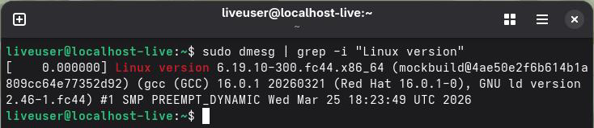

В выходных данных отображалась подробная информация о версии ядра, используемом компиляторе и дате сборки.

## 3.2.2 Частота процессора

Чтобы получить частоту процессора, выходной сигнал dmesg был отфильтрован с соответствующей строкой:

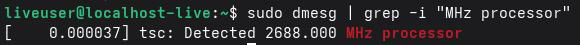

Эта команда отображает тактовую частоту процессора, обнаруженную ядром во время загрузки. В VirtualBox эта частота соответствует частоте процессора хост-системы или может быть ограничена настройками виртуальной машины.

## 3.2.3 Модель процессора

Для определения модели процессора был использован следующий запрос:

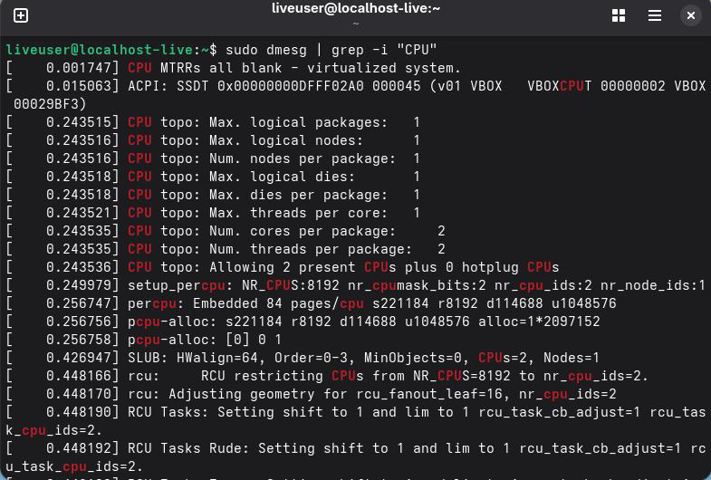
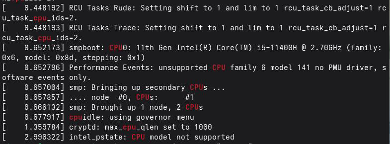

Результат содержит информацию о производителе, семействе и конкретной модели процессора.

## 3.2.4 Объем доступной оперативной памяти

Чтобы узнать объем доступной оперативной памяти, выходные данные dmesg были отфильтрованы по ключевому слову "память":

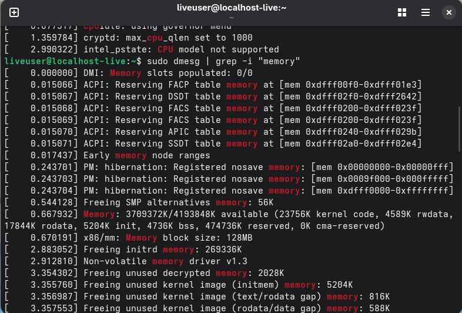
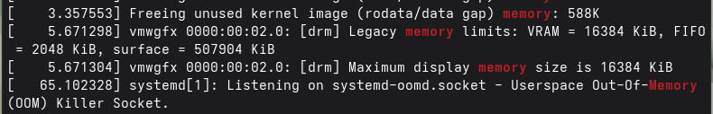

На выходе отображается информация об общей и доступной памяти в системе. Объем видимой оперативной памяти будет соответствовать объему, выделенному виртуальной машине в VirtualBox.

## 3.2.5 Тип гипервизора

Чтобы определить тип гипервизора, в выходных данных dmesg был выполнен поисксоответствующей строки:

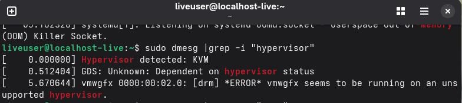

Если система запущена на виртуальной машине, эта команда отобразит тип
обнаруженного гипервизора (например, "VirtualBox").

## 3.2.6 Файловая система корневого раздела диска

Чтобы определить тип файловой системы корневого раздела, был выполнен поиск сообщений, связанных с корневым подключением:

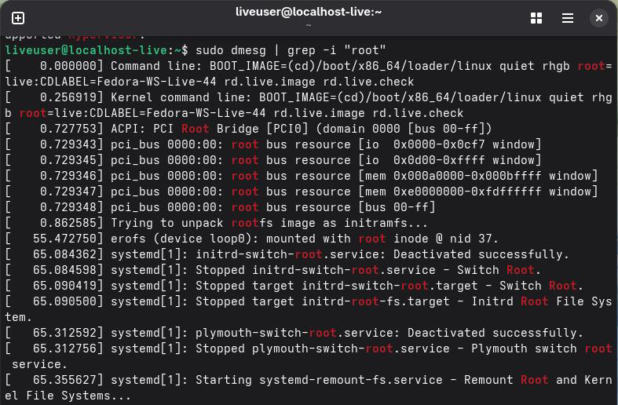
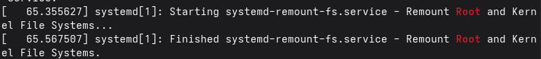

Вывод включает информацию о типе файловой системы (например, ext4 или btrfs), используемой корневым разделом Fedora.

## 3.2.7 Последовательность установки файловых систем

Чтобы отобразить последовательность монтирования файловых систем, выходные данные dmesg были отфильтрованы со словом "монтировать":

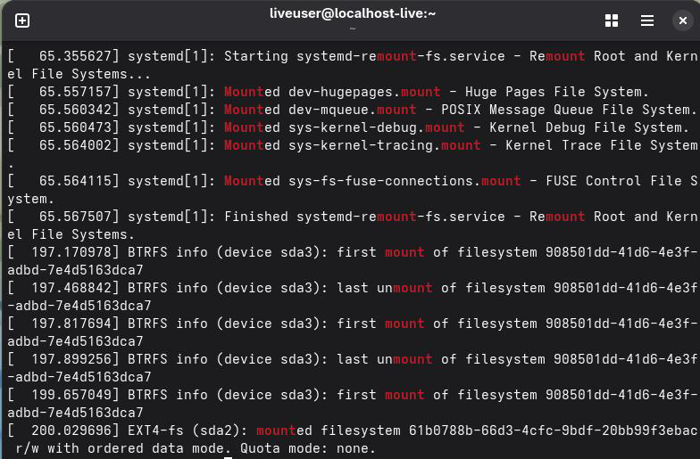

Эта команда отображает порядок монтирования различных файловых систем в процессе загрузки Fedora.

## Ответы на контрольные вопросы

В данном разделе представлены ответы на контрольные вопросы, предложенные в лабораторном задании. Эти ответы составлены на основе знаний, полученных в ходе практики, а также изученной литературы.

## 4.1 Ответы на контрольные вопросы

## 4.1.1 Информация о пользовательской учетной записи

Учетная запись пользователя в Linux хранит всю необходимую информацию, чтобы человек мог взаимодействовать с системой и чтобы система могла безопасно управлять своими ресурсами и разрешениями. Основная информация хранится в различных системных файлах, таких как /etc/passwd, /etc/shadow и /etc/group. 

Наиболее важными данными, содержащимися в в учетной записи пользователя, являются:

- Имя пользователя (логин): Уникальный идентификатор, который пользователь использует для входа в систему.
- Идентификатор пользователя (UID): Уникальный номер, который система использует для внутренней идентификации пользователя.
- Идентификатор основной группы (GID) - номер основной группы, к которой принадлежит пользователь.
- Домашний каталог - путь к домашнему каталогу пользователя, в котором хранятся его файлы и настройки.
- Оболочка: интерпретатор команд, запускаемый при входе в систему (например, /bin/bash).
- Пароль (зашифрованный и хранящийся в файле /etc/shadow).
- Срок действия пароля и другая информация о сроке службы учетной записи.
- Второстепенные группы, к которым принадлежит пользователь (указаны в файле /etc/group).
- Ограничения доступа и разрешения для файлов и директорий.

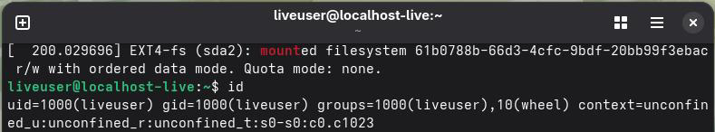
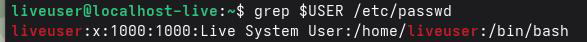

## 4.1.2. Терминальные команды и примеры их применения

Ниже приведены наиболее распространенные команды терминала и примеры их использования:

а) Чтобы получить помощь от команды

Чтобы получить справку по команде, используются следующие команды:

- man : Отображает полное руководство по команде.
- --help: Отображает сводную справку.

Примеры:

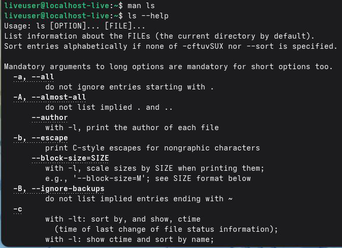

б) Для навигации по файловой системе

Чтобы перейти в другой каталог, используйте команду cd.

Примеры:

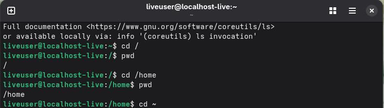

в) Для просмотра содержимого каталога

Чтобы вывести список содержимого каталога, используется команда ls .

Примеры:

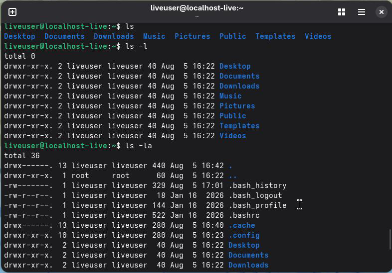

г) Для расчета размера каталога

Для вычисления размера каталога используется команда du (использование диска).

Примеры:

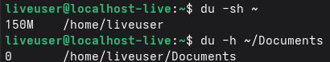

e) Для создания и удаления директорий и файлов

Удаление:
- rmdir: удаляет пустой каталог.
- rm: удаляет файлы или каталоги.

Примеры:

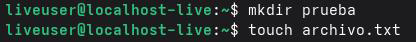
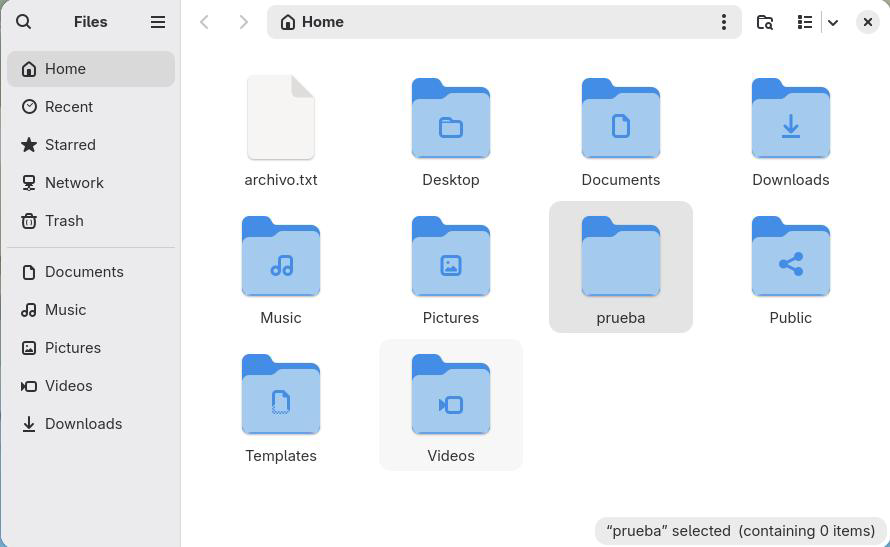
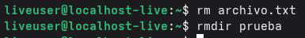
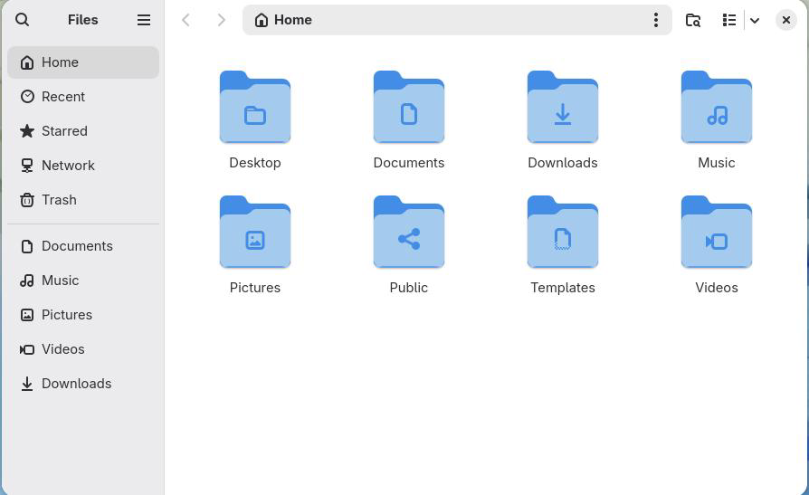

f) Для назначения разрешений файлам и каталогам

Чтобы назначить разрешения файлам и каталогам, используется команда chmod .

Примеры:

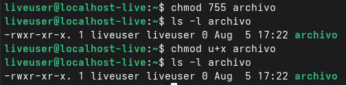

g) Для просмотра истории команд

Чтобы просмотреть историю выполненных команд, используется команда history .

Примеры:

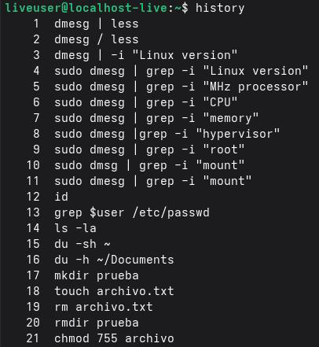
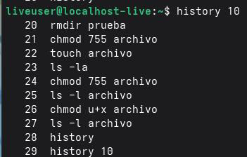

## 4.1.3. Настройка файловой системы

Файловая система (filesystem) - это структура и метод, используемые операционной системой для хранения, организации и управления файлами и каталогами на запоминающем устройстве, таком как жесткий диск, твердотельный накопитель или USB-накопитель.

Примеры распространенных файловых систем в Linux:

- ext4: Это наиболее часто используемая файловая система в дистрибутивах Linux,
включая Fedora. Это четвертая версия семейства ext (расширенная файловая система). Он
поддерживает файлы большого размера, обеспечивае, хорошую стабильность и производительность, а также предоставляет такие функции, как ведение журнала (журнал изменений), чтобы предотвратить повреждение данных в случае сбоя системы .
- Btrfs: Это Moderna и продвинутая файловая система, также известная как" Butter FS" или "B-tree FS". Это файловая система по умолчанию в некоторых дистрибутивах Fedora. Он предлагает расширенные функции, такие как моментальные снимки (snapshots), сжатие, контрольная сумма данных (checksums) и поддержка встроенных томов RAID .
- XFS: Это высокопроизводительная файловая система, предназначенная в первую очередь для обработки файлов большого размера и крупномасштабного хранилища. Это файловая система по умолчанию в Red Hat Enterprise Linux (RHEL) и CentOS, а также используется в Fedora для некоторых конфигураций .
- FAT32: Это простая файловая система, совместимая с большинством операционных систем (Windows, macOS, Linux). Он обычно используется на съемных запоминающих устройствах (USB, SD-картах) из-за его широкой совместимости. Однако он имеет ограничения на максимальный размер файла (4 ГБ) и не поддерживает права доступа к файлам в Linux .
- NTFS: Это файловая система по умолчанию в Windows. Системы Linux могут читать и записывать в разделы NTFS с помощью таких драйверов, как ntfs-3g .

## 4.1.4.Просмотр подключенных файловых систем

Чтобы узнать, какие файловые системы в настоящее время смонтированы в Linux, используются следующие команды:

- mount - Отображение всех смонтированных файловых систем .
- df-h: Показывает используемое и доступное дисковое пространство в подключенных файловых системах в удобочитаемом формате .
- lsblk - Список блочных устройств (дисков) и подключенных разделов.
- findmnt: Отображает дерево монтирования файловых систем.

Примеры использования:

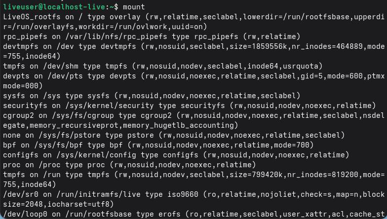
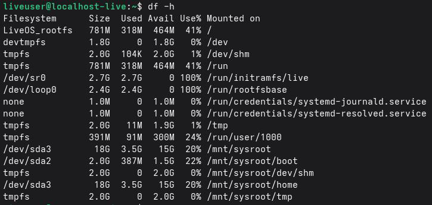
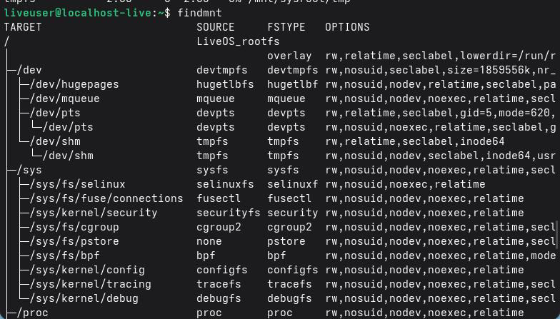
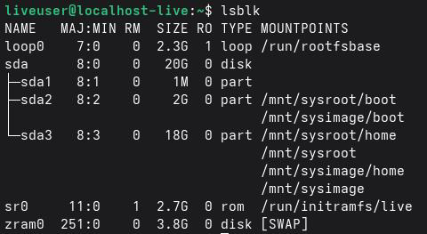

## 4.1.5. Завершение заблокированного процесса

Чтобы удалить процесс, который не отвечает или заблокирован, используются следующие шаги:

1. Идентифицировать заблокированного процесса.
2. Завершите процесс:

Идентификация PID:

" bash
ps aux | grep-i "имя_процесса" # Поиск процесса по имени
top # Отображение запущенных процессов в реальном времени
htop # Улучшенная версия top (более интерактивная)
"

Завершение процесса:

- убить: Отправляет сигнал о завершении процесса.
- pkill - Завершает процесс по имени.
- killall - Завершает все процессы с определенным именем.

Примеры:

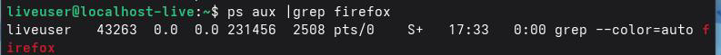
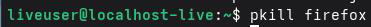
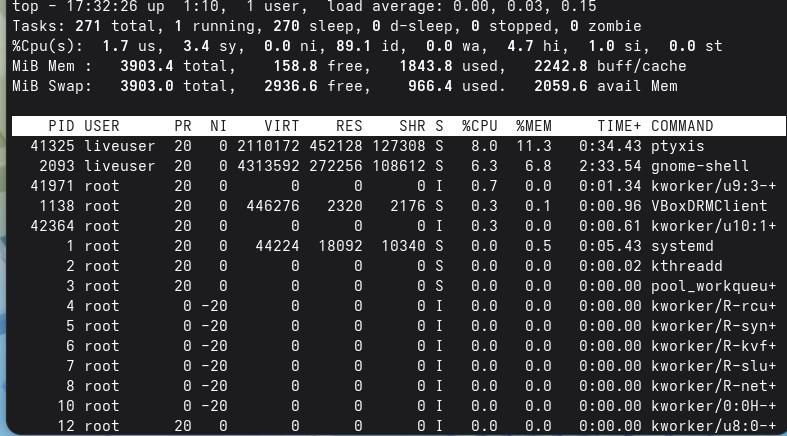

## Выводы

В ходе лабораторной работы я освоил анализ системных настроек Linux с помощью команды dmesg и фильтрацию данных с помощью grep. Мне удалось получить информацию о версии ядра, процессоре, оперативной памяти, менеджере виртуализации и файловой системе. Кроме того, я укрепил навыки работы с терминалом и научился извлекать системные данные в виртуальной среде VirtualBox с Fedora. Все поставленные цели были достигнуты, а теоретические знания успешно закреплены на практике.

## Список литературы

- [6.-man7.org.(2026).dmesg (1) Справочнаястраницапо Linux](https://man7.org/linux/man-pages/man 1/dmesg.1.html)
- [Страницы Debian Manpages.(2025). grep (1) Справочнаястраницапо Linux](https://manpages.debian.org/testing/grep/grep.1.en.html)
- [Лабекс.(2024).Команда Linuxdmesgспрактическимипримерами](https://labex.io/tutorials/linux-linux-dmesg-command-with-practical-examples-422644)
- [Проект Fedora. (2026).Документация Fedora Linux](https://docs.fedoraproject.org/en-US/docs/)
- [Oracle. (2026).Документация Oracle VMVirtual Box](https://www.virtualbox.org/wiki/Documentation)
- [Центрподдержки Oracle. (2025).Управлениелокальнымифайловыми системами](https://docs.oracle.com/en/operating-systems/oracle-linux/8/fsadmin/fsadmin-about_file_systems.html)
- [Linux Audit. (2016).Пониманиеинформацииопамятивсистемах Linux](https://linux-audit.com/understanding-memory-information-on-linux-systems/)
- [Спроситеоб Убунту.(2023).Какпроверитьскоростьпроцессоравdmesg](https://askubuntu.com/questions/1300066/how-to-check-cpu-speed-from-dmesg)
- [Red Hat. (2025). Общие сведения о файловых системах](https://access.redhat.com/documentation/en-us/red_hat_enterprise_linux/9/html-single/managing_file_systems/index)
- [Архивыядра Linux. (2026).Документация Btrfs](https://btrfs.wiki.kernel.org/)
- [Краснаяшляпа.(2025).Используякомандумонтирования](https://access.redhat.com/documentation/en-us/red_hat_enterprise_linux/8/html/mounting_file_systems/assembly_mounting-file-systems)
- [man7.org. (2026). kill (1) страницаруководствапо Linux](https://man7.org/linux/man-pages/man 1/kill.1.html)
