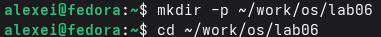
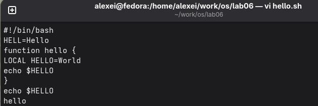
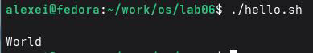
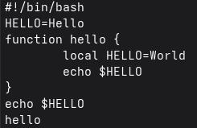
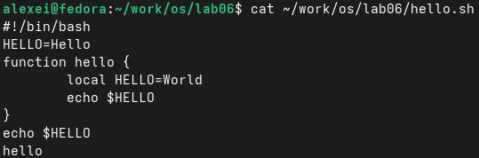

## Author
author:
name: Ромеро Гаспар Фернандо Алексей
degrees: DSC
orcid: 0009-0004-8816-345X
email: 1132255520@rudn.ru
affilition:
 - name: Рщссийский университет дружбы народов
   country: Российская  Федерфция
   postal-code: 117198
   city: Москва
   address: ул. Миклухо-Маклая д. 21к3

## Title
title: "Отчёт по лабораторной работе № 10"
subtitle: "Текстовый редактор vi"
license: "CC BY"
abstract: |
  В данном отчёте представлены результаты выполнения лабораторной работы по теме: освоение текстового редактора vi, одного из наиболее распространённых редакторов в системах Unix/Linux.

  Описаны три режима работы vi (командный, вставки, последней строки), команды навигации, редактирования, поиска и замены, а также работа с файлами.

  Сделаны выводы о достижении поставленной цели и о формировании навыков эффективной работы с текстом в командной строке.
keywords: [vi, vim, текстовый редактор, режимы vi, командный режим, редактирование]
---

# Введение

1. Цель работы
2. Теоретические сведения
> 2.1. Режимы работы редактора vi
> 2.1.1. Командный режим
> 2.1.2. Режим вставки
> 2.1.3. Режим последней строки
> 2.2. Команды управления курсором
> 2.3. Команды позиционирования
> 2.4. Команды перемещения по файлу
> 2.5. Команды перемещения по словам
> 2.6. Команды редактирования
> 2.6.1. Вставка текста
> 2.6.2. Вставка строк
> 2.6.3. Удаление текста
> 2.6.4. Отмена и повтор действий
> 2.7. Команды режима последней строки
> 2.8. Опции редактора vi
3. Задание и последовательность выполнения работы
> 3.1. Создание нового файла con vi
4. Редактирование существующего файл с vi
5. Контрольные вопросы
6. Выводы
7. Список литературы

---

# Цель работы

Целью данной лабораторной работы является знакомство с операционной системой Linux и получение практических навыков работы с редактором vi, установленным по умолчанию практически во всех дистрибутивах Linux.

---

# Теоретические сведения

В этом разделе представлены теоретические основы текстового редактора vi, одного из наиболее широко используемых редакторов в системах Unix/Linux, известного своей эффективностью и присутствующего практически во всех операционных системах этого семейства.

## 2.1 Режимы работы редактора vi
vi (Visual Display Editor) — это интерактивный текстовый редактор, работающий в трёх основных режимах:

- Командный режим (Command mode): Это режим по умолчанию при открытии vi. В этом режиме каждое нажатие клавиши интерпретируется как команда редактирования или навигации. Например, нажатие клавиши j перемещает курсор на одну строку вниз. Этот режим позволяет быстро выполнять операции, не вводя длинные команды.
- Режим вставки (Insert mode): В этом режиме введённый вами текст вставляется в файл. Вы можете получить к нему доступ из режима командной строки, нажимая такие клавиши, как i (вставка перед курсором), a (вставка после курсора) или o (вставка новой строки ниже). Клавиша Esc позволяет в любой момент вернуться в режим командной строки.
- Режим последней строки (Last line mode): Также известный как режим Ex, он активируется нажатием клавиши : из режима командной строки. В этом режиме курсор перемещается в нижнюю строку экрана, где можно вводить более сложные команды, такие как сохранение файла (:w), выход из редактора (:q) или поиск и замена текста (:%spatternreplacement/g).

## 2.2. Команды управления курсором

В командном режиме курсор управляется с помощью специальных клавиш для эффективной навигации без использования мыши:

- h — Перемещает курсор на один символ влево.
- l — Перемещает курсор на один символ вправо.
- j — Перемещает курсор на одну строку вниз.
- k — Перемещает курсор на одну строку вверх.

##2.3. Команды позиционирования

Эти команды позволяют перемещать курсор в пределах файла на большие расстояния:

- 0 или ^ — Перемещает курсор в начало текущей строки.
- $ — Перемещает курсор в конец текущей строки.
- G — Перемещает курсор в конец файла.
- nG — Перемещает курсор на строку номер n.
- H, M, L — Перемещает курсор в начало, середину или конец видимой области экрана соответственно.

## 2.4. Команды перемещения по файлу

Для быстрой навигации по файлу используйте следующие команды:

- Ctrl-f — Переход на одну страницу вперед.
- Ctrl-b — Переход на одну страницу назад.
- Ctrl-d — Переход на полстраницы вперёд.
- Ctrl-u — Переход на полстраницы назад.

## 2.5. Команды перемещения по словам

Навигация по словам необходима для эффективного редактирования:

- w — Перемещает курсор в начало следующего слова.
- b — Перемещает курсор в начало предыдущего слова.
- e — Перемещает курсор в конец текущего или следующего слова.

## 2.6. Команды редактирования
## 2.6.1. Вставка текста

Для вставки текста используйте следующие команды в командном режиме:

- i — Вставляет текст перед курсором.
- I — Вставляет текст в начало строки.
- a — Вставляет текст после курсора.
- A — Вставляет текст в конец строки.

## 2.6.2. Вставка строк

- o — Вставляет новую строку ниже текущей строки и переходит в режим вставки.
- O — Вставляет новую строку выше текущей строки и переходит в режим вставки.

## 2.6.3. Удаление текста

Команды удаления позволяют удалять символы, слова или целые строки:

- x — Удаляет символ под курсором.
- dw — Удаляет слово, начинающееся от курсора.
- dd — Удаляет всю строку.
- D — Удаляет текст от курсора до конца строки.

## 2.6.4. Отмена

- u — Отменяет последнее выполненное действие.

## 2.7. Команды режима последней строки

Этот режим позволяет выполнять более сложные команды, нажимая двоеточие (:).

- :w — Сохраняет изменения в файле.
- :q — Выход из редактора.
- :wq — Сохраняет и выходит из редактора.
- :q! — Выход без сохранения изменений.
- :set nu — Отображает номера строк.
- :set ic — Игнорирует регистр при поиске.

## 2.8. Опции редактора vi

Редактор vi позволяет настраивать свое поведение с помощью команды `:set` в режиме последней строки:
- `:set all` — Отображает полный список всех доступных параметров.
- `:set nu` — Включает отображение номеров строк.
- `:set nonu` — Отключает отображение номеров строк.
- `:set ic` — Включает поиск без учета регистра.
- `:set list` — Отображает невидимые символы, такие как табуляция и символы конца строки.

# Задание и последовательность выполнения работы

В этом разделе представлены задания, которые необходимо выполнить, и подробные инструкции по работе с редактором vi для создания и редактирования файлов в операционной системе Linux.

##3.1. Создание нового файла con vi

Шаг 1: Создайте каталог для лабораторной работы



Шаг 2: Создайте файл hello.sh с помощью vi


Шаг 3: Войдите в режим вставки и запишите содержимое

- Нажмите клавишу i, чтобы войти в режим вставки.
- Введите следующий код:



Шаг 4: Сохраните файл и выйдите из vi

- Нажмите Esc, чтобы выйти из режима вставки.
- Нажмите :, чтобы войти в режим последней строки.
- Введите wq и нажмите Enter, чтобы сохранить и выйти.

Шаг 5: Сделайте файл исполняемым


Шаг 6: Запустите скрипт, чтобы убедиться в его работоспособности



## 3.2. Редактирование существующего файл с vi

Шаг 1: Откройте файл hello.sh для редактирования

```bash
vi ~/work/os/lab06/hello.sh
```

Шаг 2: Измените слово HELL на HELLO

- Поставьте курсор в конец слова HELL на второй строке.
- Нажмите 'a', чтобы войти в режим вставки после курсора.
- Наберите 'o', чтобы завершить HELLO.
- Нажмите 'Esc', чтобы вернуться в командный режим.

Шаг 3: Удалите слово LOCAL

- Поставьте курсор над словом LOCAL на четвёртой строке.
- Нажмите 'dw', чтобы удалить слово.
- Нажмите 'i', чтобы войти в режим вставки.
- Наберите 'local' (строчными буквами).
- Нажмите 'Esc', чтобы вернуться в командный режим.

Шаг 4: Добавьте новую строку в конец файла

- Поставьте курсор на последнюю строку файла.
- Нажмите 'o', чтобы создать новую строку ниже.
- Введите 'echo $HELLO'.
- Нажмите Esc, чтобы вернуться в командный режим.

Шаг 5: Удалите последнюю строку

- Поставьте курсор на последнюю строку.
- Нажмите dd, чтобы удалить строку.

Шаг 6: Отмените последнее действие

- Нажмите u, чтобы отменить удаление (удалённая строка появится снова).

Шаг 7: Сохраните изменения и выйдите

- Нажмите : для входа в режим последней строки.
- Введите wq и нажмите Enter, чтобы сохранить и выйти.

Шаг 8: Проверьте содержимое окончательного файла




# Контрольные вопросы

В этом разделе представлены ответы на контрольные вопросы о редакторе vi, которые позволят вам проверить ваше понимание режимов его работы, команд и функций.

## 1. Дайте краткую характеристику режимам работы редактора vi.

Редактор vi имеет три основных режима работы:

| Режим                                   | Описание |
|-----------------------------------------|
| Командный режим (Command mode)          | Это режим по умолчанию при открытии vi. Он позволяет перемещаться по файлу и выполнять команды редактирования (копировать, вставлять, удалять и т. д.). Нажатия клавиш интерпретируются как команды, а не как текст.             |
| Режим вставки (Insert mode)             | Этот режим позволяет вставлять текст в файл. Он активируется из командного режима нажатием клавиш, таких как i, a, o и т.д. Клавиша Esc возвращает вас в командный режим.                                                    |
| Режим последней строки (Last line mode) | Этот режим активируется нажатием клавиши : из командного режима. Он позволяет выполнять более сложные команды, такие как
сохранение файлов (:w), выход (:q), поиск (:/), замена (:%s/.../.../g) и настройка параметров (:set). |

## 2. Как выйти из редактора, не сохраняя произведённые изменения?

Чтобы выйти из редактора без сохранения изменений, необходимо:

1. Нажать Esc, чтобы убедиться, что вы находитесь в командном режиме.
2. Нажать : для перехода в режим последней строки.
3. Набрать q! и нажать Enter.

```bash
:q!
```

Восклицательный знак (!) принудительно завершает работу без сохранения изменений,внесенных с момента последней записи.

## 3. Назовите и дайте краткую характеристику командам позиционирования.

| Команда   | Описание                                             |
|-----------|------------------------------------------------------|
| 0         | Перемещает курсор в начало текущей строки.           |
| $         | Перемещает курсор в конец текущей строки.            |
| G         | Перемещает курсор в конец файла.                     |
| nG или :n | Перемещает курсор на строку номер n.                 |
| H         | Перемещает курсор на первую строку экрана (Home).    |
| M         | Перемещает курсор на среднюю строку экрана (Middle). |
| L         | Перемещает курсор на последнюю строку экрана (Last). |

## 4. Что для редактора vi является словом?

В vi слово определяется как последовательность буквенно-цифровых символов (букв, цифр и подчеркиваний). Последовательность небуквенно-цифровых символов (знаки препинания, пробелы и т. д.) также считается отдельным словом. Например, в строке HELL=Hello:

- HELL — это слово
- = — это слово (небуквенно-цифровой символ)
- Hello — это слово

## 5. Каким образом из любого места редактируемого файла перейти в начало (конец) файла?

- Перейти к началу файла: нажмите gg или 1G (в командном режиме).
- Перейти к концу файла: нажмите G (в командном режиме).

Также можно использовать режим последней строки:

- :1 для перехода к первой строке.
- :$ для перехода к последней строке.

## 6. Назовите и дайте краткую характеристику основным группам команд редактирования.

| Группа     | Основные команды   | Описание                                                                     |
|------------|--------------------|------------------------------------------------------------------------------|
|Вставка     | i,I,a,A,o,O        | Вставляет текст до/после курсора, в начало/конец строки или на новую строку. |
|Удаление    | x, dw, dd, D       | Удаляет символы, слова, целые строки или от курсора до конца строки.         |
|Копирование | yy                 |Копирует (вытаскивает) текущую строку (используется с p для вставки).         |
|Вставка     | p, P               |Вставляет скопированный или удаленный текст после (p) или перед (P) курсором. |
|Отмена      | u                  |Отменяет последнее выполненное действие.                                      |
| Поиск      | /pattern, ?pattern | Ищет шаблон вперед (/) или назад (?).                                        |
           
## 7. Необходимо заполнить строку символами $. Каковы ваши действия?

Чтобы заполнить строку знаком доллара ($), вы можете:

1. Установить курсор в начало строки.
2. Перейти в режим вставки, нажав клавишу i.
3. Набрать нужное количество знаков доллара ($).
4. Нажать клавишу Esc, чтобы вернуться в командный режим.

Более быстрый вариант:

1. Установить курсор в начало строки.
2. Нажать клавишу r, а затем знак доллара ($) (заменяет один символ).
3. Для замены нескольких символов используйте клавишу R (режим замены) и многократно набирайте знак $.

## 8. Как отменить некорректное действие, связанное с процессом редактирования?

Чтобы отменить некорректное действие, используйте команду `u` в командном режиме. При каждом нажатии `u` последнее выполненное действие отменяется.

- `u` — отменяет последнее действие.
- `U` — отменяет все изменения, внесенные в текущую строку с момента установки курсора.

## 9. Знать и давать характеристики общих групп верхних строк.

| Группа           | Команды                              | Описание                                                                            |
|------------------|--------------------------------------|-------------------------------------------------------------------------------------|
| Сохранить/Выход  | :w, :q, :wq, :q!                     | Сохраняет,выходит,сохраняет и выходит, выходит без сохранения.                      | 
| Позиционирование | :n                                   | Перемещает курсор на строку номер n.                                                |
| Найти/Заменить   | :/pattern, :%s/pattern/replacement/g | Ищет шаблон или выполняет глобальную замену.                                        | 
| Параметры        | :set nu, :set ic, :set list          | Отображает номера строк,игнорирует регистр при поиске,отображает невидимые символы. |
|Информация        | :set all                             | Отображает все настроенные параметры.                                               |

## 10. Как определить, не перемещая курсора, позицию, в которой заканчивается строка?
В vi команда $ (в командном режиме) перемещает курсор в конец текущей строки, но если вы не хотите перемещать курсор, вы можете:

1. Нажать g_ — переместит курсор к последнему символу строки, не являющемуся пробелом.
2. В режиме последней строки команда :set list отображает символ $ в конце каждой строки, визуально указывая, где она заканчивается.

## 11. Выполните анализ опций редактора vi (сколько их, как узнать их назначение и т.д.).

Чтобы увидеть все доступные параметры в vi, используйте команду `:set all` в режиме последней строки. Это отобразит полный список всех параметров и их текущих значений. Некоторые из наиболее распространенных параметров:

| Параметры      | Описание                                                        |
|----------------|-----------------------------------------------------------------|
| nu /number     | Отображает номера строк.                                        |
| ic /ignorecase | Игнорирует регистр при поиске.                                  |
| list           | Отображает невидимые символы (табуляция, символы конца строки). |
| ai /autoindent | Включает автоматическое выравнивание.                           |
| ws /wrapscan   | Позволяет продолжить поиск с начала файла.                      |

Чтобы отключить параметр, используйте `no` перед именем, например:

```bash
:set nonu
```

## 12. Как определить режим работы редактора vi?

Чтобы определить текущий режим работы vi:

- Режим команд: Внизу экрана не отображается специальный индикатор. Клавиши не вводят текст.
- Режим вставки: Внизу отображается индикатор, например, --INSERT- или --INSERT-.
- Режим последней строки: Внизу отображается символ двоеточия (:), где можно вводить команды.

## 13. Постройте граф взаимосвязи режимов работы редактора vi.

Переходы:
- Режим команд → Режим вставки: с помощью `i`, `a`, `o`, `I`, `A`, `O` и т. д.
- Режим вставки → Режим команд: с помощью `Esc`.
- Режим команд → Режим последней строки: с помощью `:`.
- Режим последней строки → Режим команд: нажатием `Enter` после выполнения команды (или `Esc`).

                  +-----------------------+
                  |    Командный режим    |
                  | (режим по умолчанию)  |
                  +-----------+-----------+
                              |
              +---------------+---------------+
              |                               |
              v                               v
  +-----------+-----------+       +-----------+-----------+
  |     Режим вставки     |       | Режим последней строки|
  |   (Вставка текста)    |       |     (Команды с :)     |
  +-----------+-----------+       +-----------+-----------+
              ^                               |
              |                               v
              +-----------------------+-------+
                             |
                             v
                 +-----------+-----------+
                 |  Выйти из редактора   |
                 |     (:wq или :q!)     |
                 +-----------------------+

Переходы:

- Режим команд → Режим вставки: с помощью `i`, `a`, `o`, `I`, `A`, `O` и т. д.
- Режим вставки → Режим команд: с помощью `Esc`.
- Режим команд → Режим последней строки: с помощью `:`.
- Режим последней строки → Режим команд: нажатием `Enter` после выполнения команды (или `Esc`).

---

# Выводы

В ходе выполнения лабораторной работы я познакомился с операционной системой Linux и приобрел практические навыки работы с редактором vi. Я изучил три режима работы редактора: командный, вставки и последней строки, а также научился переключаться между ними. Я освоил основные команды навигации (h,j,k,l,0,$,G), редактирования (i,a,o,dd,dw,x,u) и работы с файлами (:w,:q,:wq,:q!). Я создал и отредактировал файл hello.sh, применяя изученные команды для модификации текста, удаления и вставки строк, а также отмены действий. Все поставленные задачи выполнены, полученные навыки являются основой для эффективной работы с текстовыми файлами в командной строке Linux.

---

## Список литературы

- [Ближневосточный технический университет. (с.ф.). Режимы работы.](https://user.ceng.metu.edu.tr/~ucoluk/ceng111/lab_manual/node17.html)
- [Национальный университет Чэнчи. (с.ф.). Я видел «簡易使用說明».](https://www.cs.nccu.edu.tw/~lien/UNIX/VI/BASIC/hardcopy.htm)
- [SCO Inc. (без даты). Настройка Ви.](http://osr600doc.sco.com/en/FD_create/_Configuring_vi.html)
- [ТУ Грац. (с.ф.). vi-Команды.](https://www.staff.tugraz.at/reinfried.o.peter/unix/vi.html)
- [Кентский государственный университет. (с.ф.). Базовый vi.](https://www.cs.kent.edu/~durand/CS0F06/Help/h_vi.html)
- [GitHub. (2024). Введение в редактор vi.](https://github.com/r3kste/ID2090)
- [Ближневосточный технический университет. (s.f.). Режимы работы.](https://user.ceng.metu.edu.tr/~ucoluk/ceng111/lab_manual/node17.html)
