---
## Author
author:
name: Ромеро Гаспар Фернандо Алексей
degrees: DSC
orcid: 0009-0004-8816-345X
email: 1132255520@rudn.ru
affilition:
 - name: Рщссийский университет дружбы народов
   country: Российская  Федерфция
   postal-code: 117198
   city: Москва
   address: ул. Миклухо-Маклая д. 21к3

## Title
---
title: "Отчёт по лабораторной работе № 12"
subtitle: "Основы программирования на Bash"
license: "CC BY"
abstract: |
  В данном отчёте представлены результаты выполнения лабораторной работы по теме: изучение основ программирования в командном процессоре ОС UNIX на примере языка Bash.

  Описаны переменные, арифметические операции, метасимволы, управляющие конструкции (if, case, for, while, until), функции и передача параметров. Разработаны скрипты для резервного копирования, обработки аргументов и подсчёта файлов по расширению.

  Сделаны выводы о достижении поставленной цели и о применении Bash для автоматизации задач.
keywords: [Bash, скрипты, переменные, циклы, функции, автоматизация, Linux]
---

# Введение

1. Цель работы
2. Теоретические сведения
> 2.1. Командные процессоры (оболочки)
> 2.2. Переменные в языке программирования bash
> 2.3. Арифметические операции
> 2.4. Метасимволы и их экранирование
> 2.5. Командные файлы и функции
> 2.6. Передача параметров в командные файлы и специальные переменные
> 2.7. Использование команды getopts
> 2.8. Управление последовательностью действий в командных файлах
> 2.8.1. Оператор цикла for
> 2.8.2. Оператор выбора случая
> 2.8.3. Условный оператор if
> 2.8.4. Операторы циклов while и until
> 2.8.5. Прерывание циклов
3. Задание и последовательность выполнения работы
> 3.1. Скрипт автоматического резервного копирования
> 3.2. Скрипт с произвольным количеством аргументов
> 3.3. Скрипт, аналогичный команде ls
> 3.4. Скрипт для подсчёта файлов по расширению
4. Контрольные вопросы
5. Выводы
6. Список литературы

---

#Цель работы

Целью данной лабораторной работы является изучение программирования в командном процессоре ОС UNIX на примере языка bash. В ходе работы необходимо освоить основные элементы языка: переменные,арифметические операции,метасимволы,управляющие конструкции (условные операторы, циклы), создание и выполнение командных файлов (скриптов), а также приобрести практические навыки разработки скриптов для автоматизации задач в операционной системе.

---

#Теоретические сведения

В этом разделе представлены основные концепции программирования в командной оболочке Bash, необходимые для создания скриптов в операционной системе Linux

## 2.1 Командные процессоры (оболочки)

Командный процессор (shell) — это программа,позволяющая пользователю взаимодействовать с операционной системой посредством команд. В системах UNIX/Linux наиболее распространены следующие реализации:

- Bourne shell (sh): стандартная оболочка UNIX с базовым, но полным набором функций.
- C shell (csh): использует синтаксис, аналогичный языку программирования C.
- Korn shell (ksh): сочетает в себе возможности sh и csh.
- BASH (Bourne Again Shell): наиболее широко используемая оболочка в Linux,разработанная проектом GNU, которая сочетает в себе возможности C shell и Korn shell.

POSIX — это набор стандартов для интерфейса между операционными системами и программами,предназначенный для обеспечения совместимости и переносимости между различными системами UNIX/Linux.

## 2.2. Переменные в языке программирования bash

В Bash переменные определяются без явного указания типа данных. По умолчанию это строки, хотя они также могут хранить числа и массивы. Базовый синтаксис:

```bash
variable_name="value"
```

Для доступа к значению переменной используется символ $:

```bash
name="Alice"
echo $name # Вывод: Alice
```
Важные правила:

- Имена переменных должны начинаться с буквы или символа подчеркивания.
- Вокруг знака равенства (=) не должно быть пробелов.
- Массивы можно определять в скобках: fruits=("apple" "banana" "cherry") .

Специальные переменные:

- $0: Имя скрипта.
- $1, $2, ...: Позиционные параметры (аргументы, передаваемые скрипту).
- $#: Общее количество аргументов.
- $@: Все аргументы в виде отдельного списка.
- $?: Код завершения последней выполненной команды.
- $$: PID (идентификатор процесса) текущей оболочки.

## 2.3. Арифметические операции

Bash позволяет выполнять основные арифметические операции с использованием синтаксиса $(( ... )) или команды let:

```bash
num1=10
num2=5
sum=$((num1 + num2))
echo "Сумма: $sum"
```

Распространённые операторы: +, -, *, /, % (модуль), ** (возведение в степень) и операторы присваивания, такие как +=, -=, *=.

## 2.4. Метасимволы и их экранирование

Метасимволы — это символы, имеющие особое значение для оболочки, такие как *,?,[ ],|,>,<,$,&. Чтобы оболочка интерпретировала их как буквальные символы (а не как их специальную функцию), необходимо использовать escape:

```bash
echo \* # Отображает символ *
echo ab\*\*cd # Отображает ab*\*cd
```

## 2.5. Командные файлы и функции

Скрипты — это текстовые файлы, содержащие команды, которые выполняются последовательно. Чтобы сделать скрипт исполняемым, используйте:

```bash
chmod +x script_name
```

Функции в Bash определяются с помощью ключевого слова `function` или просто с помощью имени, за которым следуют скобки:

```bash
function my_function {
echo "Hello, $1!"
}
my_function "World"
```

## 2.6. Передача параметров в командные файлы и специальные переменные

Позиционные параметры ($1, $2, ...) позволяют передавать аргументы скрипту. Команда `shift` удаляет первый параметр и сдвигает остальные. Команда `getopts` позволяет анализировать параметры (флаги) в командной строке.

## 2.7. Использование команды getopts

`getopts` — это встроенная команда Bash для обработки параметров в скриптах:

```bash
while getopts "lha:" OPTION; do
case $OPTION in
l) echo "Option -l enabled" ;;
h) echo "Option -h enabled" ;;
a) echo "Argument: $OPTARG" ;;
*) echo "Usage: $0 [-l] [-h] [-a value]" ;;
esac
done
```

## 2.8. Управление последовательностью действий в командных файлах

Bash предоставляет управляющие структуры, аналогичные структурам других языков программирования.

## 2.8.1. Operador de bucle for

```bash
for i in {1..5}; do
echo "Iteración $i"
done
```

## 2.8.2. Оператор выбора случая

```bash
case "$1" in
start) echo "Iniciando..." ;;
stop) echo "Deteniendo..." ;;
*) echo "Uso: $0 {start|stop}" ;;
esac
```

## 2.8.3. Условный оператор if

``` bash
if [ -f "$FILE" ]; then
echo "El archivo existe."
elif [ -d "$FILE" ]; then
echo "Es un directorio."
else
echo "No existe."
fi
```
## 2.8.4. Операторы циклов while и until

``` bash
# while - se ejecuta mientras la condición sea verdadera
while [ $CONTADOR -le 5 ]; do
echo "Contador: $CONTADOR"
((CONTADOR++))
done
# until - se ejecuta hasta que la condición sea verdadera
until [ $CONTADOR -eq 10 ]; do
echo "Contador: $CONTADOR"
((CONTADOR++))
done
```

## 2.8.5. Прерывание циклов

- break: Завершает выполнение цикла.
- continue: Переход к следующей итерации.

# Задание y последовательность выполнения работы

В этом разделе представлены задания, которые необходимо выполнить, и подробные инструкции по созданию скриптов на языке bash для автоматизации задач в операционной системе Linux.

## 3.1. Скрипт автоматического резервного копирования

Задание: Написать скрипт, который при запуске создает резервную копию собственного кода (сбой в его исходном коде) в каталоге backup во внутреннем каталоге,использует odin и архиваторы (zip, bzip2 и tar).

Шаг 1: Создайте каталог для скриптов

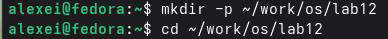

Шаг 2: Создайте скрипт резервного копирования


Содержимое скрипта:


\# Скрипт: backup_script.sh
\# Описание: Создает резервную копию самого скрипта в ~/backup/
\# Создайте каталог резервного копирования, если он не существует


\#Создайтекаталогрезервногокопирования, еслионнесуществует

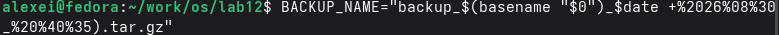

\# Создайте файл tar.gz текущего скрипта
tar -czf ~/backup/"$BACKUP_NAME" "$0"
\# Сообщение с подтверждением

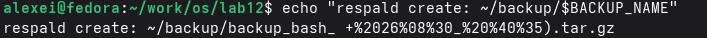

Шаг 3: Сделайте скрипт исполняемым


Шаг 4: Запустите скрипт


Шаг 5: Убедитесь, что резервная копия создана

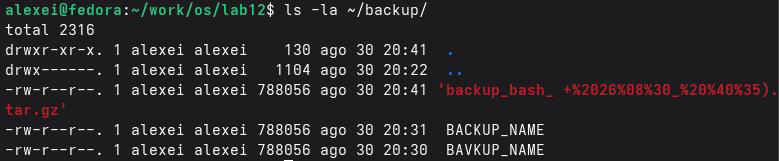

## 3.2. Скрипт с произвольным количеством аргументов

Задание: Напишите скрипт, который принимает любое количество аргументов командной строки (даже больше 10) и выводит их последовательно.

Шаг 1: Создайте скрипт


## 3.2.Скриптспроизвольнымколичествомаргументов

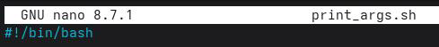
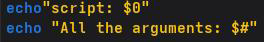
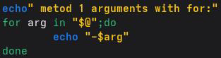
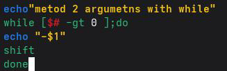

Шаг 2: Сделайте скрипт исполняемым

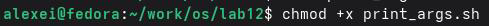

Шаг 3: Запустите скрипт с разным количеством аргументов

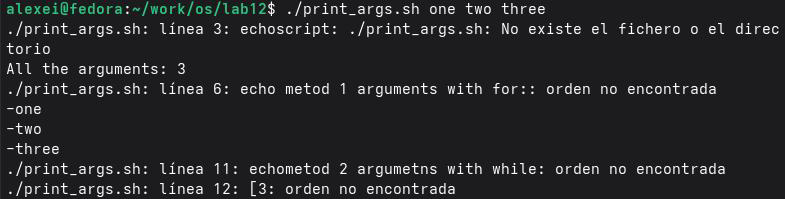

## 3.3. Скрипт, аналогичный команде ls

Инструкции: Напишите скрипт, работающий как `ls` (без использования команд `ls` или `dir`), отображающий информацию об указанном каталоге и правах доступа к файлам.

Шаг 1: Создайте скрипт

``` bash
nano my_ls.sh
Содержимое скрипта:
```

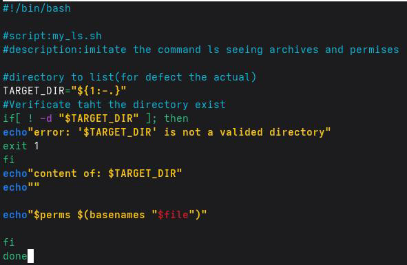

Шаг 2: Сделайте скрипт исполняемым


Шаг 3: Запустите скрипт

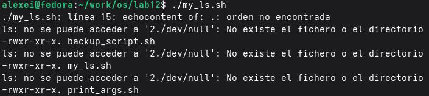

## 3.4. Скрипт для подсчета файлов по расширению

Скрипт `count_ext` принимает в качестве аргументов расширение файла (например, .txt, .doc, .jpg, .pdf) и каталог, и подсчитывает, сколько файлов с этим расширением находится в каталоге.

Шаг 1: Создание скрипта

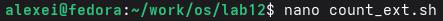

Содержимое скрипта:

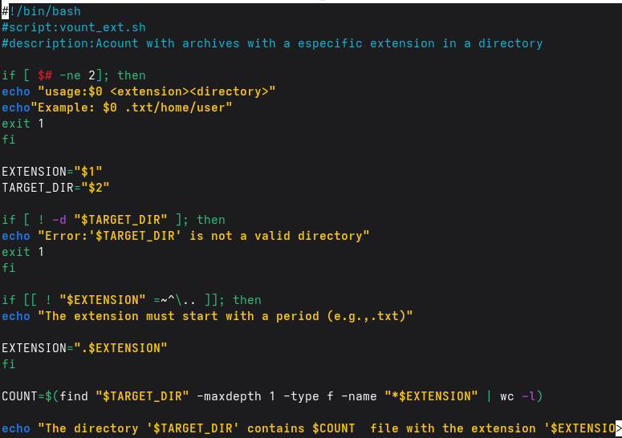
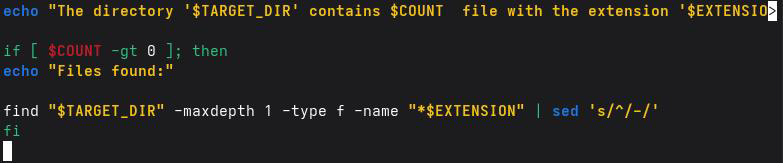

Шаг 2: Сделайте скрипт исполняемым


Шаг 3: Запустите скрипт

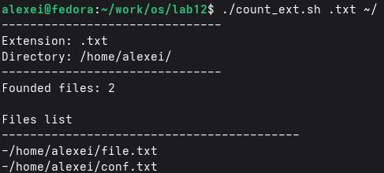

# Контрольные вопросы

В этом разделе представлены ответы на контрольные вопросы по программированию на Bash, которые позволят вам проверить понимание основных концепций написания сценариев оболочки в системах Unix/Linux.

## 1. Объясните понятие командной оболочки. Приведите примеры командных оболочек. Чем они отличаются?

Командная оболочка — это программа, которая выступает в качестве интерфейса между пользователем и операционной системой, интерпретируя и выполняя команды,введенные пользователем. Это среда, в которой пользователи могут взаимодействовать с системой с помощью командной строки или скриптов. Примеры оболочек в Unix/Linux:

| Оболочка                  | Особенности                                                                                  |
|---------------------------|------------------------------------------------------------------------------------------------|
| Оболочка Борна (sh)       | Оригинальная оболочка UNIX, простая и базовая. Она является основой для многих других оболочек. |
| Оболочка C (csh)          | Использует синтаксис, похожий на язык C. Включает историю команд и псевдонимы. |
| Оболочка Корна (ksh)      | Сочетает в себе возможности sh и csh. Соответствует стандарту POSIX. |
| BASH (Bourne Again Shell) | Самая распространенная оболочка в Linux. Сочетает в себе возможности sh, csh и ksh. Является оболочкой по умолчанию в большинстве дистрибутивов Linux.|

Основные различия:

- Синтаксис: csh имеет синтаксис, похожий на C (например, if (condition) then),в то время как sh/ksh/bash используют if [condition]; then.
- Возможности: bash и ksh обладают большим количеством функций, чем sh (автозавершение, история команд, массивы и т. д.).
- Совместимость: sh более базовый; bash включает дополнительные возможности.

## 2. Что такое POSIX?

POSIX (Portable Operating System Interface) — это набор международных стандартов (IEEE), определяющих интерфейс между операционной системой и прикладными программами. Его основная цель — обеспечить переносимость программного обеспечения между различными UNIX-совместимыми операционными системами, позволяя программам,написанным для одной системы POSIX, работать на другой с минимальными изменениями.

## 3. Как определяются переменные и массивы в языке программирования bash?

Переменные:

В Bash переменн

```bash
name="Alice" # Простая переменная
number=10 # Числовая переменная (рассматривается как строка)
```

Для доступа к её значению используйте $:

```bash
echo $name # Выводит "Alice"
Массивы:
```

Они определяются в скобках:

```bash
fruits=("apple" "banana" "cherry") # Массив
echo ${fruits[0]} # Выводит "apple"
echo ${fruits[@]} # Выводит все элементы
```

## 4. Каково назначение операторов let и read?

`let`: Позволяет выполнять арифметические операции и присваивать результат переменной.

```bash
let a=5+3
echo $a # 8
```

`read`: Считывает ввод пользователя с клавиатуры (stdin) и сохраняет его в переменной.

```bash
read name
echo "Hello, $name"
```

## 5. Какие арифметические операции можно применять в языке программирования bash?

Bash поддерживает следующие арифметические операции (с использованием $(( ... )) или let):
 
| Оператор | Описание                 | Пример          |
|----------|--------------------------|-----------------|
|+         | Сложение                 | $((3 + 5)) → 8  |
| -        | Вычитание                | $((10 - 4)) → 6 |
| *        | Умножение                | $((4 * 5)) → 20 |
| /        | Целочисленное деление    | $((10 / 3)) → 3 |
| %        | Остаток от деления       | $((10 % 3)) → 1 |
| **       | Возведение в степень     | $((2 ** 3)) → 8 |
| ++       | Инкремент                | ((i++))         |
| --       | Декремент                | ((i--))         |
| +=       | Присваивание с сложением | ((x += 5))      |

## 6. Что означает операция (( ))?

Синтаксис (( ... )) в Bash используется для вычисления арифметических выражений. Он позволяет выполнять математические операции и числовые присваивания в среде командной оболочки. Его можно использовать в циклах, условных операторах и присваиваниях.

```bash
((a = 5 + 3)) # Присваивание
echo $a # 8
((a++)) # Увеличение
if (( a > 10 )); then # Условие
echo "a больше 10"
fi
```

## 7. Какие стандартные имена у вас есть?

| Переменная       | Описание                                              |
|------------------|-------------------------------------------------------|
| HOME             | Домашний каталог пользователя.                        |
| PATH             | Список каталогов, в которых выполняется поиск команд. |
| USER или LOGNAME | Текущее имя пользователя.                             |
| SHELL            | Текущая оболочка пользователя.                        |
| PWD              | Текущий рабочий каталог.                              |
| OLDPWD           | Предыдущий рабочий каталог.                           |
| TERM             | Тип терминала.                                        |
| HOSTNAME         | Имя хоста.                                            |
| RANDOM           | Генерирует случайные числа.                           |
| PS1              | Командная строка.                                     |

## 8. Что такое метасимволы?

Метасимволы — это специальные символы в командной оболочке, имеющие специфическое значение, выходящее за рамки их буквального значения. Они позволяют выполнять такие операции, как перенаправление, использование конвейера, подстановочных знаков и т. д. Примеры:

- * — подстановочный знак (любая строка).
- ? — подстановочный знак (один символ).
- [ ] — наборы символов.
- | — конвейер между командами.
- > — перенаправление вывода.
- < — перенаправление ввода.
- $ — переменная.
- & — фоновое выполнение.

## 9. Как экранировать метасимволы?

Чтобы оболочка интерпретировала метасимвол как буквальный символ (то есть без его особого значения), используется экранирование. Методы экранирования:

1. С помощью обратной косой черты \: экранирует один символ.

```bash
echo \* # Выводит '*'
echo \$HOME # Выводит '$HOME'
```

2. С помощью одинарных кавычек ' ': экранирует все метасимволы внутри них.

```bash
echo 'Каталог $HOME' # Выводит 'Каталог $HOME'
```

3. С помощью двойных кавычек " ": экранирует все метасимволы, кроме $, \ и `.

```bash
echo "Каталог $HOME" # Выводит 'Каталог /home/username'
```

## 10. Как создавать и запускать командные файлы?

Создание скрипта:

1. Создайте текстовый файл с расширением .sh (необязательно) и напишите в нём команды.
2. Первая строка должна содержать shebang: #!/bin/bash (или название используемой вами оболочки).
3. Сохраните файл.

Сделайте его исполняемым:

```bash
chmod +x script_name.sh
```

Запустите его:

```bash
./script_name.sh
```

## 11. Как определяются функции в программировании на Bash?

Функции в Bash можно определить двумя способами:

Способ 1 (наиболее распространенный):

```bash
function function_name {
# команд
}
```

Способ 2:

```bash
function_name() {
# команд
}
```

Пример:

```bash
function greet {
echo "Hello, $1!"
}
greet "World" # Выводит "Hello, World!"
```

## 12. Каким образом можно узнать, является ли файл каталогом или обычным файлом?

В Bash вы можете использовать операторы проверки -f (обычный файл) и -d (каталог) внутри оператора if: 

``` bash
бить если [ -f "$файл"]; затем
echo "$file — обычный файл."
элиф [-d "$файл"]; затем
echo «$file — это каталог».
еще
echo "$file не существует или имеет другой тип."
Фи
```

## 13. Как называются команды set, typeset и unset?

- set: Позволяет настраивать или отображать параметры и опции оболочки. Также
используется для присвоения значений позиционным переменным.

```bash
set -- arg1 arg2 arg3 # Присваивает позиционные аргументы
echo $1 # arg1
```

- `typeset`: Объявляет переменные с определенными атрибутами (аналогично `declare`).
Полезен для определения переменных или массивов только для чтения.

```bash
typeset -r PI=3.14159 # Переменная только для чтения
```

- unset: Удаляет переменные или функции.

```bash
unset name # Удаляет имя переменной
unset -f greet # Удаляет функцию greet
```

## 14. Как передаются параметры в командных файлах?

Параметры передаются скрипту в командной строке после имени скрипта:

```bash
./script.sh parameter1 parameter2 parameter3
```

Внутри скрипта доступ к ним осуществляется с помощью позиционных переменных:

- $0 — имя скрипта.
- $1 — первый параметр.
- $2 — второй параметр и т. д.
- $# — общее количество параметров.
- $@ — все параметры в виде списка.
- $* — все параметры в виде одной строки.

## 15. Назовите специальные варианты языка bash и их названия.

| Переменная | Описание
| $0        | Имя текущего скрипта или оболочки.
| $1 до $9 | Позиционные параметры (аргументы).
| $#       | Количество переданных аргументов.
| $@       | Все аргументы в виде отдельного списка.
| $*       | Все аргументы в виде одной строки.
| $?       | Код завершения последней выполненной команды.
| $$       | PID текущей оболочки.
| $!       | PID последнего фонового процесса.
| $-       | Текущие параметры оболочки.

---

# Выводы

В ходе выполнения лабораторной работы я изучил основы программирования в командном процессоре ОС UNIX на примере языка bash. Я освоил основные элементы языка: переменные, арифметические операции, метасимволы и их экранирование, а также управляющие конструкции (условные операторы, циклы for, while, until и оператор выбора case). Я научился создавать и выполнять командные файлы (скрипты), передавать им параметры и обрабатывать аргументы командной строки. Мной были разработаны четыре скрипта: для создания резервной копии самого себя, для обработки произвольного числа
аргументов, аналог команды ls и скрипт для подсчёта файлов по расширению. Все поставленные задачи выполнены, полученные навыки являются основой для автоматизации задач в операционной системе Linux.

---

# Список литературы

- [danielnjama. (2025). Руководство по написанию скриптов Bash. GitHub.](https://github.com/danielnjama/bash-scripting#1)
- [Free Software Foundation. (2026). Справочное руководство по Bash: Массивы. GNU.org.](https://www.gnu.org/software/bash/manual/html_node/Arrays.html)
- [LinuxConfig. (2022). Скрипты Bash: Примеры использования флагов с аргументами.](https://linuxconfig.org/bash-script-flags-usage-with-arguments-examples)
- [GeeksforGeeks. (2025). Позиционные параметры в скриптах оболочки.](https://www.geeksforgeeks.org/linux-unix/how-to-use-positional-parameters-in-shell-scripting/)
- [Educational. (2026). Шпаргалка по Bash: 25 лучших команд и создание пользовательскихкоманд.](https://www.educative.io/blog/bash-shell-command-cheat-sheet)
- [GeeksforGeeks. (2024). Скрипт оболочки для демонстрации специальных параметров.](https://www.geeksforgeeks.org/linux-unix/shell-script-to-demonstrate-special-parameters-with-example)
