## Author
author:
name: Ромеро Гаспар Фернандо Алексей
degrees: DSC
orcid: 0009-0004-8816-345X
email: 1132255520@rudn.ru
affilition:
 - name: Рщссийский университет дружбы народов
   country: Российская  Федерфция
   postal-code: 117198
   city: Москва
   address: ул. Миклухо-Маклая д. 21к3

## Title
title: "Отчёт по лабораторной работе № 14"
subtitle: "Семафоры, имитация man и генерация случайных последовательностей"
license: "CC BY"
abstract: |
  В данном отчёте представлены результаты выполнения лабораторной работы по теме: синхронизация процессов с помощью семафоров, имитация команды man и генерация случайных последовательностей букв.

  Описаны механизм семафоров с использованием файлов-блокировок, скрипт для работы с командой man, а также генерация случайных строк с использованием встроенной переменной $RANDOM.

  Сделаны выводы о достижении поставленной цели и о применении полученных навыков для синхронизации процессов и генерации данных в Linux.
keywords: [Bash, семафор, синхронизация, man, $RANDOM, генерация, процессы]
---

# Введение

1. Цель работы
2. Задание и последовательность выполнения работы
> 2.1. Скрипт с использованием getopts (поиск с параметрами)
> 2.2. Программа на языке C и скрипт для анализа выходного кода
> 2.3. Скрипт для создания/удаления нумерованных архивов
> 2.4. Скрипт для архивирования с помощью tar и фильтрации по дате
3. Контрольные вопросы
4. Выводы
5. Список литературы

---

# Цель работы

Целью данной лабораторной работы является изучение основ программирования в оболочке ОС UNIX и получение навыков написания более сложных командных файлов с использованием логических управляющих конструкций и циклов.

---

#Задание и последовательность выполнения работы

В этом разделе описываются скрипты, которые необходимо разработать для данного упражнения, а также шаги и команды, необходимые для их реализации.

## 2.1. Скрипт с использованием getopts (поиск с параметрами)

Задача: Создайте скрипт, который анализирует командную строку со следующими параметрами и выполняет поиск в файле на основе указанного шаблона. Параметры для реализации:

- -i (входной файл): чтение данных из указанного файла
- -o (выходной файл): запись вывода в указанный файл
- -p (шаблон): поиск по шаблону
- -C: регистрозависимый
- -n: отображение номеров строк

Как работает getopts: getopts — это встроенная команда Bash, которая позволяет структурированно анализировать параметры командной строки. Параметры, которые ожидают аргумент, должны сопровождаться двоеточием (:) в строке параметров. Если параметр имеет аргумент, getopts сохраняет его значение в переменной OPTARG.

Шаг 1: Создание скрипта

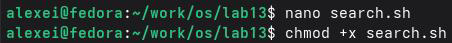

Код скрипта:

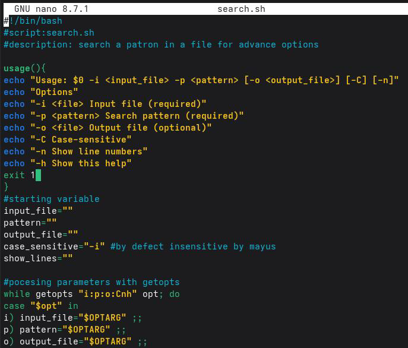
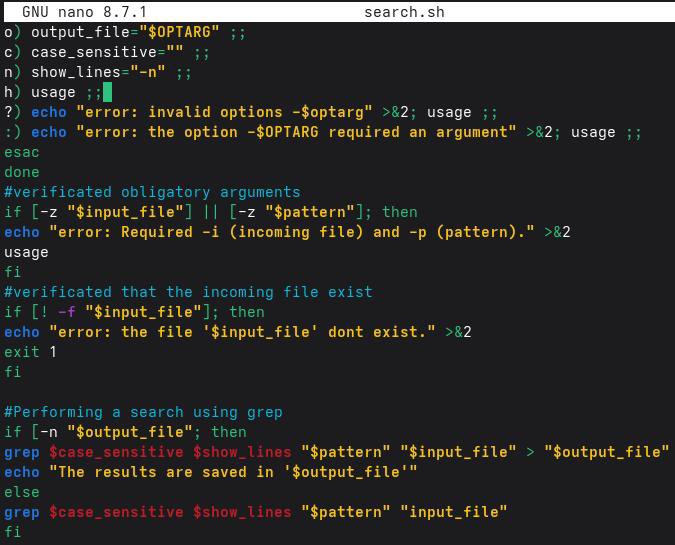

Шаг 2: Запуск скрипта

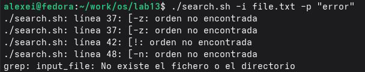
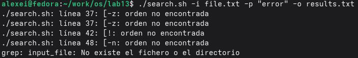
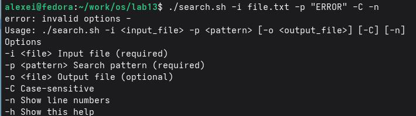

## 2.2. Программа на языке C и скрипт для анализа выходного кода

Задача: Создайте программу на языке C, которая определяет, является ли число положительным, отрицательным или равным нулю, и возвращает определенный код завершения. Затем скрипт Bash должен вызвать эту программу и вывести сообщение в зависимости от кода завершения.

Код завершения: В Bash код завершения команды хранится в переменной $?. По соглашению, код 0 означает успех, а код, отличный от 0, — ошибку.

Шаг 1: Создайте программу на языке C


Код программы:

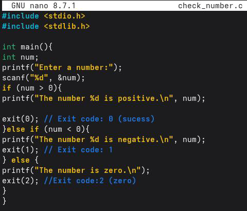

Шаг 2: Скомпилируйте программу


Шаг 3: Создайте скрипт, который анализирует код завершения

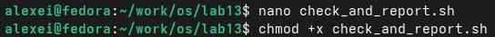

Код скрипта:

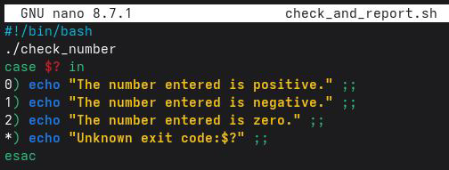

Шаг 4: Запустите скрипт

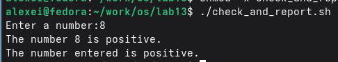

## 2.3. Скрипт для создания/удаления нумерованных файлов

Задача: Создать скрипт, который генерирует N последовательно пронумерованных файлов (например, 1.tmp, 2.tmp, ..., N.tmp) и может также удалять их.

Шаг 1: Создание скрипта

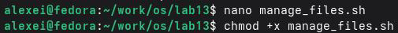

Код скрипта:

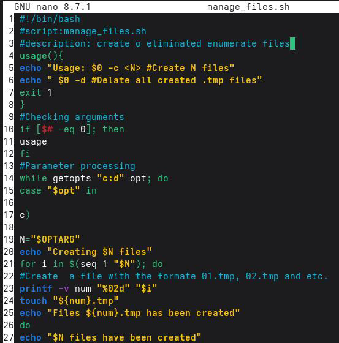
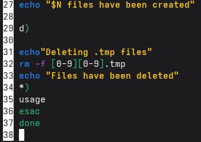

Шаг 2: Запуск скрипта

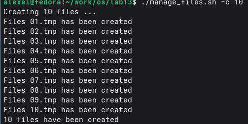
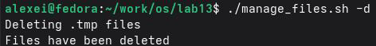

## 2.4. Скрипт для архивирования с помощью tar и фильтрации по дате

Задача: Создать скрипт, который архивирует все файлы в каталоге с помощью tar, но только те, которые были изменены за последнюю неделю.

Шаг 1: Создание скрипта

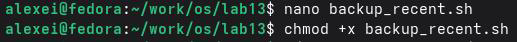

Код скрипта:

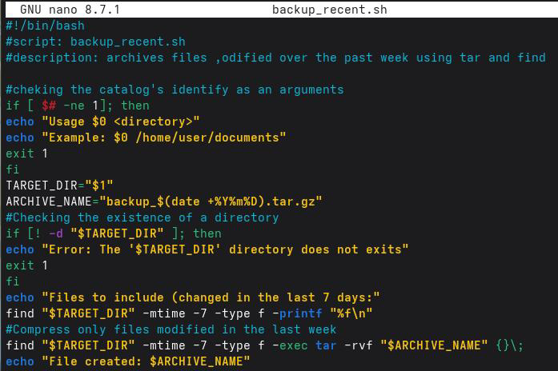

Шаг 2: Запустите скрипт

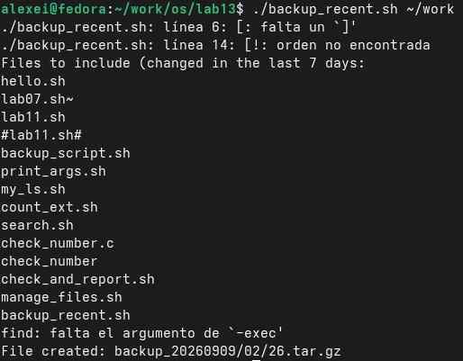

# Контрольные вопросы

В этом разделе представлены ответы на контрольные вопросы по продвинутому программированию в Bash, которые позволят вам проверить понимание концепций getopts, метасимволов, управляющих структур и циклов.

## 1. Что такое команда getopts?

Команда getopts — это встроенный инструмент Bash, позволяющий структурированным и стандартным способом анализировать и обрабатывать параметры командной строки в скриптах. Её цель — упростить реализацию пользовательских интерфейсов в скриптах, позволяя скрипту получать аргументы с флагами (например,-i,-o,-p и т.д.) и их соответствующие значения. Основные возможности:

- Обрабатывает однобуквенные параметры с дефисом (-).
- Допускает параметры с аргументами (используя двоеточие в строке параметров).
- Сохраняет значение аргумента в переменной OPTARG.
- Сохраняет индекс следующего аргумента в переменной OPTIND.
- Поддерживает стандартные параметры и обработку ошибок.

## 2. Какое отношение метасимволы имеют к генерации имён файлов?

Метасимволы (также называемые «подстановочными знаками») в Bash позволяют генерировать имена файлов с использованием шаблонов (глоббинг). Это особенно полезно,когда необходимо ссылаться на несколько файлов одновременно.

| Метасимвол | Описание                                           | Пример                                                  |
|------------|----------------------------------------------------|---------------------------------------------------------|
| *          | Соответствует любой строке (включая пустые строки) | *.txt → все файлы .txt                                  |
| ?          | Соответствует одному символу                       | file?.txt → file1.txt, file2.txt → file0.txt,file1.txt  |
| []         | Соответствует набору символов                      | file[0-9].txt                                           | 
| [^ ]       | Исключает набор символов                           | file[^0-9].txt → исключает файлы с числовыми значениями |

`Связь с генерацией имен файлов:

- Метасимволы позволяют разворачивать шаблоны в списках файлов.
- Это упрощает операции с несколькими файлами (например, `cp *.pdf ~/documents/`).
- Оболочка выполняет расширение перед выполнением команды.

## 3. Какие операторы вы знаете?
В Bash есть несколько операторов и управляющих структур:
 
| Структура    | Описание                           | Пример                                                 |
|--------------|------------------------------------|--------------------------------------------------------|
| if           | Простое условное выражение         | если [условие]; тогда ... fi                           |
| if-else      | Условное выражение с альтернативой | если [условие]; тогда ... иначе ... fi                 |
| if-elif-else | Несколько условий                  | если [c1]; тогда ... elif [c2]; тогда ... иначе ... fi |
| case         | Множественный выбор                | case $var in pattern1) ... ;; pattern2) ... ;; esac    |
|for           | Цикл по списку                     | for i in list; do ... done                             |
| while        | Условный цикл                      | while [условие]; do ... done                           |
| until        | Цикл до условия                    | until [условие]; do ... done                           |
| break        | Выход из цикла                     | break                                                  |
| continue     | Переход к следующей итерации       | continue                                               |


## 4. Какие операторы используются для создания цикла?

В Bash для прерывания циклов используются следующие операторы:

- break — Завершает выполнение текущего цикла (полностью выходит из него).

```bash
for i in {1..10}; do
if [ $i -eq 5 ]; then
break # Выход из цикла при i=5
fi
echo $i
done
```

- continue — Переход к следующей итерации цикла (не завершает весь цикл).

```bash
for i in {1..5}; do
if [ $i -eq 3 ]; then
continue # Пропуск итерации при i=3
fi
echo $i
done
```

## 5. Для чего нужны команды `false` и `true`?

Команды `true` и `false` — это встроенные утилиты Bash, возвращающие определенные коды завершения:

- `true` — Всегда возвращает код завершения 0 (успех/истина).
- `false` — Всегда возвращает код завершения 1 (неудача/ложь).

Распространенные варианты использования:

1. Бесконечные циклы:

```bash
while true; do
echo "Running...
sleep 1
done
```

2. Условные скрипты:

```bash
if true; then
echo "This always runs
```

3. Отладка и тестирование:

```bash
command && echo "Success" || echo "Failure"
```
## 6. Что означает `if test -f mans/s/i.\$s`?

Эта строка проверяет, существует ли файл с динамически генерируемым именем. Давайте проанализируем каждую часть:

| Часть        | Значение                                                                                             |
|--------------|------------------------------------------------------------------------------------------------------|
| `if test -f` | Проверяет, существует ли файл и является ли он обычным (-f).                                         |
| `man`        | Фиксированный префикс имени файла.                                                                   |
| `$s`         | Переменная, содержащая значение расширения или суффикса.                                             |
| `\\$i`       | Экранирует знак доллара ($), чтобы он не интерпретировался как переменная, отображая `$i` буквально. |
| `.`          | Буквальный разделитель.                                                                              |
| `\\$s`       | Экранирует знак доллара ($), чтобы отображать $s буквально.                                          |

Интерпретация:

Эта строка проверяет, существует ли файл с именем man<value_of_s>$i.<value_of_s> в
текущем каталоге.

## 7. Объясните различные конструкции while и until.

| Характеристика         | Условие                                              | until                                                            |
|------------------------|------------------------------------------------------|------------------------------------------------------------------|
| while                  | Выполняется,пока условие истинно (код завершения 0). | Выполняется до тех пор, пока условие истинно (код завершения 0). |
| Эквивалент             | while [ condition ]; do ... done                     | while [ ! condition ]; do ... done                               |
| Типичное использование | Повторять,пока что-то истинно.                       | Повторять, пока что-то истинно.                                  |

Пример:

```bash
# while: выполняется, пока counter <= 5
counter=1
while [ $counter -le 5 ]; do
echo "while: $counter"
((counter++))
done
# until: выполняется, пока counter > 5
counter=1
until [ $counter -gt 5 ]; do
echo "until: $counter"
((counter++))
done
```

Основное различие:

- while выполняет блок, пока условие истинно.
- Функция `until` выполняет блок кода до тех пор, пока условие не станет истинным (т.е. пока оно ложно).

---

#Выводы

В ходе выполнения лабораторной работы я изучил основы программирования в оболочке ОС UNIX и научился писать более сложные командные файлы с использованием логических управляющих конструкций и циклов. Я освоил использование команды getopts для анализа командной строки с ключами, создал программу на языке Си и командный файл для анализа кода завершения, разработал скрипт для создания и удаления пронумерованных файлов, а также реализовал скрипт для архивации файлов с фильтрацией по дате изменения с помощью команд tar и find. Все поставленные задачи выполнены, полученные навыки являются основой для автоматизации сложных задач в операционной системе Linux.

---

## Список литературы

- [Baeldung. (2021). Анализ аргументов командной строки в Bash.](https://www.baeldung.com/linux/bash-parse-command-line-arguments)
- [GNU. (2026). Справочное руководство по Bash: Код завершения.](https://www.gnu.org/software/bash/manual/html_node/Exit-Status.html)
- [Zero To Mastery. (2025). Руководство для начинающих по использованию getopts в Bash.](https://zerotomastery.io/blog/bash-getopts)
- [LabEx. (2025). Как использовать код завершения в скриптах?](https://labex.io/questions/how-to-use-exit-status-in-scripts-927170)
- [GeeksforGeeks. (2024). Скриптинг в Bash — цикл while. Получено 15 августа 2026 г. с](https://www.geeksforgeeks.org/bash-scripting-while-loop/)
- [*GeeksforGeeks. (2023). Скриптинг в Bash — цикл until. Получено 15 августа 2026 г. с](https://www.geeksforgeeks.org/bash-scripting-until-loop/)
