## Author
author:
name: Ромеро Гаспар Фернандо Алексей
degrees: DSC
orcid: 0009-0004-8816-345X
email: 1132255520@rudn.ru
affilition:
 - name: Рщссийский университет дружбы народов
   country: Российская  Федерфция
   postal-code: 117198
   city: Москва
   address: ул. Миклухо-Маклая д. 21к3

## Title
title: "Отчёт по лабораторной работе № 14"
subtitle: "Семафоры, имитация man и генерация случайных последовательностей"
license: "CC BY"
abstract: |
  В данном отчёте представлены результаты выполнения лабораторной работы по теме: синхронизация процессов с помощью семафоров, имитация команды man и генерация случайных последовательностей букв.

  Описаны механизм семафоров с использованием файлов-блокировок, скрипт для работы с командой man, а также генерация случайных строк с использованием встроенной переменной $RANDOM.

  Сделаны выводы о достижении поставленной цели и о применении полученных навыков для синхронизации процессов и генерации данных в Linux.
keywords: [Bash, семафор, синхронизация, man, $RANDOM, генерация, процессы]
---

# Введение

1. Цель работы
2. Задание и последовательность выполнения работы
> 2.1. Скрипт с семафором и синхронизацией процессов
> 2.2. Скрипт для имитации команды man
> 2.3. Скрипт для генерации случайных последовательностей букв
3. Выводы
4. Список литературы

---

#Цель работы

Целью данной лабораторной работы является изучение основ программирования в оболочке ОС UNIX и получение навыков написания более сложных командных файлов с использованием логических управляющих конструкций и циклов, а также освоение работы с семафорами, генерацией случайных чисел и созданием аналогов системных команд.

---

#Задание и последовательность выполнения работы

В этом разделе представлены задания, которые необходимо выполнить, и подробные инструкции по созданию скриптов на языке bash для реализации семафоров, имитации команды man и генерации случайных последовательностей букв.

## 2.1. Скрипт с семафором и синхронизацией процессов

Задание: Написать командный файл, реализующий упрощённый механизм семафоров. Командный файл должен в течение некоторого времени t1 дожидаться освобождения ресурса, выдавая об этом сообщение, а дождавшись его освобождения, использовать его в течение некоторого времени t2 < t1,также выдавая информацию о том, что ресурс используется. Запустить командный файл в одном виртуальном терминале в фоновом режиме, перенаправив его вывод в другой терминал. Доработать программу для взаимодействия трёх и более процессов.

Теоретическая справка: Семафор — это механизм синхронизации, который контролирует доступ к общему ресурсу в многозадачных системах . В Bash семафор можно реализовать с помощью файлов-блокировок, где наличие файла указывает на занятость ресурса .

Шаг 1: Создание скрипта семафора


Код скрипта (для двух процессов):

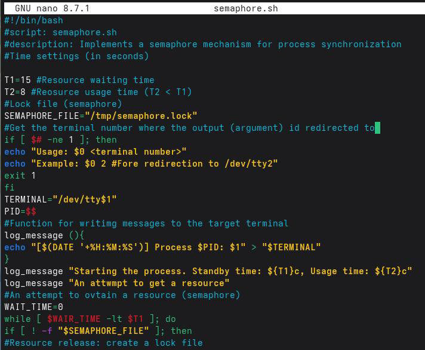
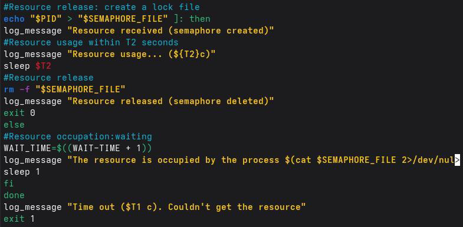

Шаг 2: Запустите скрипт в двух терминалах

Терминал 1 (основной):


Шаг 3: Версия для трех процессов (semaphore_multiple.sh)

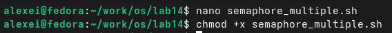

Код скрипта (для нескольких процессов):

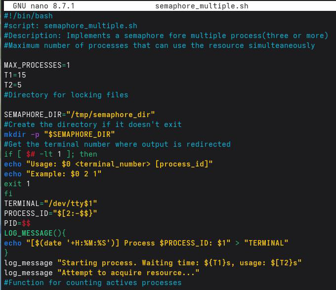
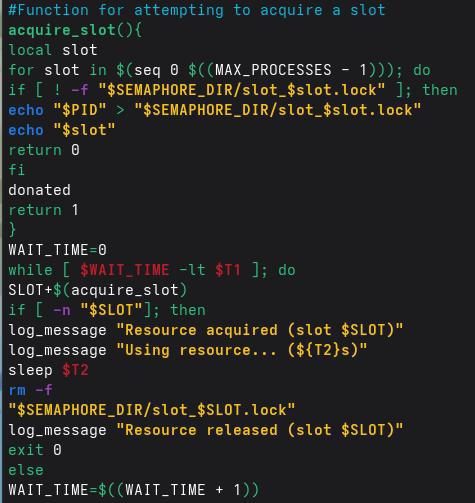
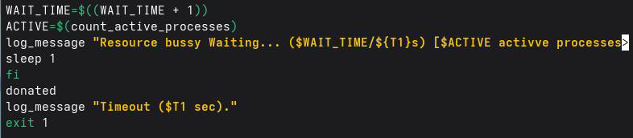

Шаг 4: Запуск нескольких процессов

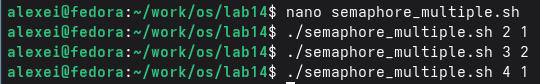

## 2.2. Скрипт для имитации команды man

Задание: Реализовать комнду man с помощью комндного файла. Командный файл должен получать имя команды в качестве аргумента и отображать его справочную страницу или сообщение об ошибке, если оно не существует.

Шаг 1: Создание скрипта

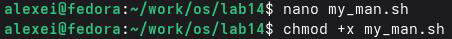

Код скрипта:

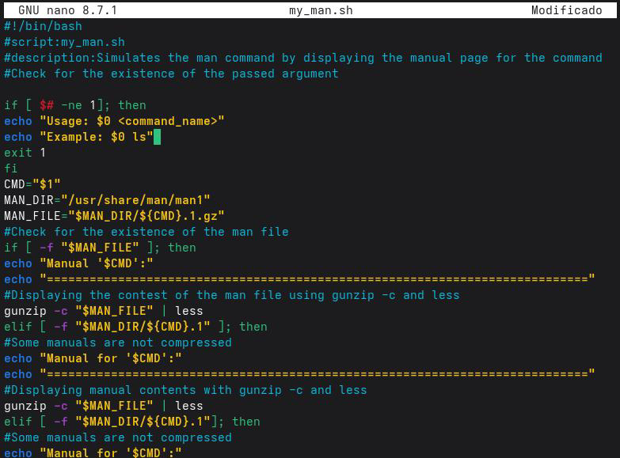

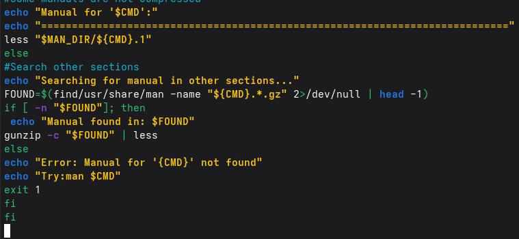

Шаг 2: Просмотр содержимого каталога man1


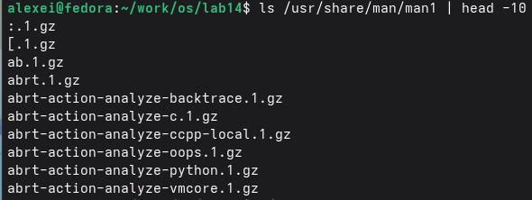

Шаг 3: Запуск скрипта


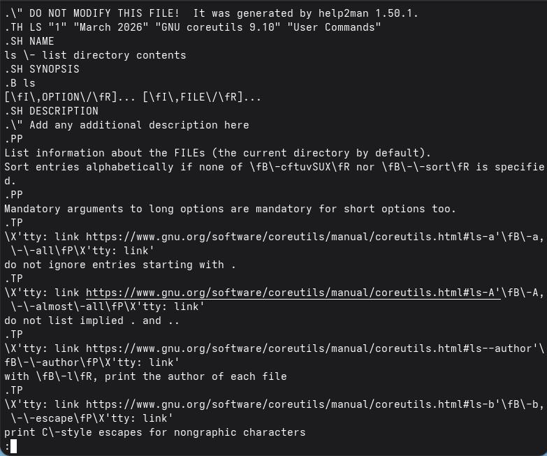

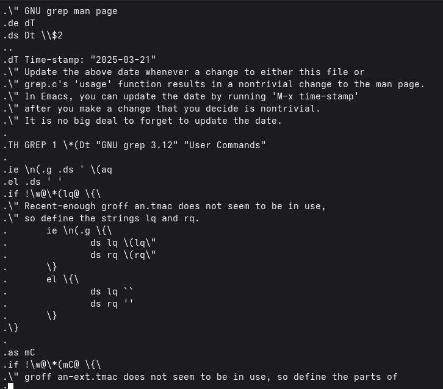


## 2.3. Скрипт для генерации случайных последовательностей букв

Задание: использование встроенной переменной $RANDOM, запись командного файла, генерация случайной последовательности букв лучайнуго `$RANDOM` генерирует псевдослучайные числа в диапазоне от 0 до 32767.

Шаг 1. Создайте сценарий.

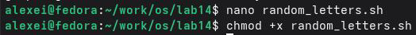

Код скрипта:

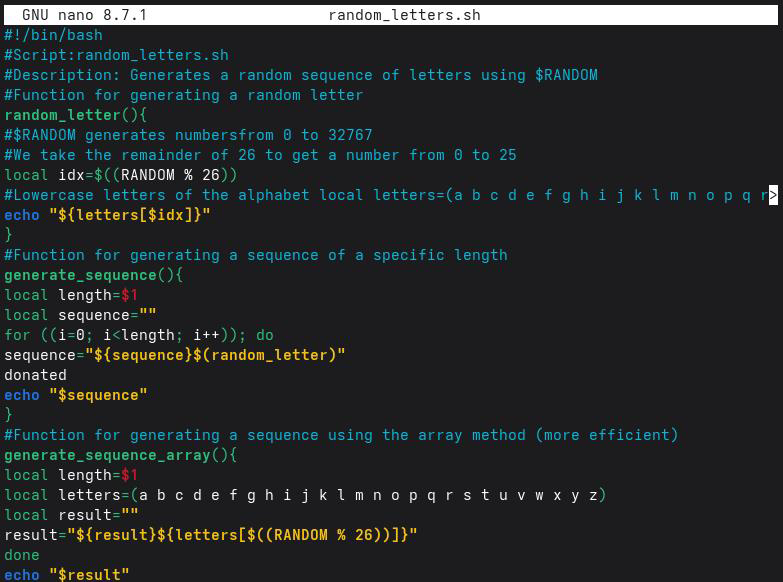
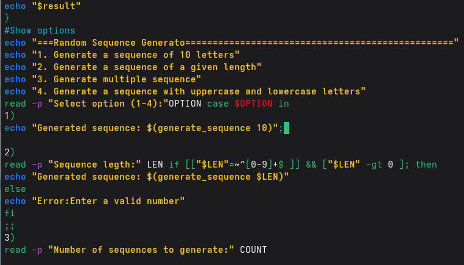
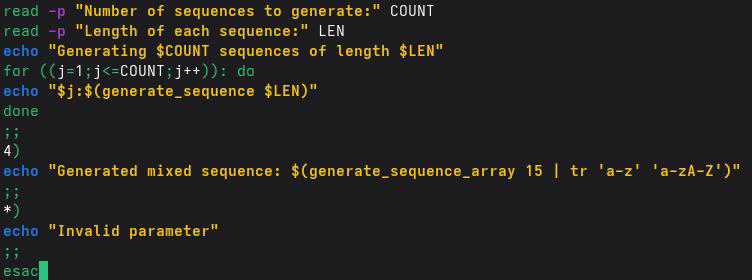

Шаг 2: Расширенная версия с параметрами командной строки

```bash
nano random_letters_cli.sh
chmod +x random_letters_cli.sh
```
Код скрипта (с аргументами командной строки)

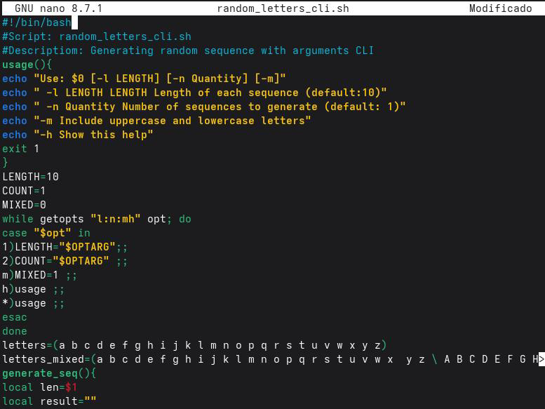
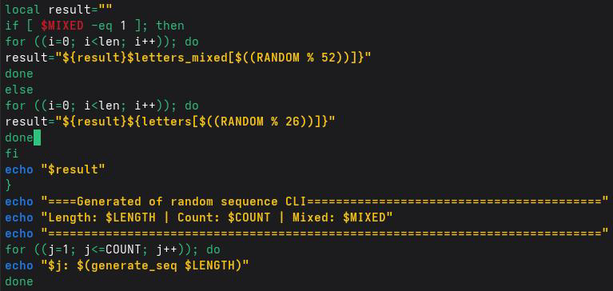

Шаг 3: Запуск скриптов

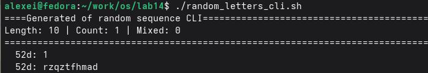

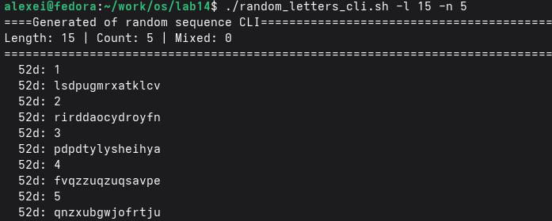
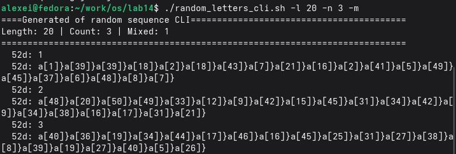

# Контрольные вопросы

В этом разделе даются ответы на контрольные вопросы, касающиеся продвинутого программирования в Bash.

## 1. Найдите синтаксическую ошибку в следующей строке: while [$1 != "exit"]

Основная ошибка заключается в отсутствии пробелов вокруг скобок и операторов сравнения. В Bash правильный синтаксис для `[(test)` требует пробелов между элементами.

- Неправильно (как в вопросе):

```bash
while [$1 != "exit"]
```

- Правильно:

```bash
while [ "$1" != "exit" ]
```

Пояснение изменений:

- Пробел после `[` и перед `]`
- Пробелы вокруг оператора `!=`.
- Переменные должны быть заключены в двойные кавычки ("$1"), чтобы избежать проблем, если аргумент содержит пробелы или пуст.

## 2. Необходимо ли подключать движок к сети?

В Bash конкатенация строк выполняется простым размещением переменных рядом друг с другом в одной строке. Простой пример:

```bash
str1="Hello"
str2="World"
result="$str1 $str2"
echo "$result" # Выводит: Hello World
```

Другие способы:

- Использование +=:

```bash
text="Hello"
text+="World"
echo "$text" # Выводит: Hello World
```

- Использование printf -v (более эффективная версия для множества конкатенаций):

```bash
printf -v result '%s' "$str1" "$str2"
echo "$result" # Выводит: Hello World
```

3. Найдите информацию о том, как использовать seq. Можно ли релизовать и ее функции при программировании в bash? seq генерирует последовательности чисел. Пример: `seq 1 5` выводит 1 2 3 4 5. Альтернативы в Bash:

1. С `for` и `{start..end}` (рекомендуется для фиксированных диапазонов):

```bash
for i in {1..10}; do echo $i; done
```

2. С `while` (для более сложных последовательностей):

```bash
i=1
while [ $i -le 10 ]; do echo $i; ((i++)); done
```

3. С `for ((...))` (синтаксис, похожий на C):

```bash
for ((i=1; i<=10; i++)); do echo $i; done
```

## 4. Каков результат операции $((10/3))?

Результат операции $((10/3)) равен 3. 

В Bash арифметические операции с $((...)) работают с целыми числами (целочисленное деление). Результат отбрасывает десятичную часть, поэтому 10/3 = 3,333...становится 3.

## 5. Укажите кратко основные отличия командной оболочки zsh от bash.

- zsh (Z Shell) — более современная и продвинутая оболочка, чем Bash, с улучшенными функциями для интерактивного пользователя.
- Bash — это универсальная стандартная оболочка; она присутствует почти в каждой системе Linux, более стабильна и имеет лучшую поддержку скриптов.

Основные отличия:

| Функции            | Bash                                | Zsh                                                              | 
|--------------------|----------------------------------------------------------------------------------------------------|
| Автозавершение     | Базовое                             | Интеллектуальное, с описаниями и параметрами                     |
| Совместимость      | Универсальная (стандартная в Linux) | Не всегда устанавливается по умолчанию                           |
| Скрипты            | Более стабильная и портативная      | Менее портативная (скрипты могут давать сбои в других оболочках) |
| Настройка          | Ограниченная                        | Высокая степень кастомизации (темы, плагины с Oh My Zsh)         |
| Исправление ошибок | Не исправляет опечатки              | Предлагает исправления для неправильно написанных команд         |

## 6. Проверьте правильность следующего синтаксиса: for ((a=1; a <= LIMIT; a++))

Да, синтаксис правильный (при условии, что LIMIT — предопределенная переменная). Это синтаксис циклов for в Bash в стиле C. Полный и правильный пример:

```bash
LIMIT=5
for ((a=1; a <= LIMIT; a++)); do
echo "Iteration $a"
done
```

## 7. Экономия времени и денег без программирования. Что вы думаете о том,чтобы попробовать это сделать? Какие недостатки?

Преимущества Bash:

- Прямая интеграция с операционной системой: Вы можете выполнять команды,управлять файлами и процессами без внешних библиотек.
- Простая автоматизация: Идеально подходит для административных задач, резервного копирования и рабочих процессов разработки (конвейеров).
- Установлен по умолчанию: Практически во всех системах Unix/Linux.

Недостатки:

- Неинтуитивный синтаксис: Легко допустить ошибки (например, забыть пробелы в [ ]).
- Сложности со сложными операциями: Математика и расширенная обработка данных ограничены; все обрабатывается как текст.
- Менее структурирован: В отличие от языков, таких как Python или C, структуры данных ограничены (в старых версиях нет собственных объектов или ассоциативных массивов).
- Ограниченная переносимость: Скрипты, использующие специфические для Bash функции, могут не работать в других оболочках (например, sh или dash).

---

#Выводы

В ходе выполнения лабораторной работы я изучил основы программирования в оболочке ОС UNIX и научился писать более сложные командные файлы с использованием логических управляющих конструкций и циклов. Я реализовал упрощённый механизм семафоров для синхронизации процессов с использованием файлов-блокировок, создал командный файл для имитации работы команды man с поиском справки в каталоге /usr/share/man/man1,а также разработал скрипт для генерации случайных последовательностей букв латинского алфавита с использованием встроенной переменной $RANDOM. Все поставленные задачи выполнены, полученные навыки являются основой для автоматизации сложных задач и синхронизации процессов в операционной системе Linux.

---

# Список литературы

- [Cylab. (2026). Избегайте утечки учетных данных с помощью Pass: стандартного менеджера паролей для Unix.](https://cylab.be/blog/503/avoid-credential-leakage-with-pass-the-standard-unix-password-manager)
- [Chezmoi. (б. д.). Настройка.](https://www.chezmoi.io/user-guide/setup/)
- [Chezmoi. (б. д.). Что делает chezmoi?.](https://www.chezmoi.io/)
- [Руководство по GNU Emacs. (б.д.). Хранилище паролей Unix.](https://www.gnu.org/software/emacs/manual/html_node/auth/The-Unix-password-store.html)
- [Chezmoi. (б. д.). Справочная информация — шаблоны.](https://www.chezmoi.io/reference/templates/)
- [Cylab. (2026). Избегайте утечки учетных данных с помощью Pass — стандартногоменеджера паролей для Unix.](https://cylab.be/blog/503/avoid-credential-leakage-with-pass-the-standard-unix-password-manager)
- [GoPass. (2026). gopass — чуть более продвинутый стандартный менеджер паролей для Unix для команд.](https://www.gopass.pw/)
- [Password Store — Google Play. (2026). Password Store — приложение для Android.](https://play.google.com/store/apps/details?id=dev.msfjarvis.aps)
- [Хранилище паролей. (2026). Хранилище паролей: стандартный менеджер паролей для Unix.](https://www.passwordstore.org/)
- [Проект Fedora. (2026). Руководство по системному администрированию DNF.](https://docs.fedoraproject.org/en-US/fedora/latest/system-administrators-guide/package-management/DNF/Command_Reference/)
- [Chezmoi. (б. д.). Краткое руководство.](https://www.chezmoi.io/quick-start/)
- [Интерфейс командной строки GitHub. (2026). Руководство по интерфейсу командной строки GitHub.](https://cli.github.com/manual/)
- [*GPG. (2026). Документация по GNU Privacy Guard.](https://gnupg.org/documentation/)
- [How-To Geek. (2021). Как создать семафор в Bash.](https://www.howtogeek.com/devops/how-to-create-a-semaphore-in-bash/)
- [Baeldung. (2023). Используйте $RANDOM для генерации случайной строки.](https://www.baeldung-cn.com/linux/generate-random-string-using-random)
- [CloudComputing-Insider. (2022). Использование случайных строк в Bash.](https://www.cloudcomputing-insider.de/zufallsquellen-in-der-bash-nutzen-a-b7c25dcc121b0161f7501eebb98d45db/)
- [Unix & Linux Stack Exchange. (2020). Пользовательская команда man.](https://unix.stackexchange.com/questions/)
- [Baeldung. (2023). Использование $RANDOM для генерации случайной строки.](https://www.baeldung-cn.com/linux/generate-random-string-using-random)
- [GNU Savannah. (2022). Неожиданный пробел в условном операторе.](https://savannah.gnu.org/support/index.php?110745)
- [Refine. (2024). Zsh и Bash.](https://refine.dev/blog/zsh-vs-bash/)
- [Unix&Linux Stack Exchange.(2020).Пользовательскаякомандаman.](https://unix.stackexchange.com/questions/)
- [Baeldung. (2023).Использование$RANDOMдлягенерациислучайнойстроки.](https://www.baeldung-cn.com/linux/generate-random-string-using-random)
- [GNUSavannah. (2022).Неожиданныйпробелвусловномоператоре.](https://savannah.gnu.org/support/index.php? 110745)
- [Refine. (2024).Zshи Bash.](https://refine.dev/blog/zsh-vs-bash/)
