---
# Author
author:
name: Ромеро Гаспар Фернандо Алексей
degrees: DSC
orcid: 0009-0004-8816-345X
email: 1132255520@rudn.ru
affilition:
  - name: Рщссийский университет дружбы народов
    country: Российская  Федерфция
    postal-code: 117198
    city: Москва
    address: ул. Миклухо-Маклая д. 21к3

# Title
title: "Отчёт по лабораторной работе № 3"
subtitle: "Оформление отчётов: Markdown и Pandoc"
license: "CC BY"
abstract: |
  В данном отчёте представлены результаты выполнения лабораторной работы по теме: оформление отчётов с использованием языка разметки Markdown и утилиты Pandoc.

  Описаны базовый синтаксис Markdown (заголовки, выделение, списки, ссылки, изображения, формулы), установка Pandoc и компиляция документов в форматы PDF и DOCX. Приведён пример Makefile для автоматизации сборки.

  Сделаны выводы о достижении поставленной цели и о преимуществах использования Markdown для оформления учебных и научных работ.
keywords: [Markdown, Pandoc, Makefile, PDF, DOCX, оформление отчётов]
---

# Введение

1. Цель работы
2. Предварительные сведения
> 2.1. Базовые сведения о Markdown 
> 2.1.1. Заголовки
> 2.1.2. Выделение текста
> 2.1.3. Списки
> 2.1.4. Ссылки 
> 2.1.5. Блоки кода
> 2.1.6. Математические формулы
> 2.2. Оформление отчета по лабораторной работе 
> 2.2.1. Структура отчёта
> 2.2.2. Содержание основных элементов отчета 
3. Задание и последовательность выполнения работы
> 3.1. Установка Pandoc
> 3.2. Создание отчета в формате Markdown
> 3.3. Компиляция отчета в форматы PDF, DOCX y MD 
> 3.4. Создание архива с файлами отчета
4. Выводы
5. Список литературы

---

# Цель работы

Целью данной лабораторной работы является освоение процедуры оформления отчетов с помощью легковесного языка разметки Мarkdown. В ходе работы необходимо изучить базовый синтаксис Markdown для форматирования текста, создания списков, вставки изображений и оформления математических формул, а также получить практический опыт работы с утилитой Pandoc для компиляции документов в форматы PDF и DOCX. Кроме того, требуется закрепить навыки использования системы контроля версий Git для сохранения и фиксации результатов работы в удаленном репозитории.

---

# Теоретическое введение

 В этом разделе представлены основные принципы работы с языком разметки Markdown, конвертером Pandoc и структурой академических отчётов, необходимые для понимания и выполнения задания.

## 2.1 Базовые сведения о Markdown

Markdown — это легкий язык разметки, созданный в 2004 году Джоном Грубером и Аароном Шварцем. Его ключевая идея заключается в том, что текст, набранный в Markdown, должен оставаться читаемым в исходном формате, без необходимости преобразования в HTML, при этом предоставляя простую синтаксическую структуру для добавления базовых элементов форматирования, таких как курсив, подчеркивание, заголовки и списки.


## 2.1.1 Заголовки

В Markdown заголовки создаются с помощью символа решетки (#) в начале строки. Количество таких символов определяет уровень заголовка — от первого (# Заголовок 1) до шестого (###### Заголовок 6). Важно оставлять пробел между символом # и текстом заголовка, чтобы форматирование применялось корректно. Для заголовков уровней 1 и 2 также существует альтернативный синтаксис, где текст подчёркивается символами = или -, однако наиболее распространённой и рекомендуемой формой является использование символа #.

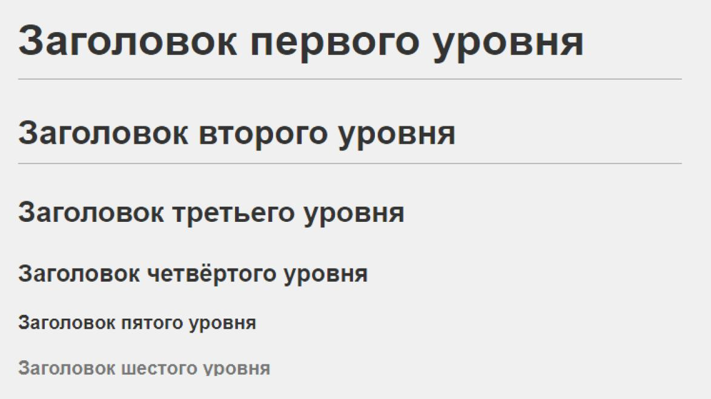

## 2.1.2 Выделение текста

В Markdown для выделения текста можно использовать звездочки (*) или нижние подчеркивания (_). Для полужирного шрифта применяются два символа — звездочка или нижнее подчеркивание (**текст** или __текст__). Для курсива — один символ — звездочка или нижнее подчеркивание (*текст* или _текст_). Для полужирного и курсива — три символа — звездочка или три нижних подчеркивания (***текст*** или ___текст___). Хотя оба символа допустимы, рекомендуется использовать звездочки, так как они более распространены и помогают избежать путаницы в некоторых редакторах. Кроме того, в некоторых версиях Markdown допускается выделение текста с помощью тильды (~~текст~~) и выделение кода в строке (код).

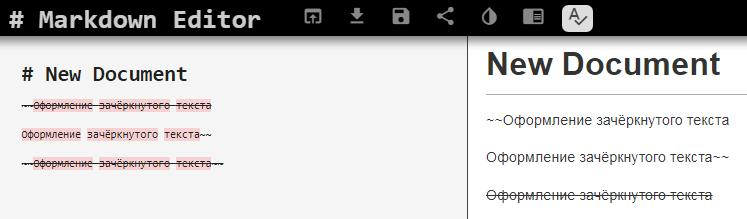

## 2.1.3. Списки

Markdown позволяет легко создавать списки. Для формирования неупорядоченных списков используйте символы «-», «*» или «+» в начале строки, за которыми следует пробел. Отсортированные списки создаются с использованием чисел, за которыми следует точка (1., 2., 3.). Чтобы создать вложенные списки, просто добавьте отступ (два или четыре пробела) к элементам, принадлежащим подуровню . Важно поддерживать последовательность виспользовании символов в одном и том же списке, чтобы избежать ошибок форматирования.

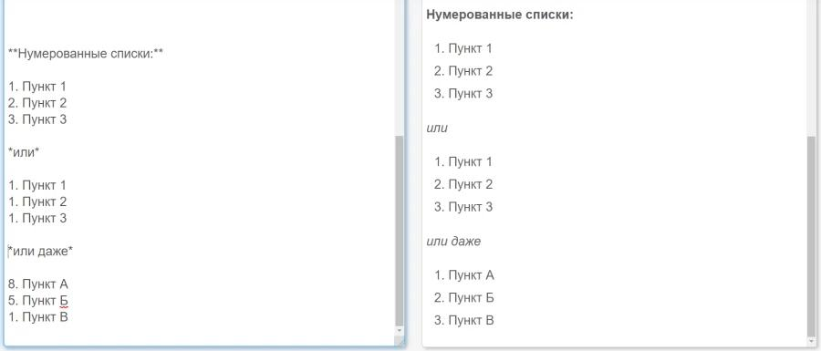

## 2.1.4. Ссылки

Ссылки в Markdown создаются с помощью синтаксиса [видимый текст](URL). Видимый текст — это то, что будет отображаться в документе, а URL — это адрес, на который ведет ссылка. Кроме того, можно добавлять заголовки к ссылкам, добавляя текст в кавычках после URL: [текст](URL "заголовок"). Для внутренних ссылок внутри одного
документа можно использовать конструкцию [text](#id-из-заголовка), где ID автоматически формируется из текста заголовка, заменяя пробелы кавычками и удаляя специальные символы. Также существует синтаксис для внешних ссылок, позволяющий задать URL в другом месте документа и тем самым очистить текст от лишних элементов.

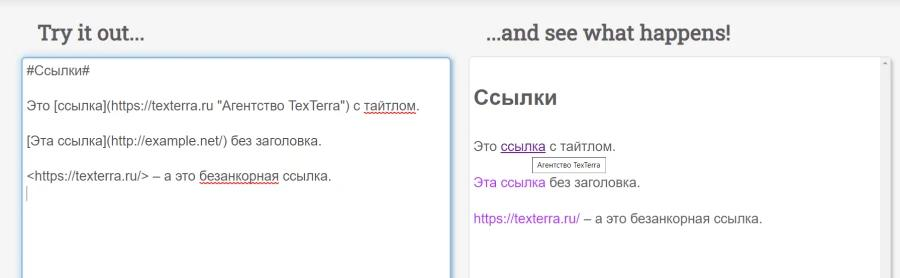

## 2.1.5. Блоки кода

Markdown поддерживает два способа вставки блоков кода. Первый — это выделениетекста с помощью четырех пробелов или табуляции, что указывает на наличие форматированного кода. Второй, более современный и предпочтительный метод — использование трех обратных кавычек (```) в начале и конце блока кода. Эта синтаксическая конструкция также позволяет указать язык программирования после первых обратных кавычек, чтобы выделить синтаксис (например, ```bash``` для Bash-кода). Для inline-кода внутри абзаца используются обычные обратные кавычки (например, ```код```).

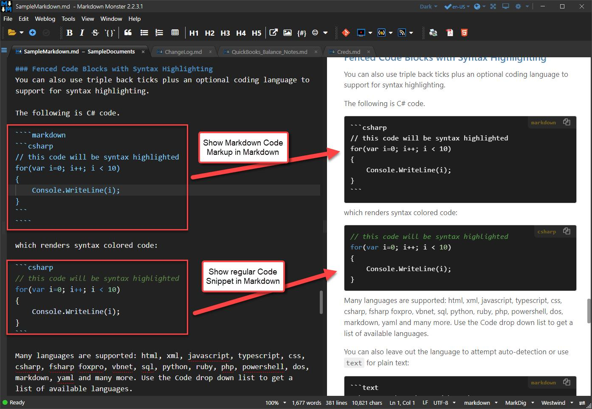

## 2.1.6. Математические формулы

Markdown позволяет включать математические формулы с использованием LaTeX-синтаксиса, особенно при работе с процессорами, поддерживающими MathJax или KaTeX. Для отображения формул в тексте их нужно заключить в двойные долларовые символы
(`$формула$`). Формулы в блоках, отображаемые отдельной строкой и по центру, записываются между двумя парами символов доллара (`$$формула$$`). Это позволяет корректно оформлять сложные математические выражения, включая дроби (`\frac{}{}`),
интегралы (`\int`), квадратные корни (`\sqrt{}`) и греческие буквы (`\alpha`, `\beta`). Совместимость с формулами зависит от используемого Markdown-процессора, однако эта функция особенно полезна для академических и научных отчётов.

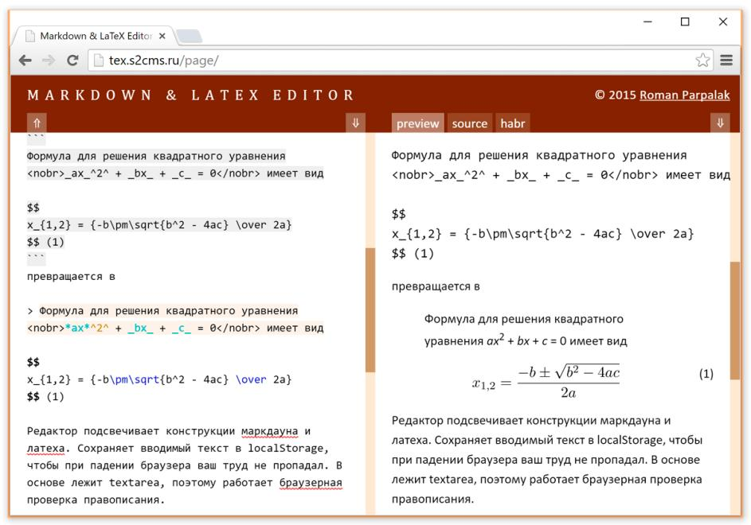

## 2.2. Оформление отчета по лабораторной работе

Структура лабораторного отчета должна соответствовать определенным стандартам, чтобы обеспечить его ясность и полноту. Согласно ГОСТ 7.32-2001, отчет о проведении исследований должен включать ряд обязательных структурных элементов.

## 2.2.1. Структура отчёта

Рекомендуемая базовая структура лабораторного отчета включает следующие элементы:

- Титульный лист (Обложка)
- Содержание (Индекс)
- Введение (Введение)
- Основная часть (Основная часть, где описана методология и результаты)
- Закрытие (Выводы)
- Список используемых источников (Библиографические ссылки)

## 2.2.2. Содержание основных элементов отчета

- Введение: Представляет цели работы и контекст исследования.
- Основная часть: Описывает развитие практики, включая выполненные команды и
скриншоты полученных результатов.
- Закрытие: Обобщает полученные результаты и оценивает, были ли достигнуты
поставленные цели, выделяя приобретенные компетенции.
- библиографические ссылки: Перечисляет библиографические ссылки, к которым
обращались, в стандартном формате.

# Задание и последовательность выполнения работы

В этом разделе описаны практические шаги, необходимые для выполнения лабораторной работы — от установки инструментов до создания сжатого архива с итоговым отчетом.

## 3.1. Установка Pandoc

Для преобразования документов Markdown в другие форматы, такие как PDF, DOCX или HTML, используется инструмент Pandoc. В системах Fedora установка выполняется с помощью следующей команды:

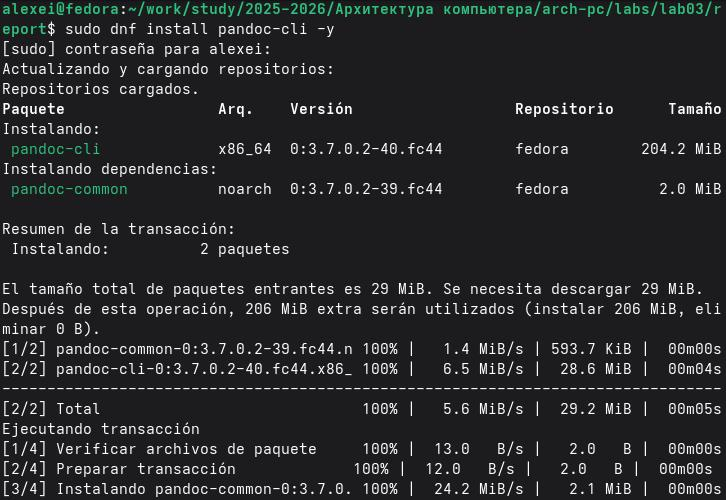

Проверка установки:

Чтобы убедиться, что Pandoc установлен правильно, выполняется следующая команда:

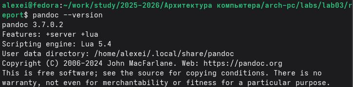

На выходе должна отображаться установленная версия.

## 3.2. Создание отчета в формате Markdown

Первым практическим шагом является создание файла отчета в формате Markdown (.md). Этот файл должен содержать всю информацию из предыдущей лаборатории (Лаборатория № 2), переписанную с использованием синтаксиса Markdown.

Структура файла Markdown:

Файл должен включать следующие разделы:

- Титульный лист (Титульный лист): Информация об университете, факультете, степени,
данные студента.

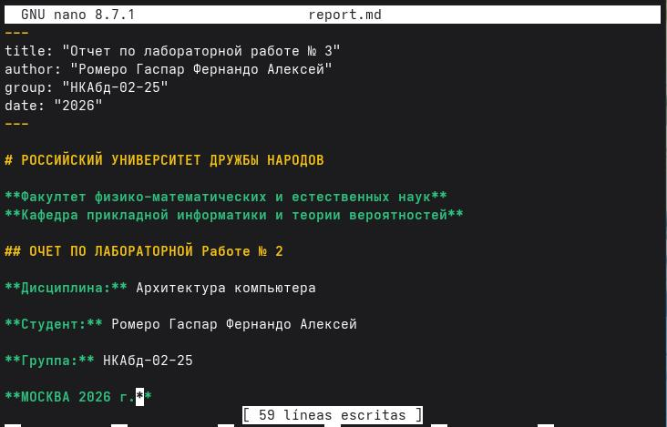
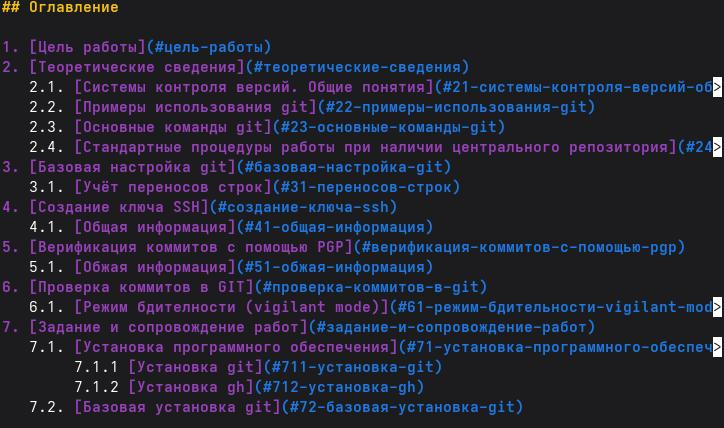

- Цели работы (Цель).

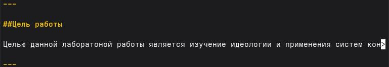

- Теоретические сведения (Теория) с соответствующими подразделами.

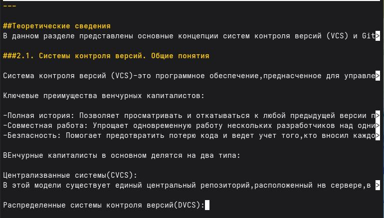

- Забота и сопровождение работ (Практическое развитие).

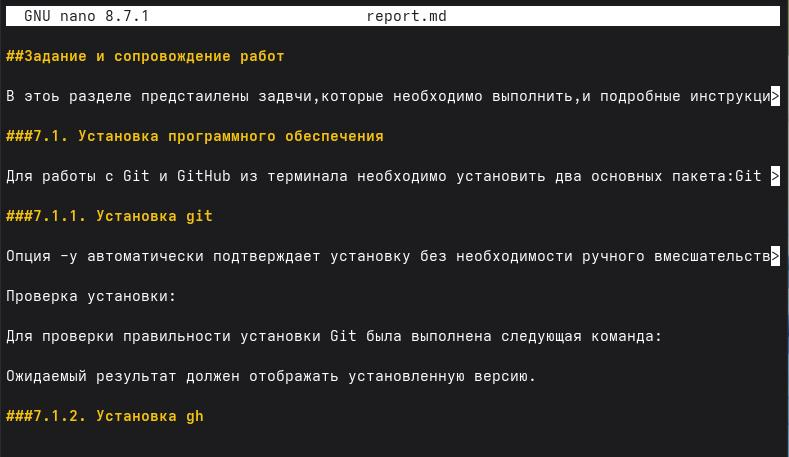

- Контрольные вопросы.

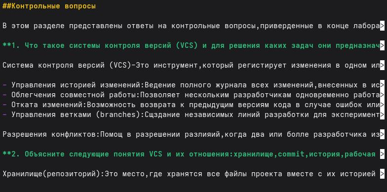

- Выводы.

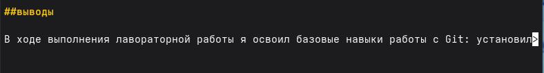

- Список литературы (Ссылки).

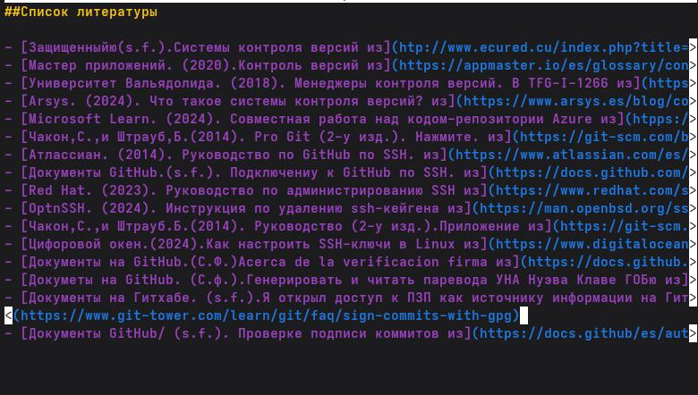

Снимки экрана должны быть включены в отчет с использованием синтаксиса Markdown для изображений:

```уценка

```

Рекомендация: Создайте папку assets/img / в каталоге лаборатории, чтобы
упорядочить все изображения.

## 3.3. Компиляция отчета в форматы PDF, DOCX y MD

Когда файл Markdown готов, нужно собрать его в нужные форматы.
Сборка в PDF:

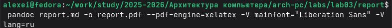

Сборка в DOCX:

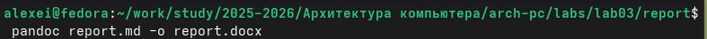

Использование Makefile для автоматизации сборки:

Чтобы было проще и не вводить команды каждый раз, можно создать файл Makefile в папке с лабораторной работой. Вот что в нём написать:

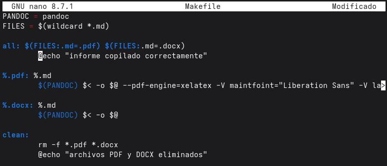

Теперь, чтобы собрать все форматы сразу:

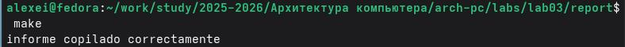

А чтобы удалить все созданные файлы:

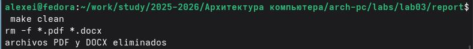

## 3.4. Создание архива с файлами отчета

После создания всех необходимых файлов их нужно упаковать в сжатый архив .zip для отправки.

В ZIP-архив следует включить следующие файлы:

1. reporte.md (исходный текст в формате Markdown)
2. reporte.pdf (отчет в формате PDF)
3. reporte.docx (отчет в формате DOCX)
4. Makefile (для компиляции)
5. Папка assets/ (содержит изображения)

Команда для создания ZIP-архива:

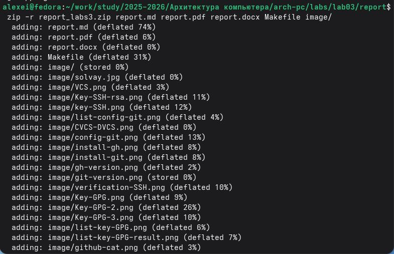

Проверка содержимого ZIP-архива:

Чтобы убедиться, что ZIP-файл содержит все необходимые элементы:

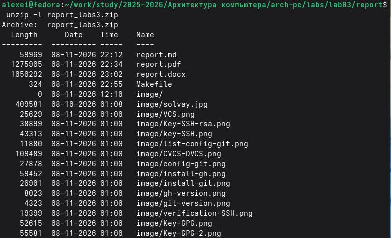

---

# Выводы

В ходе выполнения лабораторной работы я освоил базовые навыки оформления отчетов с использованием языка разметки Markdown. Я изучил основные элементы синтаксиса: заголовки, выделение текста, списки, ссылки, вставку изображений и математических формул. Также я научился использовать утилиту Pandoc для компиляции отчетов в форматы PDF и DOCX, и автоматизировал процесс с помощью Makefile. Все поставленные задачи выполнены, полученные навыки будут полезны для дальнейшего оформления учебных и научных работ

---

# Список литературы

- [Грубер, Дж. (2004). Уценка. Дерзкий огненный шар](https://daringfireball.net/projects/markdown/)
- [Потрясающая академия. (2024). Читшит-лист для уценки.](https://fabacademy.org/2024/labs/waag/students/leo-kuipers/other/Markdown-cheatsheet/)
- [Pandoc. (2026). Руководство пользователя Pandoc](https://pandoc.org/demo/example3.html)
- [Libnorm. (2018). ГОСТ 7.32-2001](http://libnorm.ru/)
- [Документы на GitHub. (s.f.). Базовый синтаксис написания и форматирования](https://docs.github.com/en/get-started/writing-on-github/getting-started-with-writing-and-formatting-on-github/basic-writing-and-formatting-syntax)
- [Катекс. (2026). Документация по Катекс](https://katex.org/docs/supported.html)
- [Pandoc. (2026). Руководство пользователя Pandoc](https://pandoc.org/demo/example3.html)
- [Проект Fedora. (2026). Руководство по системному администрированию DNF](https://docs.fedoraproject.org/en-US/fedora/latest/system-administrators-guide/package-management/DNF/Command_Reference/)
- [Грубер, Дж. (2004). Markdown. Daring Fireball](https://daringfireball.net/projects/markdown/)
