## Author
author:
name: Ромеро Гаспар Фернандо Алексей
degrees: DSC
orcid: 0009-0004-8816-345X
email: 1132255520@rudn.ru
affilition:
 - name: Рщссийский университет дружбы народов
   country: Российская  Федерфция
   postal-code: 117198
   city: Москва
   address: ул. Миклухо-Маклая д. 21к3

## Title
title: "Отчёт по лабораторной работе № 6"
subtitle: "Основы работы в командной строке Linux"
license: "CC BY"
abstract: |
  В данном отчёте представлены результаты выполнения лабораторной работы по теме: взаимодействие с операционной системой Linux через командную строку.

  Описаны основные команды навигации и управления файлами: pwd, cd, ls, mkdir, rmdir, rm, man и history. Приведены примеры использования различных опций и работы с историей команд.

  Сделаны выводы о достижении поставленной цели и о формировании базовых навыков работы в терминале.
keywords: [Linux, командная строка, pwd, cd, ls, mkdir, man, history]
---

# Введение

1. Цельработы
2. Теоретическиесведения
> 2.1. Форматкоманды
> 2.2. Командаman
> 2.3. Командаcd
> 2.4. Командаls
> 2.5. Командаmkdir
> 2.6. Командаrm
> 2.7. Командаhistory
3. Заданиеипоследовательностьвыполненияработы 
> 3.1. Определениеполногоименидомашнегокаталога 
> 3.2. Работаскаталогом/tmp 
> 3.3. Проверканаличияподкаталогаcron 
> 3.4. Работасдомашнимкаталогом 
> 3.5. Созданиеиудалениекаталогов 
> 3.6. Использованиекомандыman 
>3.7. Использованиекомандыhistory
4. Контрольныевопросы
5. Выводы
6. Списоклитературы

---

# Цель работы

Целью данной лабораторной работы является приобретение практических навыков взаимодействия пользователя с операционной системой типа Linux посредством командной строки. В ходе работы необходимо изучить основные команды для навигации по файловой системе, управления каталогами и файлами, а также освоить использование справочной системы man и истории команд для эффективной работы в терминале.
---

# Теоретические сведения

В этом разделе представлены теоретические основы интерфейса командной строки в системах Unix/Linux и основные команды, необходимые для взаимодействия с операционной системой.

## 2.1. Формат команды

Командная строка — это текстовый интерфейс, позволяющий пользователю взаимодействовать с операционной системой, вводя инструкции. Общий формат команды в Linux выглядит следующим образом:

текст
<имя команды> [параметры] [аргументы]

Имя команды указывает на выполняемое действие, параметры (также называемые флагами) изменяют её поведение, а аргументы указывают объекты, над которыми она работает (файлы, каталоги и т. д.).

## 2.2. Команда man

Команда `man` (сокращение от manual) — это встроенный инструмент для работы с документацией в системах Unix/Linux. Она позволяет получить доступ к страницам руководства, содержащим подробную информацию о большинстве команд, доступных в системе, включая их синтаксис, параметры и примеры использования.

Чтобы использовать команду `man`, введите:

`bash`
`man <имя_команды>`
`Например, чтобы просмотреть руководство для команды `ls`:`

`bash`
`man ls`

Внутри страницы руководства вы можете перемещаться с помощью клавиш со стрелками, переходить между страницами с помощью пробела и выходить, нажимая клавишу `q`.

## 2.3. Команда cd

Команда `cd` (переход в другой каталог) используется для навигации между каталогами в файловой системе. Её базовый формат: bash cd [каталог_файла]
Некоторые распространённые варианты включают:
- `cd ..` — перемещается на один уровень вверх по иерархии каталогов.
- `cd ~` или просто `cd` — переводит вас в домашний каталог пользователя.
- `cd /` — переводит вас в корневой каталог системы.

## 2.4. Команда ls

Команда `ls` (список) отображает содержимое каталога. Её базовый формат:

```bash
`ls [параметры] [put]`
```

Некоторые из наиболее часто используемых параметров:

- `-a` — отображает все файлы, включая скрытые (те, чьи имена начинаются с точки).
- `-l` — отображает подробную информацию (права доступа, количество ссылок, владелец, размер, дата изменения).
- `-F` — добавляет символ в конец имени файла, чтобы указать тип файла (`/` для каталогов, `*` для исполняемых файлов, `@` для символических ссылок).
- `-t` — сортирует файлы по дате изменения.
- `-R` — рекурсивно выводит содержимое подкаталогов.

Можно комбинировать несколько параметров, например: `ls -la` для отображения всех файлов с подробной информацией.

## 2.5. Команда mkdir

Команда `mkdir` (создать каталог) создает новые каталоги. Ее формат:

```bash
mkdir [параметры] каталог_каталог
```

Параметр `-p` позволяет создать полную иерархию каталогов, создавая любые
промежуточные каталоги, которых еще нет:

```bash
mkdir -p ~/dir1/dir2/dir3
```

## 2.6. Команда rm

Команда `rm` (удалить) удаляет файлы или каталоги. Её базовый формат:

```bash
rm [параметры] [файлы]
```

Некоторые важные параметры:

- -r — удаляет каталоги и их содержимое рекурсивно.
- -f — принудительно удаляет без запроса подтверждения.

Для удаления пустого каталога можно также использовать специальную команду
`rmdir`.

## 2.7. Команда history

Команда `history` отображает список команд, ранее выполненных в текущей сессии терминала. Каждая команда обозначается номером, что позволяет:

- Просмотреть всю историю: `history`.
- Повторно выполнить команду по её номеру: `!<number>`.
- Выполнить поиск в истории, нажав Ctrl+R.

Эта функция очень полезна для экономии времени при повторении сложных команд или для запоминания того, как была выполнена предыдущая задача.

# Задание и последовательность выполнения работы

В этом разделе представлены задания, которые необходимо выполнить, и подробные
инструкции по работе с командной строкой в операционной системе Linux.

## 3.1. Определение полного имени домашнего каталога

Шаг 1: Определите полный путь к домашнему каталогу

Чтобы найти абсолютный путь к домашнему каталогу пользователя, используйте команду `pwd` (вывести рабочий каталог). Сначала перейдите в домашний каталог, а затем выполните следующую команду:

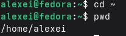

В выводе будет показан полный путь, например: /home/alexei

## 3.2. Работа с каталогом /tmp

Шаг 1: Перейдите в каталог /tmp

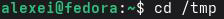

Шаг 2: Отобразите содержимое каталога /tmp с помощью различных опций

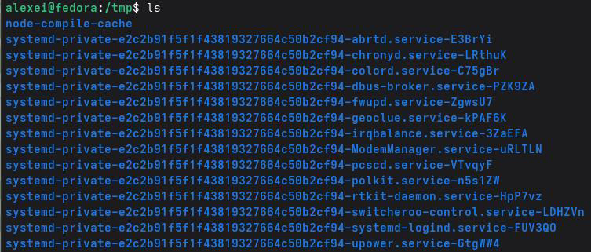
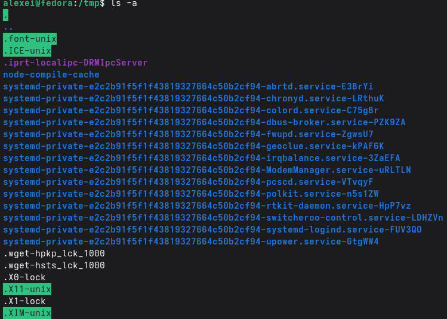
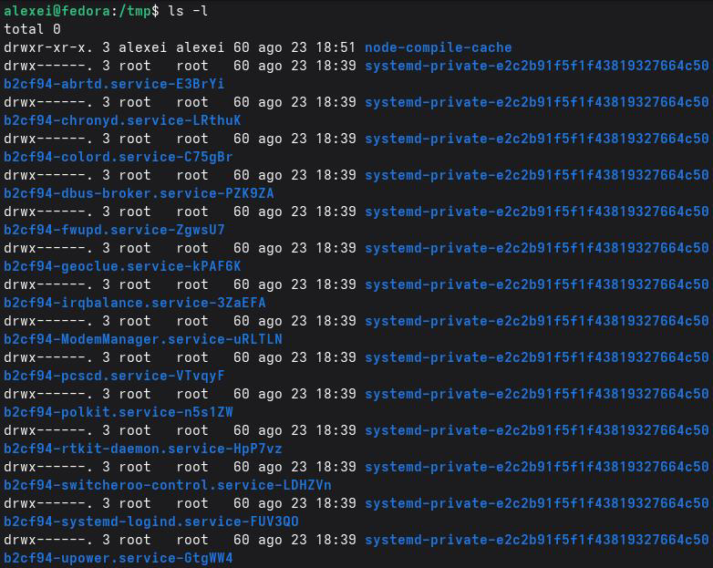
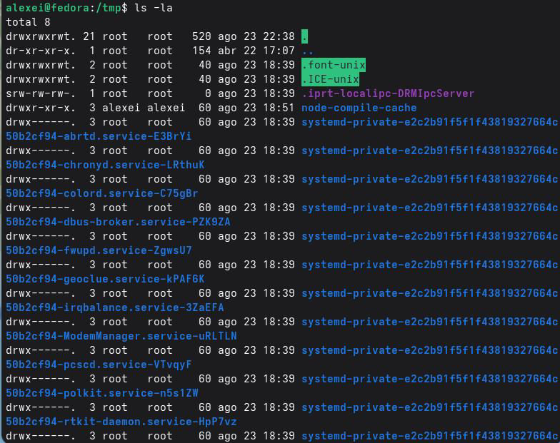
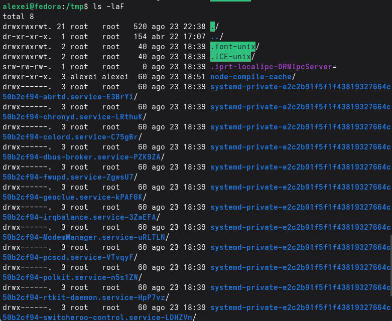

Пояснение различий:

- ls — показывает только имена видимых файлов и каталогов.
- ls -a — также показывает скрытые файлы (те, которые начинаются с точки).
- ls -l — показывает подробную информацию: права доступа, количество ссылок, владелец, группа, размер, дата и имя.
- ls -la — объединяет обе опции: показывает все файлы с подробной информацией.
- ls -laF — добавляет символ в конец имени, чтобы указать тип файла (/ для каталогов, * для исполняемых файлов, @ для символических ссылок).

## 3.3. Проверка наличия подкаталога cron

Шаг 1: Проверьте, существует ли подкаталог cron в /var/spool

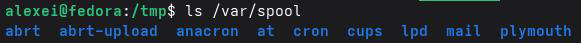

Чтобы выполнить поиск именно каталога cron:

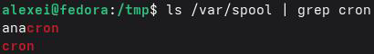

Или напрямую:

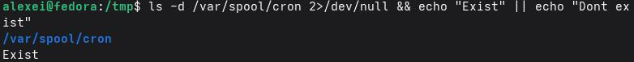

## 3.4.Работа с домашним каталогом

Шаг 1: Перейдите в свой домашний каталог


Шаг 2: Отобразите содержимое своего домашнего каталога с подробной информацией

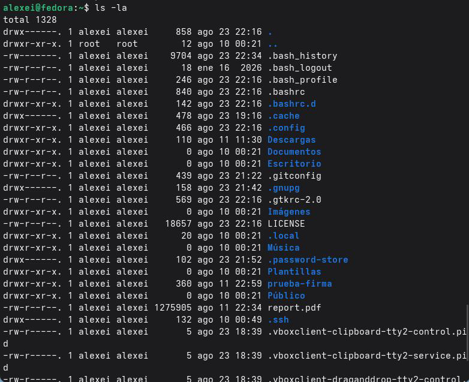

Шаг 3: Определитевладельцафайловикаталогов

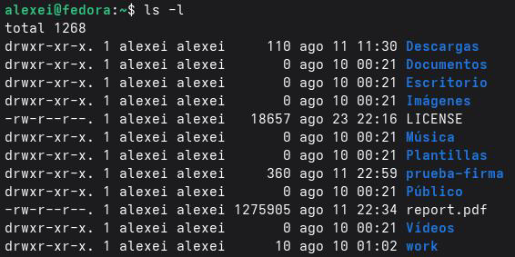

В выводе команды ls -l третий столбец указывает владельца каждого файла или каталога.

## 3.5. Создание и удаление каталогов

Шаг 1: Создайте новую директорию в своей домашней директории

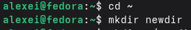

Шаг 2: Создайте подкаталог внутри newdir

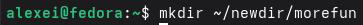

Шаг 3: Создайте три директории одной командой

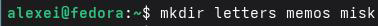

Шаг 4: Удалите три директории одной командой

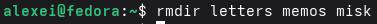

Шаг 5: Попробуйте удалить директорию newdir с помощью команды rm

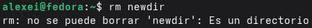

Команда выведет ошибку, указывающую на то, что newdir является директорией. Чтобы удалить её, необходимо использовать опцию -r:

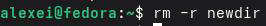

Шаг 6: Убедитесь, что директория была удалена

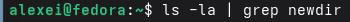

## 3.6. Использование команды man

Шаг 1: Определите параметр `ls` для рекурсивного перечисления подкаталогов

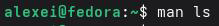
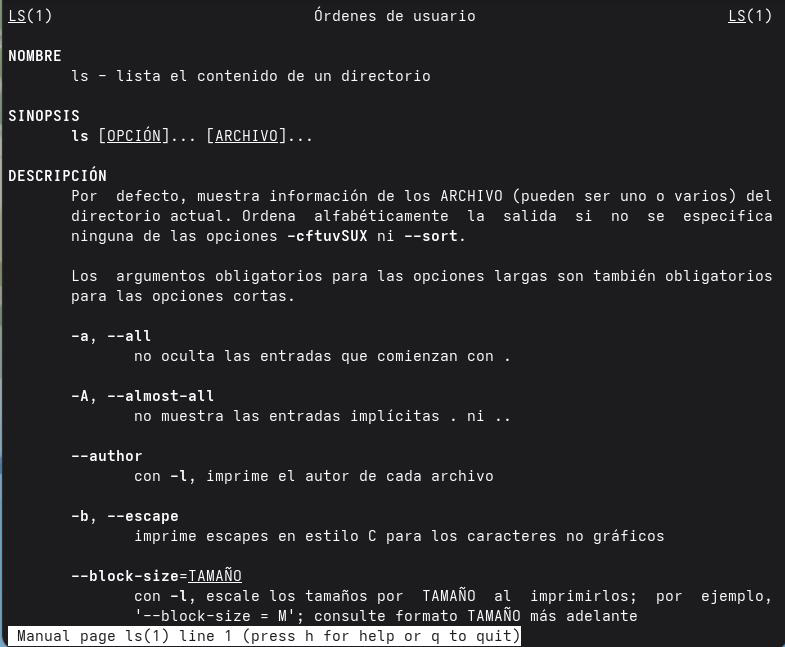

В руководстве найдите параметр `-R` или `--recursive`, который позволяет рекурсивно перечислять содержимое подкаталогов.

Шаг 2: См. руководство по командам `cd`, `pwd`, `mkdir`, `rmdir` и `rm`

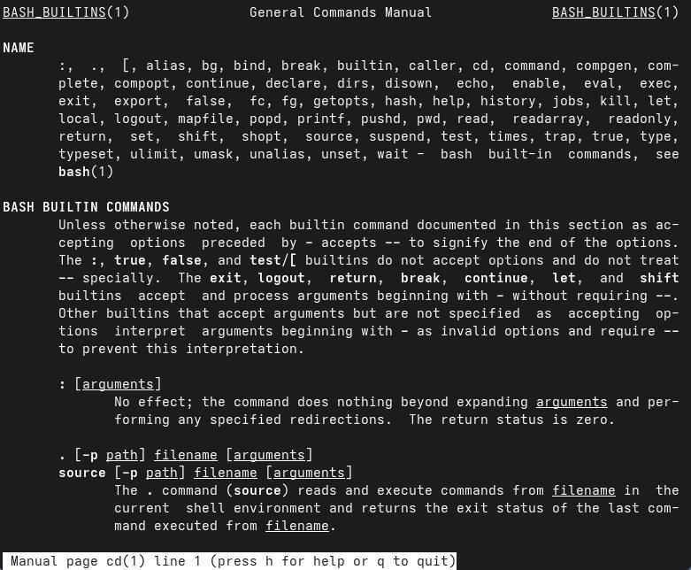
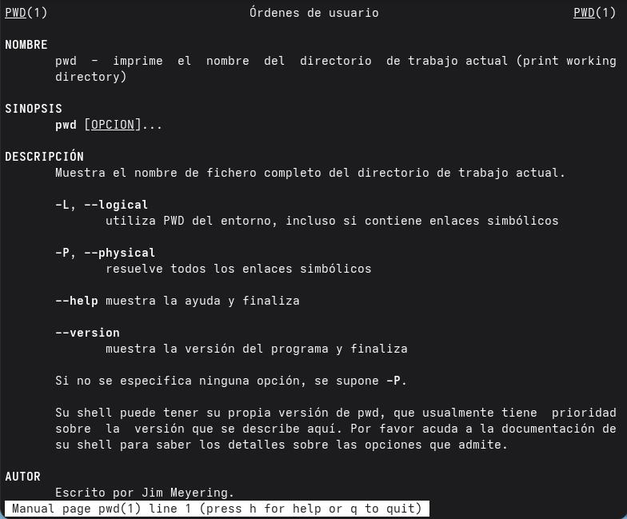
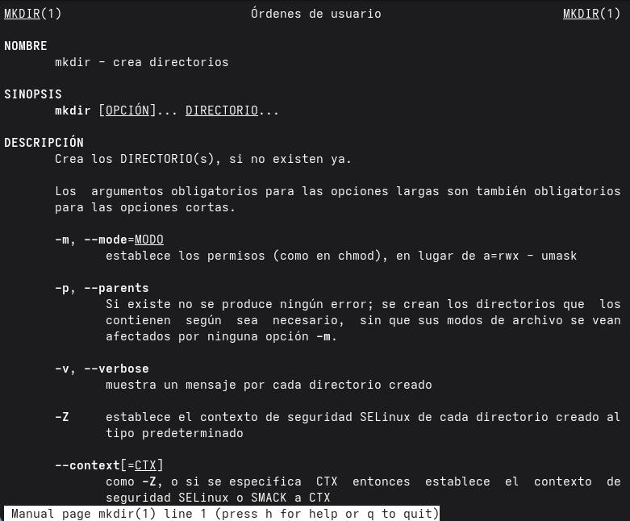
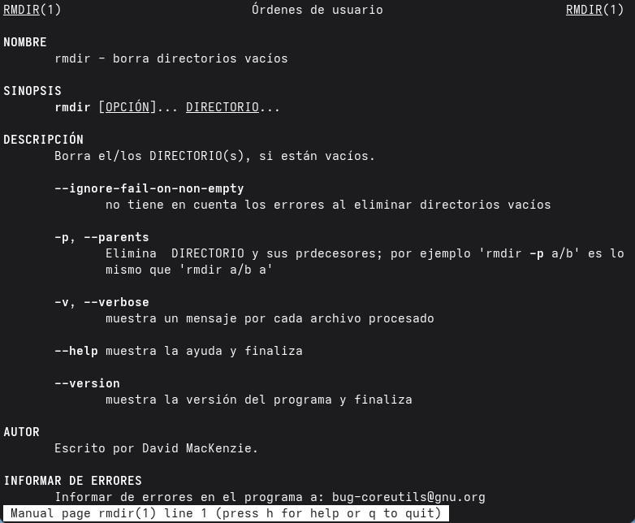
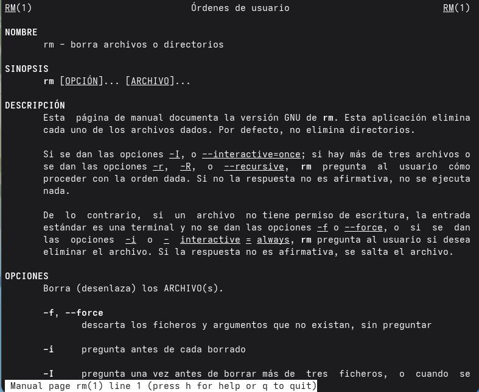

Пояснение основных параметров:

- `cd` — не имеет существенных параметров; он только меняет каталог.
- `pwd` — с `-P` отображает физический путь без символических ссылок.
- `mkdir` — `-p` создает промежуточные каталоги; `-m` устанавливает права доступа.
- `rmdir` — удаляет только пустые каталоги.
- `rm` — `-r` удаляет рекурсивно; `-f` принудительно удаляет; `-i` запрашивает подтверждение.

## 3.7. Использование команды history

Шаг 1: Отобразить историю команд

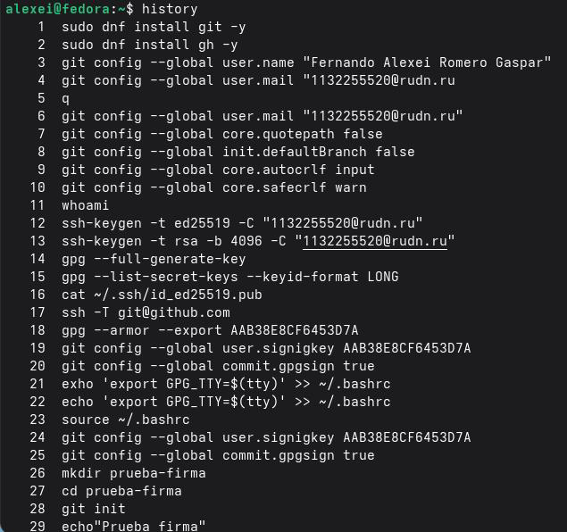
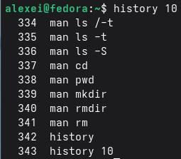

Шаг 2: Повторно выполнить команду из истории по её номеру

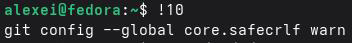

Шаг 3: Изменить и выполнить команду из истории 

Например, если команда 20 — ls -la, её можно изменить на ls -l:

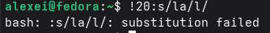

Шаг 4: Найти в истории с помощью Ctrl+R

Нажмите Ctrl+R и введите часть искомой команды.

Шаг 5: Выполнить последнюю команду

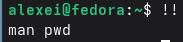

# Контрольные вопросы

## 1. Что такое командная строка?

Интерфейс командной строки (CLI) — это текстовый интерфейс, позволяющий пользователю взаимодействовать с операционной системой, вводя инструкции в виде команд. В отличие от графических пользовательских интерфейсов (GUI), командная строка требует от пользователя ввода конкретных команд для выполнения таких задач, как навигация по файловой системе, запуск программ или управление файлами. Это мощный и эффективный инструмент, особенно для административных задач и задач автоматизации, поскольку он обеспечивает точный контроль над системой и возможность объединять команды для выполнения сложных задач.

## 2. Перед командами не следует включать абсолютные слова. Существует каталог?

Пожалуйста, проверьте сначала. Абсолютный путь — это полный адрес, указывающий местоположение файла или
каталога от корня файловой системы (обозначается символом /). Абсолютный путь не зависит от текущего каталога и всегда начинается с корня. 

Команда для определения абсолютного пути к текущему каталогу — `pwd` (вывести
рабочий каталог). Пример:

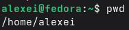

Если пользователь находится в каталоге `/home/alexei`, вывод будет следующим.

## 3. Вот некоторые из команд и параметров, которые могут быть вам предоставлены. Какие имена есть в каталоге? Пожалуйста, сначала ознакомьтесь с информацией.

Чтобы определить типы файлов и отобразить только их имена в текущем каталоге, используйте команду `ls` с опцией `-F`. Эта опция добавляет в конец имени файла символ, указывающий на его тип.

| Символ         | Тип файла           |
|----------------|---------------------|
| /              | Каталог             |
| *              | Исполняемый файл    |
| @              |Символическая ссылка |
| (без символов) | Обычный файл        |

Примеры:

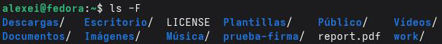

Вы также можете комбинировать это с -p (аналогично -F, но только для каталогов):

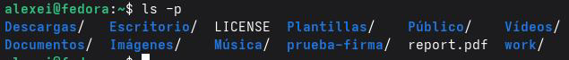

## 4. Как изобразить информацию о скрытых файлах? Приведите пример.

Скрытые файлы в Linux — это файлы, имена которых начинаются с точки (.). Эти файлы обычно содержат настройки приложений или системы и не отображаются в обычных списках во избежание путаницы. Чтобы отобразить эту информацию, используйте команду `ls` с опцией `-a` (все):

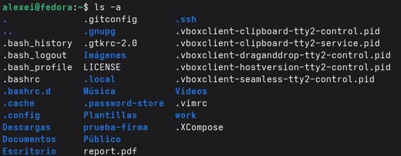

Пример:

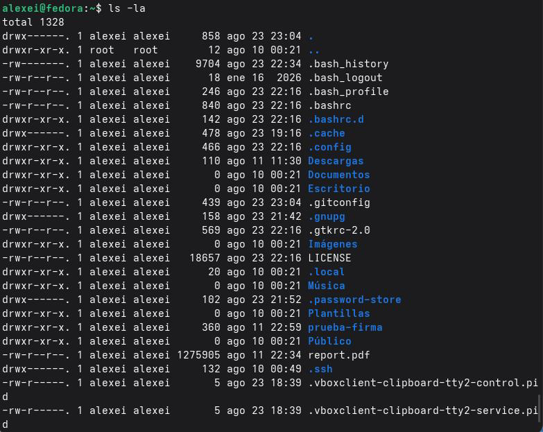

Это отобразит все файлы, включая скрытые, с подробной информацией (права доступа, владелец, размер, дата и т. д.).

## 5. Как узнать, как проверить каталог? Чем это похоже на вашу команду? Пожалуйста, сначала посмотрите.

Да, вы можете удалять как файлы, так и каталоги с помощью одной и той же команды `rm` (удалить). Разница заключается в используемых параметрах.

Для удаления файлов используйте команду `rm` без каких-либо специальных параметров:

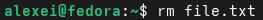

Для удаления каталогов и их содержимого используйте параметр `-r` (рекурсивный):

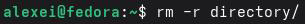

Также существует специальная команда `rmdir` для удаления пустых каталогов:

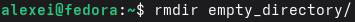

Примеры:

| Команда            | Действие                                          |
|--------------------|---------------------------------------------------|
| rm file.txt        | Удаляет файл file.txt                             |
| rm -r folder       | Удаляет папку и все ее содержимое                 |
| rmdir empty_folder | Удаляет папку только в том случае, если она пуста |

## 6. Нам не нужно предоставлять информацию или информацию о выполненных пользовательских командах?

Для просмотра истории последних выполненных команд используется команда history. По умолчанию она отображает все команды в текущей сессии.

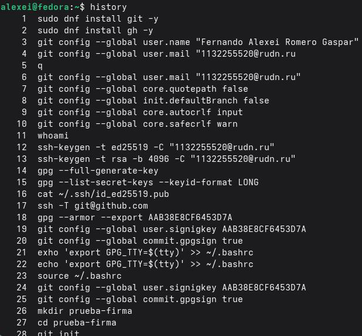

Чтобы отобразить только последние N команд, можно указать число:

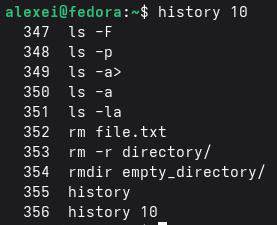

Это отобразит только последние 10 выполненных команд.

## 7. Как использовать историю команд для изменения уже выполненных команд? Для начала, добро пожаловать.

История команд позволяет повторно использовать и изменять предыдущие команды, используя символ !, за которым следует число или текстовая строка.

Базовый синтаксис:

- !<число> — выполняет команду с номером, указанным в истории.
- !! — выполняет последнюю команду.
- !<текст> — выполняет последнюю команду, начинающуюся с <текст>.
- <число>:s/<старый>/<новый>/ — выполняет команду <число>, заменяя <старый> на <новый>.

Примеры:

```bash
# История команд
history
1 cd /tmp
2 ls -la
3 pwd
# Повторное выполнение команды 2
!2 # Выполняет: ls -la
# Повторное выполнение последней команды
!! # Выполняет последнюю команду
# Повторно выполняет измененную команду 2 (замените -la на -l)
!2:s/la/l/ # Выполняет: ls -l
```

## 8. Первые команды нажимайте одновременно.

В Linux можно выполнять несколько команд в одной строке, используя разные
операторы, которые определяют, как они будут объединены в цепочку.

| Оператор | Функция                                                                                      |
|----------|----------------------------------------------------------------------------------------------|
| ;        | Выполняет команды последовательно, независимо от успеха или неудачи предыдущих.              | 
| &&       | Выполняет следующую команду только в том случае, если предыдущая была выполнена успешно (код завершения 0).                                                                                            |
| ||       | Выполняет следующую команду только в том случае, если предыдущая завершилась неудачей (код завершения, отличный от 0)                                                                                |

Примеры:

```bash
# Выполнить три команды последовательно
cd /tmp; ls; pwd
# Создать каталог и, если успешно, перейти в него
mkdir new_dir && cd new_dir
# Попытаться перейти в каталог; если не удастся, создать его
cd /tmp/nonexistent_dir || mkdir /tmp/nonexistent_dir
```

## 9. Экранирующие символы.

Экранирующие символы — это специальные символы, которые позволяют оболочке интерпретировать символ буквально, то есть рассматривать специальный символ как обычный, не пытаясь выполнить его специальную функцию. Наиболее распространенным экранирующим символом в Linux является обратная косая черта (\). 

Примеры специальных символов, которые необходимо экранировать:

| Символ | Специальная функция                             |
|--------|-------------------------------------------------|
| \      | Начало символа экранирования                    |
| ""     | Кавычки (групповой текст)                       |
| ''     | Одинарные кавычки (групповой литеральный текст) |
| $      | Переменная среды                                |
| *      | Подстановочный знак (любая строка)              |
| ?      | Подстановочный знак (один символ)               |
| []     | Наборы символов                                 |
| |      | Вертикальный символ                             |
| ><     | Перенаправление ввода/вывода                    |


Примеры:

```bash
# Создать файл с именем, содержащим пробелы (без экранирования)
touch my file.txt #  Ошибка: создает два файла "my" и "file.txt"
# Используйте экранирование, чтобы сделать пробел буквальным
touch my\ file.txt #  Создает "my file.txt"
# Используйте кавычки для той же цели
touch "my file.txt" #  Создает "my file.txt"
```

## 10. Охарактеризуйте вывод информации на экран после выполнения команды ls с опцией l.

Опция -l команды ls отображает подробный список файлов и каталогов, также известный как «длинный формат». Каждая строка содержит информацию о файле или каталоге, организованную в столбцы. Вывод имеет следующий формат:

текст

drwxr-xr-x 2 группа пользователей 4096 13 августа 10:00 Документы/
-rw-r--r-- 1 группа пользователей 1024 13 августа 09:30 file.txt

| Столбец | Значение                                                                                |
|---------|-----------------------------------------------------------------------------------------|
| 1       | Тип файла (d = каталог, - = файл, l = символическая ссылка) и права доступа (rwxr-xr-x) |
| 2       | Количество жестких ссылок на файл                                                       |
| 3       | Владелец файла (имя пользователя)                                                       |
| 4       | Группа, к которой принадлежит файл                                                      |
| 5       | Размер файла в байтах                                                                   |
| 6       | Дата и время последнего изменения                                                       |
| 7       | Имя файла или каталога                                                                  |

## 11. В чём смысл игры? Приоритет отдаётся первому отношительному и абсолютному пути при выполнении какой-либо команды.

Абсолютный путь — это полный адрес, указывающий местоположение файла или каталога от корня файловой системы (обозначается символом /). Например: /home/alexei/documentos/informe.txt. 

Относительный путь указывает местоположение файла или каталога относительно текущего каталога. Он не начинается с / и использует такие символы, как . (текущий каталог) и..(родительский каталог).

Примеры:

| Тип           | Путь                              | Значение                               |
|---------------|-----------------------------------|----------------------------------------|
| Абсолютный    | /home/alexei/documents/report.txt | От корневого каталога (/) до файла     |
| Относительный | documents/report.txt              | От текущего каталога                   |
| Относительный | ../report.txt                     | На один уровень выше текущего каталога |

Пример использования `cd`:

```bash
# Использование абсолютного пути
`cd /home/alexei/documents`
# Использование относительного пути (если вы находитесь в `/home/alexei`)
`cd documents`
# Использование относительного пути (на один уровень выше)
`cd ..`
```

## 12. Как получить информацию о команде?

Для получения подробной информации о команде используйте команду `man` (справочник), которая отображает справочную страницу для указанной команды:

```bash
man <имя_команды>
```

Примеры:

```bash
man ls # Отображает руководство для 'ls'
man cd # Отображает руководство для 'cd'
man man # Отображает руководство для 'man'
```

Внутри справочной страницы вы можете перемещаться с помощью клавиш со стрелками, двигаться вперед с помощью пробела и выходить с помощью клавиши `q`.

## 13. Какая клавиша или комбинация клавиш служит для автоматического дополнения при вводе команд?

Клавиша Tab используется для автозаполнения команд, имен файлов и каталогов в терминале. При нажатии клавиши Tab во время ввода команды или пути оболочка пытается автоматически дополнить текст на основе существующих файлов и каталогов.

Пример:

```bash
# Введите часть команды и нажмите Tab
cd /home[TAB] # Дополняется до: cd /home/
```

Если есть несколько возможных вариантов, двойное нажатие клавиши Tab отобразит все доступные варианты.

---

# Выводы

В ходе выполнения лабораторной работы я приобрёл практические навыки взаимодействия с операционной системой Linux через командную строку. Я изучил основные команды для навигации по файловой системе (cd, pwd), просмотра содержимого каталогов (ls с различными опциями), создания и удаления каталогов (mkdir, rm, rmdir). Также я освоил использование справочной системы man для получения информации о командах и работу с историей команд (history) для их повторного выполнения и модификации. Все поставленные задачи выполнены, полученные навыки являются основой для эффективной работы в терминале Linux.

---

# Список литературы

- [GNU.org. (2025). Руководство по coreutils: Список каталогов.](https://www.gnu.org/software/coreutils/manual/coreutils.pdf)
- [USDA. (2024). Интерфейс командной строки Linux. https://scinet.usda.gov/guides/use/cli
- [Система Университета Иллинойса. (2026). Краткий справочник по командам Linux.](https://answers.uillinois.edu/hipaa/104977)
- [Национальная лаборатория Ок-Ридж. (s.f.). Базовая командная строка Linux.](https://single-crystal.ornl.gov/guide/linux/index.html)
- [Документация Ubuntu. (2026). Командная строка Linux для начинающих.](https://documentation.ubuntu.com/desktop/en/latest/tutorial/the-linux-command-line-for-beginners/)
- [Страницы руководства Debian. (2025). man(1) — man-db — Debian trixie.](https://manpages.debian.org/trixie/man-db/man.1.de.html)
- [Страницы руководства Debian. (2026). ls(1) — coreutils — Debian unstable.](https://manpages.debian.org/unstable/coreutils/ls.1.en.html)
- [phoenixNAP. (2025). Команда истории Linux с примерами.](https://www.phoenixnap.de/kb/Linux-Verlaufsbefehl)
- [Научные вычисления USDA. (2024). Интерфейс командной строки Linux.](https://scinet.usda.gov/guides/use/cli)
- [Стэнфордский университет. (2026). Командная строка — ваш друг.](https://ccrma.stanford.edu/docs/common/command-line.html)
