## Author
author:
name: Ромеро Гаспар Фернандо Алексей
degrees: DSC
orcid: 0009-0004-8816-345X
email: 1132255520@rudn.ru
affilition:
 - name: Рщссийский университет дружбы народов
   country: Российская  Федерфция
   postal-code: 117198
   city: Москва
   address: ул. Миклухо-Маклая д. 21к3

## Title
title: "Отчёт по лабораторной работе № 7"
subtitle: "Файловая система Linux: права доступа и анализ"
license: "CC BY"
abstract: |
  В данном отчёте представлены результаты выполнения лабораторной работы по теме: изучение файловой системы Linux, управление правами доступа и анализ дискового пространства.

  Описаны команды touch, cat, less, head, tail, cp, mv, chmod, mount, df и fsck. Приведены примеры работы с правами доступа в символьной и числовой форме, копирования и перемещения файлов и каталогов.

  Сделаны выводы о достижении поставленной цели и о практической значимости полученных навыков для администрирования Linux.
keywords: [Linux, файловая система, chmod, cp, mv, df, mount, права доступа]
---

# Ввдение

1. Цельработы
2. Теоретическиесведения
> 2.1. Командыдляработысфайламиикаталогами
> 2.1.1. Командаtouch
> 2.1.2. Командаcat
> 2.1.3. Командаless
> 2.1.4. Командаhead
> 2.1.5. Командаtail
> 2.2. Копированиефайловикаталогов (cp)
> 2.3. Перемещениеипереименованиефайловикаталогов (mv)
>2.4. Правадоступа
> 2.4.1. Изменениеправдоступа (chmod)
> 2.5. Анализфайловойсистемы
> 2.5.1. Командаmount
> 2.5.2. Командаdf
> 2.5.3. Командаfsck
3. Заданиеипоследовательностьвыполненияработы 
> 3.1. Работасфайламиикаталогами 
> 3.2. Копированиефайловикаталогов 
> 3.3. Перемещениеипереименованиефайловикаталог 
> 3.4. Изменениеправдоступакфайламикаталогам 
> 3.5. Анализфайловойсистемы
4. Контрольныевопросы
5. Выводы
6. Списоклитературы

---

# Цель работы

Целью данной лабораторной работы является ознакомление с файловой системой Linux, её структурой, именами и содержимым каталогов. В ходе работы необходимо приобрести практические навыки по применению команд для работы с файлами и каталогами, по управлению процессами (и работами), по проверке использования диска и обслуживанию файловой системы.

---

# Теоретические сведения

В этом разделе представлены теоретические основы наиболее важных команд для работы с файлами и каталогами в системах Linux, а также инструменты для анализа и обслуживания файловой системы.

## 2.1. Команды для работы с файлами и каталогами
## 2.1.1. Команда touch

Команда `touch` используется для создания пустого файла или для обновления даты и времени изменения существующего файла. Её базовый формат:


Например, `touch file.txt` создаёт файл с именем `file.txt` без содержимого в текущем каталоге. Если файл уже существует, `touch` обновляет его метку времени до текущего времени.

## 2.1.2. Команда cat

Команда `cat` (объединение файлов) используется для вывода всего содержимого
одного или нескольких файлов в стандартный вывод. Её базовый формат:


Например, `cat file.txt` выводит всё содержимое файла `file.txt` в терминал. Это полезно для небольших файлов, но может быть непрактично для больших файлов, поскольку отображает всё содержимое сразу.

## 2.1.3. Команда less

Команда `less` позволяет просматривать содержимое текстовых файлов постранично,
отображая по одному экрану за раз. Её базовый формат:


Во время просмотра для навигации можно использовать следующие клавиши:

- Пробел или f — перейти на одну страницу вперёд
- b — вернуться на одну страницу назад
- Enter — перейти на одну строку вперёд
- q — выйти из режима просмотра

Эта команда особенно полезна для больших файлов или для выхода из других команд.

## 2.1.4. Команда head

Команда `head` по умолчанию отображает первые 10 строк файла. Её базовый формат:


Чтобы отобразить определённое количество строк, используйте опцию `-n`:


## 2.1.5. Команда tail

Команда `tail` по умолчанию отображает последние 10 строк файла. Её базовый формат:


Как и в случае с `head`, вы можете указать другое количество строк с помощью опции `-n`:


Очень полезная опция для `tail` — `-f` (следовать), которая позволяет в режиме реального времени видеть новые строки, добавляемые в файл (например, для мониторинга лог-файлов).

## 2.2. Копирование файлов и каталогов (cp)

команда `cp` (копировать) используется для копирования файлов или каталогов из одного места в другое. Её базовый формат:


При копировании файла можно указать другое имя для копии:


Для копирования всего каталога и его содержимого необходимо использовать опцию `-r` (рекурсивное копирование):


Опция `-i` (интерактивное копирование) запрашивает подтверждение перед перезаписью существующего файла.

## 2.3. Перемещение и переименование файлов и каталогов (mv)

Команда `mv` (переместить) используется для перемещения файлов или каталогов вдругое место, а также для их переименования. Его базовый формат:

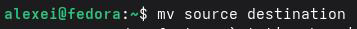

Чтобы переименовать файл в том же каталоге:


Чтобы переместить файл в другой каталог:


Как и cp, mv также поддерживает опцию -i для запроса подтверждения перед перезаписью существующих файлов.

## 2.4. Права доступа

В Linux каждый файл и каталог имеют набор прав доступа, определяющих, кто может читать, записывать или выполнять файл. Права доступа делятся на три категории:

- Владелец (u) — пользователь, которому принадлежит файл
- Группа (g) — пользователи, входящие в группу, к которой принадлежит файл
- Другие (o) — все остальные пользователи 

Права доступа обозначаются следующими символами:

- r — чтение
- w — запись
- x — выполнение

## 2.4.1. Изменение прав доступа (chmod)

Команда `chmod` (изменить режим) используется для изменения прав доступа к файлу или каталогу. Права доступа могут быть заданы символически или численно (восьмерично).

Символическая форма:

```bash
`chmod u+x file` # Добавляет права на выполнение для владельца
`chmod g-w file` # Удаляет права на запись для группы
`chmod o=r file` # Устанавливает права только на чтение для остальных
`chmod a+rwx file` # Предоставляет все права доступа всем (владельцу, группе,
остальным)
```

Числовая (восьмеричная) форма:

| Значение | Разрешение                           |
|----------|--------------------------------------|
|4         | Чтение (r)                           |
| 2        | Запись (w)                           |
| 1        | Выполнение (x)                       |
| 7        | Чтение + запись + выполнение (rwx)   |
| 6        | Чтение + запись (rw-)                |

```Баш
файл chmod 755 #rwxr-xr-x
файл chmod 644 # rw-r--r--
файл chmod 777 #rwxrwxrwx
```

## 2.5. Анализ файловой системы
## 2.5.1. Команда mount

Команда `mount` используется для отображения файловых систем, смонтированных в данный момент в системе, а также для монтирования новых файловых систем. При запуске без аргументов она отображает список всех смонтированных файловых систем с информацией об устройстве, точке монтирования, типе файловой системы параметрах монтирования.

Информация о файловых системах, которые автоматически монтируются при запуске системы, находится в файле `/etc/fstab`. Этот файл содержит для каждой файловой системы информацию об устройстве, точке монтирования, типе файловой системы и параметрах монтирования.

## 2.5.2. Команда df

Команда `df` (disk free) отображает доступное пространство на смонтированных
файловых системах. Её базовый формат:

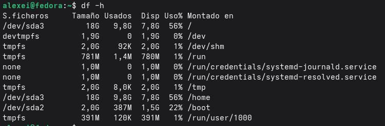

Опция `-h` (удобочитаемый формат) отображает размеры в удобочитаемых единицах (КБ, МБ, ГБ) вместо блоков. Опция `-T` добавляет тип файловой системы к выводу.

## 2.5.3. Команда fsck

Команда `fsck` (проверка файловой системы) используется для проверки и восстановления целостности файловых систем. Её базовый формат:

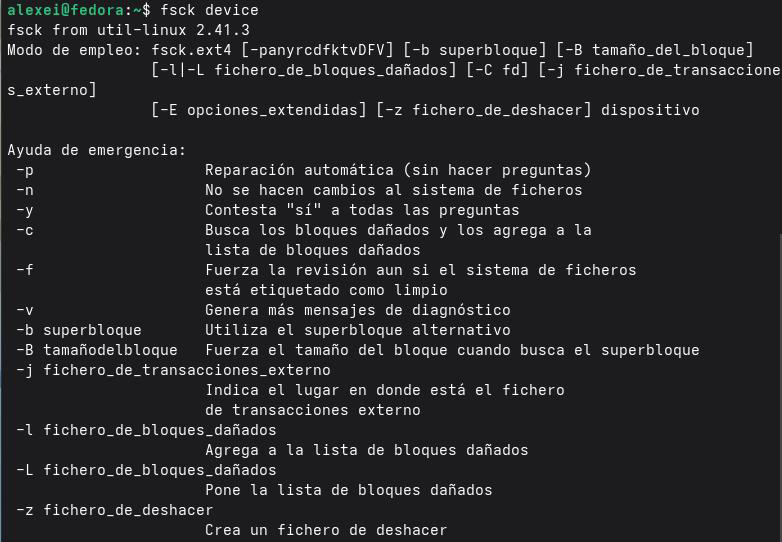

Например, `fsck /dev/sda1` проверяет файловую систему на разделе `/dev/sda1`. Важно,
чтобы файловая система не была смонтирована перед запуском `fsck` во избежание повреждения. Опция `-y` автоматически отвечает «да» на все вопросы в процессе восстановления.

## Задание и последовательность выполнения работы

В этом разделе представлены задания, которые необходимо выполнить, и подробные инструкции по работе с файлами и каталогами в операционной системе Linux.

## 3.1. Работа с файлами и каталогами

Шаг 1: Создайте текстовый файл с помощью команды `touch`


Шаг 2: Просмотрите содержимое файла с помощью команды `cat`


Шаг 3: Просмотрите содержимое файла с помощью команды `less`

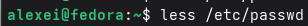
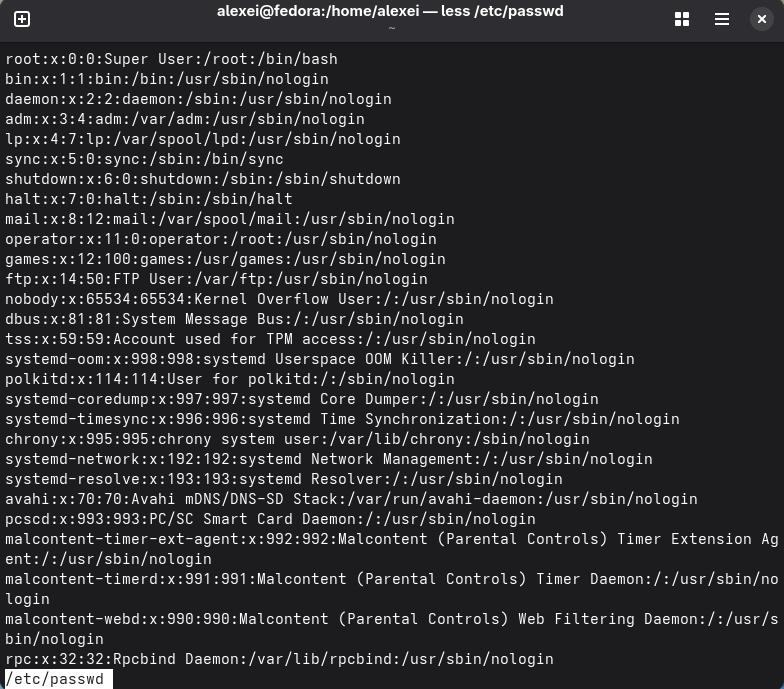

Нажмите `q` для выхода.

Шаг 4: Просмотрите первые несколько строк файла с помощью команды `head`

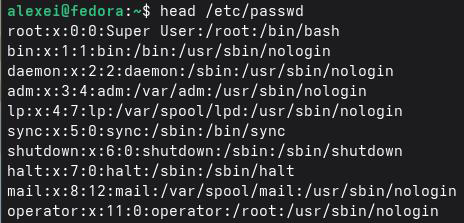
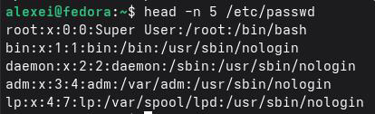

Шаг 5: Просмотрите последние несколько строк файла с помощью команды `tail`

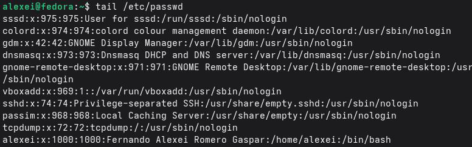
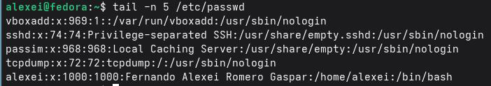

## 3.2. Копирование файлов и каталогов

Шаг 1: Скопируйте файл в ту же директорию

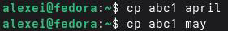

Шаг 2: Создайте директорию и скопируйте в неё файлы

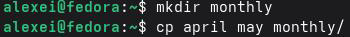

Шаг 3: Скопируйте файлы из другой директории


Шаг 4: Скопируйте всю директорию целиком (используя опцию -r)

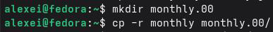

Шаг 5: Скопируйте директорию в другое место


## 3.3. Перемещение и переименование файлов и каталогов

Шаг 1: Переименование файла в текущем каталоге


Шаг 2: Перемещение файла в другой каталог

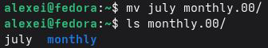

Шаг 3: Переименование каталога

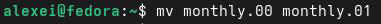

Шаг 4: Перемещение каталога в другой каталог

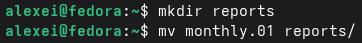

Шаг 5: Переименование каталога, отличного от текущего

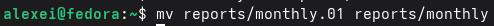

## 3.4. Изменение прав доступа к файлам и каталогам

Шаг 1: Просмотр текущих прав доступа к файлу

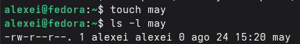

Шаг 2: Добавление прав на выполнение для владельца

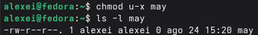

Шаг 3: Удаление прав на выполнение для владельца

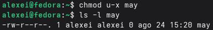

Шаг 4: Создание каталога и изменение прав доступа

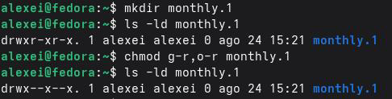

Шаг 5: Добавление прав на запись для группы

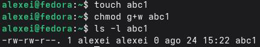

Шаг 6: Практика с различными комбинациями прав доступа

| Начальные права доступа | Команда     | Конечные права доступа |
|-------------------------|-------------|------------------------|
| drwxr--r--              | chmod g+x   | drwxr-xr--             |
| drwx--x--x              | chmod u-w   | dr-x--x--x             |
| -r-xr--r--              | chmod u+w   | -rwxr--r--             |
| -rw-rw-r--              | chmod o+w   | -rw-rw-rw-             |
| -rw-rw-r--              | chmod u-x   | -rw-rw-r--             |
| -rw-rw-r--              | chmod g-w   | -rw-r--r--             |
| -rw-rw-r--              | chmod o-r   | -rw-rw----             |
| -rw-rw-r--              | chmod a+rwx | -rwxrwxrwx             |
| -rw-rw-r--              | chmod 755   | -rwxr-xr-x             |
| -rw-rw-r--              | chmod 644   | -rw-r--r--             |

## 3.5. Анализ файловой системы

Шаг 1: Просмотр смонтированных файловых систем с помощью `mount`

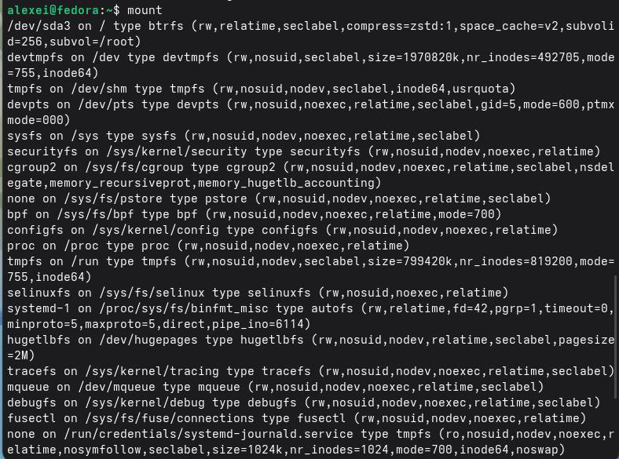

Шаг 2: Просмотр доступного дискового пространства с помощью `df`

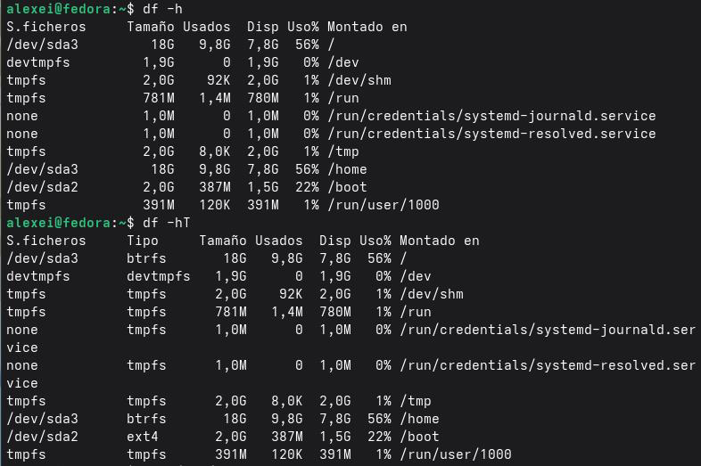

Шаг 3: Просмотр файла `/etc/fstab`

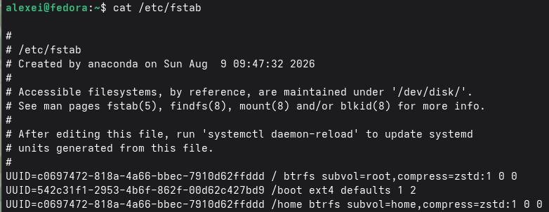

Шаг 4: Проверка файловой системы с помощью `fsck`

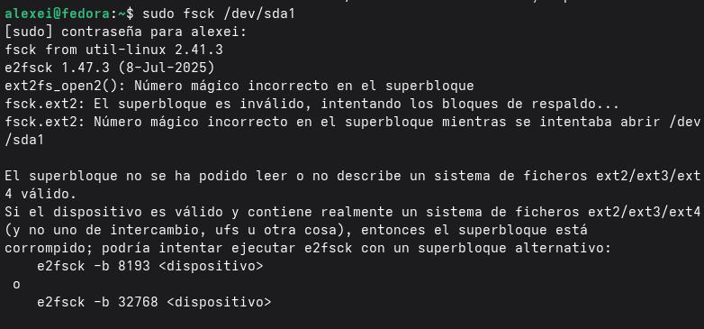

# Контрольные вопросы

В этом разделе представлены ответы на контрольные вопросы, заданные в конце лабораторной работы, которые позволят вам проверить понимание основных концепций файловой системы Linux и команд для работы с файлами и каталогами.

# 1. Что такое файловая система? Добро пожаловать в первую файловую систему.

Файловая система — это структура и метод, используемые операционной системой для хранения, организации и управления файлами и каталогами на устройстве хранения, таком как жесткий диск, SSD или USB-накопитель. Она определяет, как данные записываются и считываются, а также метаданные, связанные с каждым файлом (права доступа, владелец, размер, даты и т. д.).

Примеры распространенных файловых систем:

| Файловая система | Особенности                                        |
|------------------|-------------------------------------------------   |
| ext4             | Это наиболее широко используемая файловая система в дистрибутивах Linux. Она обеспечивает хорошую стабильность, производительность и поддержку больших файлов. Включает журналирование для предотвращения повреждения данных в случае сбоев системы.                                                                |
|XFS               | Высокопроизводительная файловая система,разработанная для обработки больших файлов и крупномасштабных хранилищ. Это файловая система по умолчанию в Red Hat Enterprise Linux (RHEL).                                                |
| Btrfs            | Современная файловая система с расширенными функциями, такими как снимки, сжатие, контрольные суммы и поддержка встроенных RAID-томов.    |
| FAT32            | Простая файловая система, совместимая с большинством операционных систем (Windows, macOS, Linux). Она широко используется на съемных носителях (USB- накопители, SD-карты) благодаря своей широкой совместимости. Ограничение: максимальный размер файла 4 ГБ.                                                      |
| NTFS             | Файловая система по умолчанию в Windows. Linux может читать и записывать данные в разделы NTFS с помощью драйверов, таких как ntfs-3g.|

## 2. Как узнать, какие аппаратные системы собраны в США?

Чтобы увидеть, какие файловые системы в данный момент смонтированы в Linux, используйте следующие команды:

1. `mount` — Отображает все смонтированные файловые системы с информацией об устройстве, точке монтирования, типе файловой системы и параметрах монтирования:

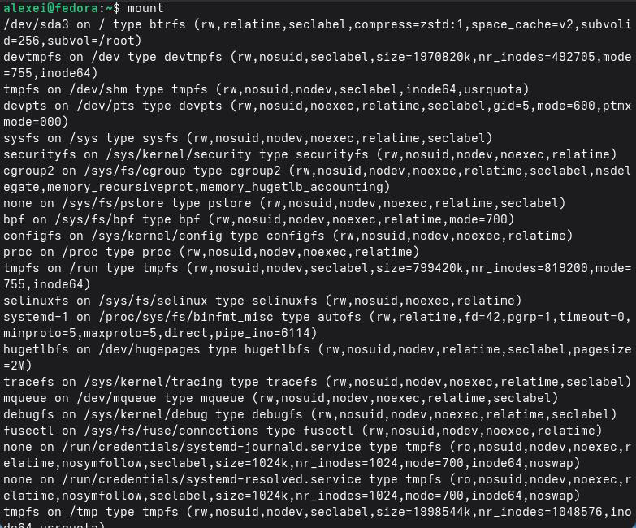

2. `df -h` — Отображает используемое и доступное дисковое пространство на смонтированных файловых системах в удобочитаемом формате (КБ, МБ, ГБ):

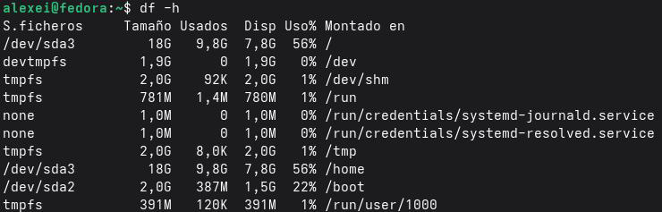

3. `df -T` — Добавляет тип файловой системы к выводу:

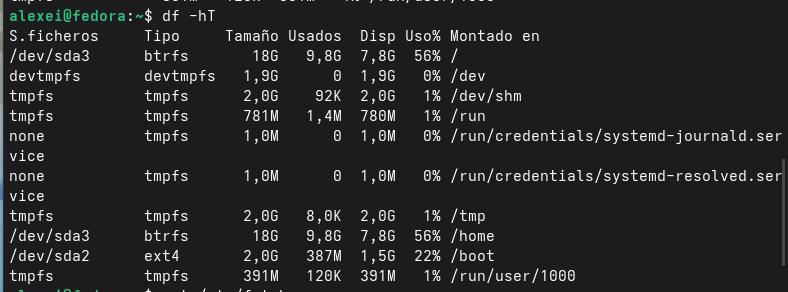

4. `lsblk` — Выводит список блочных устройств и их точек монтирования:

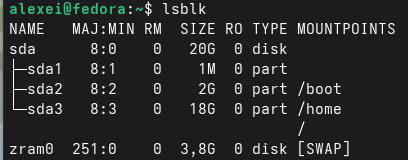

5. `findmnt` — Отображает дерево монтирования файловых систем:

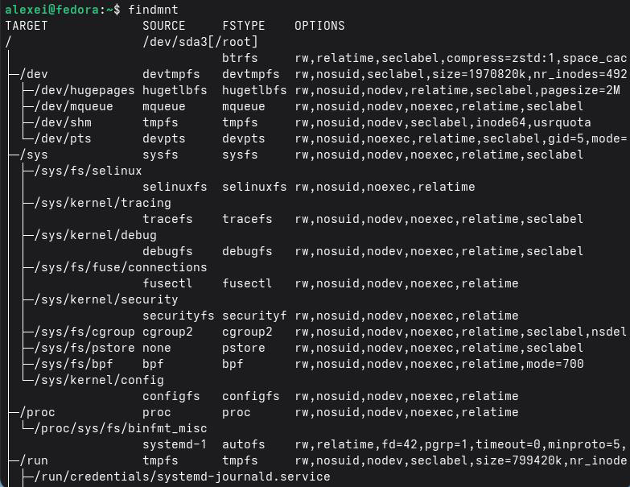

## 3. Как завершить заблокированный процесс?

Чтобы завершить процесс, который не отвечает или заблокирован, выполните следующие действия:

1. Определите процесс: Найдите PID (идентификатор процесса) заблокированного процесса.

```bash
ps aux | grep -i "process_name" # Поиск процесса по имени
top # Отображает запущенные процессы в реальном времени
htop # Улучшенная версия top (более интерактивная)
```

2. Завершите процесс:

| Команда  | Описание                                                   |
|----------|------------------------------------------------------------|
| kill -9  | <PID> Принудительно завершает процесс (без очистки)        |
| kill -15 | <PID> Безопасно завершает процесс (с возможностью очистки) |
| pkill    | <name> Завершает процесс по имени                          |
| killall  | <name> Завершает все процессы с определенным именем        |

Примеры:

```bash
kill -9 1234 # Принудительно завершает процесс с PID 1234
pkill firefox # Завершает все процессы Firefox
killall process_name # Завершает все процессы с указанным именем

```
## 4. Как установить свободное место в файловой системе?

Чтобы определить свободное место в файловой системе, используйте команду `df` (disk free):

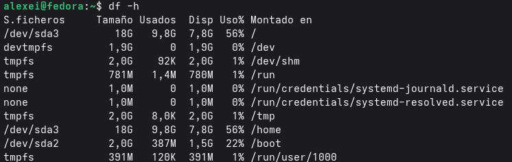

Опция `-h` (удобочитаемый формат) отображает размеры в удобочитаемых единицах
(КБ, МБ, ГБ) вместо блоков. Для каждой файловой системы отображается: общий размер,
используемое пространство, доступное пространство и точка монтирования.

## 5. Как просмотреть содержимое каталога?

Для просмотра содержимого каталога используйте команду `ls` (список):

- `ls`: Отображает файлы и каталоги в текущем каталоге
- `ls -l`: Отображает подробную информацию (права доступа, владелец, размер, дата)
- `ls -a`: Отображает все файлы, включая скрытые файлы (начинающиеся с точки)
- `ls -la`: Объединяет `-l` и `-a`
- `ls -R`: Рекурсивно отображает содержимое подкаталогов
- `ls -t`: Сортирует по дате изменения (от самых последних к самым старым)
- `ls -S`: Сортирует по размеру

## 6. Каково время доставки? Каковы некоторые из них?

Права доступа определяют, кто может читать, записывать или выполнять файл или каталог в Linux. Каждый файл и каталог имеют три набора прав доступа:

- Владелец (u) — пользователь, которому принадлежит файл
- Группа (g) — пользователи, принадлежащие к группе файла
- Другие (o) — все остальные пользователи

 Права доступа обозначаются следующими символами:

- r — чтение
- w — запись
- x — выполнение

Как изменить права доступа:

Права доступа изменяются с помощью команды chmod (изменить режим):

Символическая форма:

- chmod u+x file: Добавляет право на выполнение для владельца
- chmod g-w file: Удаляет право на запись для группы
- chmod o=r file: Устанавливает право только на чтение для остальных
- chmod a+rwx file: Предоставляет все права доступа всем

Числовая (восьмеричная) форма:

| Значение | Права доступа                               |
|----------|---------------------------------------------|
| 7        | rwx (чтение + запись + выполнение)          |
| 6        | rw- (чтение + запись)                       |
| 5        | r-x (чтение + выполнение)                   |
| 4        | r-- (только чтение)                         |
| 3        | -wx (запись + выполнение)                   |
| 2        | -w- (только запись)1-x (только выполнение)  |
| 0        | -x (нет прав доступа)                       |

bash
chmod 755 файл # rwxr-xr-x
chmod 644 файл # rw-r--r--
chmod 777 файл # rwxrwxrwx
chmod 700 файл # rwx------

## 7. Что такое команда ls -l?

В выводе команды ls -l первый символ в первом столбце указывает тип файла:

| Символ | Тип файла             |
|--------|-----------------------|
| -О     | бычный файл           |
| d      | Каталог               |
| l      | Символическая ссылка  |
| c      | Символьное устройство |
| b      | Блочное устройство    |
| p      | Именованный канал     |
| s      | Сокет                 |

Пример:

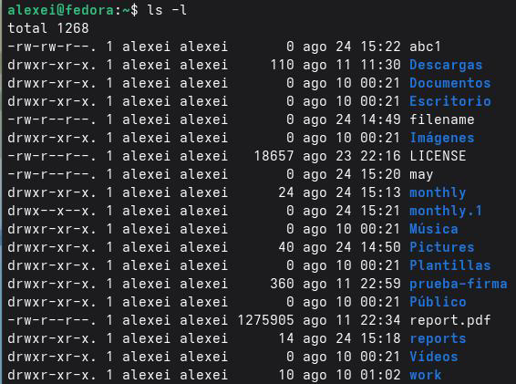

## 8. Последние версии команд для команды mv в Linux.

Команда mv (move) используется для перемещения или переименования файлов и каталогов. Ее основные функции:

1. Переименование файла в том же каталоге:

```bash
mv old_name new_name
```

2. Перемещение файла в другой каталог:

```bash
mv file.txt /path/to/directory/
```

3. Перемещение нескольких файлов в один каталог:

```bash
mv file1.txt file2.txt file3.txt /path/to/directory/
```

4. Переименование каталога:

```bash
mv old_directory new_directory
```

5. Перемещение каталога в другой каталог:

``` bash
mv source_directory /path/to/destination_directory/
```

Полезные параметры:

| Параметры  | Описание                                                        |
|------------|-----------------------------------------------------------------|
| -i         | Запрашивает подтверждение перед перезаписью существующего файла |
| -f         | Принудительное перемещение без запроса подтверждения            |
| -v         | Отображает подробную информацию о перемещаемом объекте.         |

## 9. Какую команду можно использовать для создания каталога?

Команда для создания каталогов в Linux — `mkdir` (создать каталог):

```bash
`mkdir directory_name`
Полезные параметры:
```

Полезные параметры:

|Параметры| Описание                                                                     |
|---------|------------------------------------------------------------------------------|
| `-p`    | Создает промежуточные каталоги, если они не существуют (создает всю иерархию)|
| `-m`    | Устанавливает права доступа к каталогу при его создании                      |

Примеры:

mkdir new_dir: Создает каталог с именем `new_dir`
mkdir -p dir1/dir2/dir3: Создает всю иерархию (dir1, dir2, dir3)
mkdir -m 700 private_dir: Создает каталог с правами rwx

---

## Выводы

В настоящее время сотрудники лаборатории называются фанатами. Они изучают систему Linux, её структуру и организацию каталога. Также они работали над практическими задачами с использованием команд дня: упросмотра файлов; cp ​ для копирования; mv для перемещения и переименования; chmod для управления правами доступа. Использовались также команды для анализа беспроводных систем: mount, df и fsck. Вместо отправленных элементов используются удаленные, используются недоработанные элементы. Это наиболее эффективная работа по системе Linux и её администрированию.

---

## Список литературы

- [Tsecurity. (2024). Общие полезные команды Linux.]((https://tsecurity.de/de/2387229IT+Programmierung/COMMON+USEFUL+LINUX+COMMANDS/)
- [LabEx. (2025). Файловая система Linux: навигация с помощью ls, mkdir, cp, mv, rm](https://labex.io/es/tutorials/linux-file-system-navigation-632797)
- [WikiEducator. (2025). Пользователь:ManuelRomero/ProgramacionWeb/ComandosLinux.](https://es.wikieducator.org/Usuario:ManuelRomero/ProgramacionWeb/ComandosLinux)
- [ArchWiki. (2026). Основные утилиты (испанский).](https://wiki.archlinux.org/title/Core_utilities_(Espa%C3%B1ol)
- [Справочный центр Oracle. (2024). Команды для администрирования файловой системы](https://docs.oracle.com/cd/E19253-01/819-7062/fsoverview-95856/index.html)
- [Справочная страница Ubuntu. (2023). fstab(5) — статическая информация о файловых системах.](https://manpages.ubuntu.com/manpages/jammy/es/man5/fstab.5.html)
- [S'Arreplec. (2025). 4.3. — Команды для работы с файлами.](https://sarreplec.caib.es/pluginfile.php/10571/mod_resource/content/10/DAM_SI05_Contenidos_Web/43_comandos_de_ficheros.html)
- [Network World. (2023). Понимание типов файловых систем Linux.](https://www.networkworld.com/article/972156/understanding-linux-file-system-types.html)
- [Alibaba Cloud. (2026). Проверка и восстановление файловой системы Linux](https://www.alibabacloud.com/help/en/ecs/user-guide/how-to-check-and-fix-the-file-systems-of-linux-instances)
- [Network World. (2023). Понимание типов файловых систем Linux.](https://www.networkworld.com/article/972156/understanding-linux-file-system-types.html)
- [Страница руководства Ubuntu. (2023). fstab(5) — статическая информация о файловых](системах.[https://manpages.ubuntu.com/manpages/jammy/es/man5/fstab.5.html)
