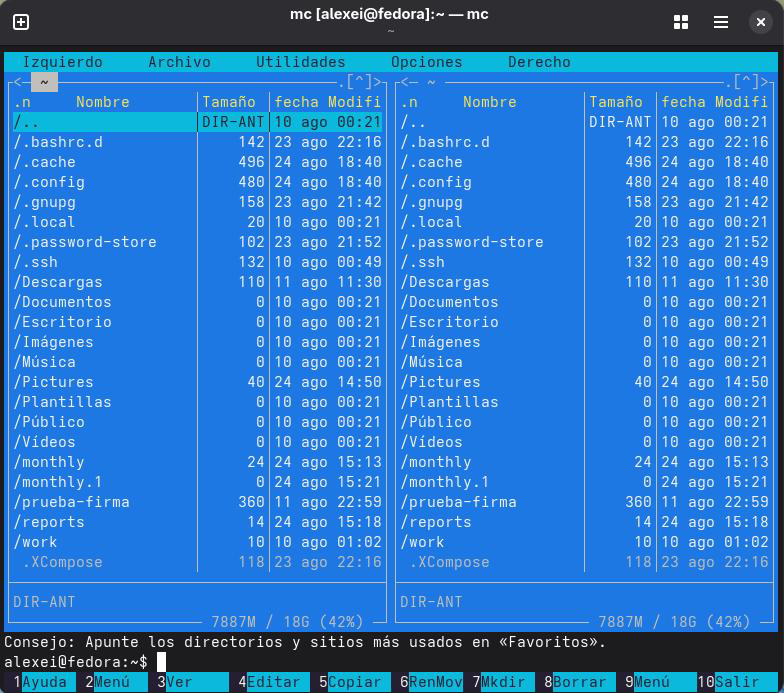

## Author
author:
name: Ромеро Гаспар Фернандо Алексей
degrees: DSC
orcid: 0009-0004-8816-345X
email: 1132255520@rudn.ru
affilition:
 - name: Рщссийский университет дружбы народов
   country: Российская  Федерфция
   postal-code: 117198
   city: Москва
   address: ул. Миклухо-Маклая д. 21к3

## Title
title: "Отчёт по лабораторной работе № 9"
subtitle: "Файловый менеджер Midnight Commander"
license: "CC BY"
abstract: |
  В данном отчёте представлены результаты выполнения лабораторной работы по теме: освоение возможностей командной оболочки Midnight Commander.

  Описаны работа с двумя панелями, режимы отображения, операции с файлами и каталогами, встроенный редактор mcedit и настройка интерфейса.

  Сделаны выводы о достижении поставленной цели и о преимуществах использования визуального файлового менеджера в терминале.
keywords: [Midnight Commander, mc, файловый менеджер, mcedit, панели, Linux]
---

## Введение

1. Цель работы
2. Теоретические сведения
> 2.1. Общие сведения о Midnight Commander
> 2.2. Режимы отображения панелей и управление ими
> 2.3. Панель меню
> 2.3.1. Меню «Файл»
> 2.3.2. Меню «Команда»
> 2.3.3. Меню «Настройки»
3. Задание и последовательность выполнения работы
> 3.1. Работа с панелями mc
> 3.2. Работа с файлами
> 3.3. Работа с меню «Команда»
> 3.4. Работа с меню «Настройки»
> 3.5. Работа с редакторо мmc
>3.6. Работа с файлами исходного кода
4. Контрольныевопросы
5. Выводы
6. Список литературы

---

# Цель работы

Целью данной лабораторной работы является освоение основных возможностей командной оболочки Midnight Commander. В ходе работы необходимо приобрести навыки практической работы по просмотру каталогов и файлов, а также по манипуляциям с ними.

---

# Теоретическиесведения

В этом разделе представлены теоретические основы визуального интерфейса Midnight Commander (mc), важного инструмента для управления файлами в системах Unix/Linux, а также его функции и режимы работы.

## 2.1 Общие сведения о Midnight Commander

Midnight Commander, широко известный как mc, — это визуальный файловый менеджер с открытым исходным кодом, разработанный для терминальных сред в Unix- подобных системах. В отличие от традиционных команд терминала, требующих ввода команд, mc предоставляет псевдографический интерфейс, облегчающий навигацию и управление файлами с помощью функциональных клавир и меню. Он основан на текстовых интерфейсных библиотеках, таких как ncurses и S-Lang, что позволяет ему работать на локальных консолях, эмуляторах терминала под X11 и удалённых SSH-соединениях. Его дизайн вдохновлён популярным файловым менеджером Norton Commander из эпохи DOS, стремясь предложить «графический» опыт управления файлами без необходимости использования графической среды рабочего стола.

При запуске из терминала интерфейс mc имеет двухпанельную вертикальную компоновку, отображающую содержимое двух разных каталогов одновременно. Такое расположение является основополагающим для его рабочего процесса, облегчая копирование и перемещение файлов между местоположениями. В дополнение к базовой навигации, mc включает в себя встроенные инструменты, такие как средство просмотра файлов (mcview), текстовый редактор (mcedit) и инструмент сравнения файлов (mcdiff).

## 2.2. Режимы отображения панелей и управление ими

Две панели в mc являются центральным элементом программы и могут быть настроены для отображения информации в различных режимах, адаптируясь к потребностям пользователя.

- Стандартный список: это режим по умолчанию, отображающий список файлов и каталогов в текущем каталоге. Отображаемая информация обычно включает имя, размери дату изменения.
- Информация: в этом режиме отображается подробная информация о файле, выбранном в активной панели, такая как права доступа, владелец, группа, размер, а также даты доступа и изменения.
- Дерево: в этом режиме отображается иерархическое представление структуры каталогов
системы, что облегчает навигацию по различным уровням каталогов более наглядным способом.
- Быстрый просмотр: в этом режиме панель становится средством просмотра, отображающим содержимое файла, выбранного в другой панели, что позволяет быстро просмотреть его содержимое.

Для навигации и управления панелями используются сочетания клавиш:

- Tab: позволяет переключать фокус с одной панели на другую.
- Ctrl-u: меняет местами содержимое двух панелей.
- Ctrl-o: Временно скрывает панели, чтобы отобразить вывод нижележащего терминала.

## 2.3.Панель меню

Основные функции mc организованы через верхнее меню, доступное с помощью клавиши F9, которое содержит следующие пункты: «Влево», «Файл», «Командная строка», «Параметры» и «Вправо». Большинство операций также можно выполнять с помощью функциональных клавиш.

## 2.3.1. Меню «Файл»

меню «Файл» объединяет основные операции с файлами и каталогами, которые активируются функциональными клавишами от F1 до F10.

| Функциональная клавиша | Команда                   | Описание                                                             |
|------------------------|---------------------------|----------------------------------------------------------------------|
| F1                     | Справка                   | Открывает встроенную справку                                         |
| F2                     | Пользовательское меню     | Открывает настраиваемое пользователем меню.                          |
| F3                     | Вид                       | Отображает содержимое выбранного файла во внутреннем окне просмотра. |
| F4                     | Редактировать             | Открывает выбранный файл во внутреннем или внешнем редакторе.        |
| F5                     | Копировать                | Копирует выбранный(е) файл(ы) в каталог на другой панели.            |
| F6                     | Переименовать/Переместить | Перемещает или переименовывает(ют) выбранный(е) файл(ы).             |
| F7                     | Создать каталог           | Создаёт новый каталог.                                               |
| F8                     | Удалить                   | Удаляет выбранный файл или каталог.                                  |
| F10                    | Выход                     | Закрывает Midnight Commander.                                        |

Кроме того, mc позволяет создавать ссылки на файлы: Ctrl-x l создаёт физическую ссылку, а Ctrl-x s — символическую.

## 2.3.2. Меню «Команда»

В этом меню собраны более продвинутые инструменты управления и системные инструменты.

| Команда                  | Описание                                                                                 |
|--------------------------|------------------------------------------------------------------------------------------|
| Дерево каталогов         | Отображает структуру каталогов системы в панели.                                         |
| Найти файл               | Открывает диалоговое окно для поиска файлов в файловой системе по имени или содержимому. |
| Поменять местами панели  | Меняет местами содержимое двух панелей.                                                  |
| Сравнить каталоги        | Сравнивает содержимое каталогов, отображаемых в двух панелях.                            |
| История командной строки | Отображает список недавно выполненных команд оболочки.                                   |
| Избранный каталог        | Обеспечивает быстрый доступ к предопределенным каталогам.                                |

## 2.3.3. Меню «Настройки»

Меню «Параметры» позволяет настраивать внешний вид и поведение mc.

| Команда                    | Описание                                                                                                           |
|----------------------------|--------------------------------------------------------------------------------------------------------------------|
| Конфигурация               | Открывает диалоговое окно для настройки общих параметров, таких как панели, командная строка и поведение программ. |
| Внешний вид                | Позволяет изменить цветовую схему интерфейса (скины).                                                              |
| Редактор файлов расширений | Определяет, какие программы запускаются при открытии файлов с определёнными расширениями.                          |
| Редактор меню              | Позволяет настроить пользовательское меню, открывающееся при нажатии клавиши F2.                                   |

## Задание и последовательность выполнения работы

В этом разделе представлены задания, которые необходимо выполнить, и подробные инструкции по работе с Midnight Commander (mc) для управления файлами и директориями в операционной системе Linux.

## 3.1. Работа с панелями mc

Шаг 1: Запустите Midnight Commander

Шаг 2: Изучите панели и режимы отображения

- Переключение между панелями: Нажмите Tab.
- Смена панелей: Ctrl-u.
- Скрытие панелей: Ctrl-o (отображает терминал; нажмите еще раз, чтобы вернуться).

Шаг 3: Изменение режима отображения панели

1. Нажмите F9, чтобы открыть меню.
2. Выберите Левая или Правая → Режим списка....
3. Попробуйте разные режимы:
a) Стандартный (стандартный вид)
b) Краткий (сводный вид)
c) Подробный (подробный вид с правами доступа, размером, датой)
d) Пользовательский (пользовательский вид)

Шаг 4: Сравнение каталогов

1. Убедитесь, что две панели отображают разные каталоги.
2. Нажмите F9 → Command → Сравнить каталоги (или Ctrl-x d).

## 3.2.Работа с файлами

Шаг 1: Создание каталога

- Выберите панель, в которой вы хотите создать каталог.
- Нажмите F7.
- Введите имя каталога (например, newdir) и нажмите Enter.

Шаг 2: Создание текстового файла

- F9 → Файл → Создать (или используйте встроенный редактор с помощью F4).
- Введите имя файла (например, text.txt) и нажмите Enter.
- Введите текст, сохраните файл с помощью F2 и выйдите с помощью F10.

Шаг 3: Копирование файлов

1. Выберите файл с помощью клавиш со стрелками.
2. Нажмите F5 (Копировать).
3. В появившемся диалоговом окне при необходимости измените целевой каталог.
4. Нажмите Enter для копирования.

Шаг 4: Перемещение/переименование файлов

- Выберите файл и нажмите F6.
- В диалоговом окне введите новое имя или путь. *Нажмите Enter.

Шаг 5: Удаление файлов или папок

- Выберите файл или папку и нажмите F8.
- Подтвердите удаление.

Шаг 6: Просмотр информации о файле

- Выберите файл.
- F9 → Файл → Информация о файле (или Ctrl+X + i).

## 3.3. Работа с меню «Команда»

Шаг 1: Поиск файлов

1. F9 → Command → Найти файл (или Ctrl+X F).
2. Введите имя файла для поиска (например, *.txt).
3. Выберите каталог поиска.
4. Нажмите Enter, чтобы начать поиск.

Шаг 2: Просмотр истории команд

- F9 → Command → История командной строки.

Шаг 3: Доступ к избранным каталогам

- F9 → Command → Список избранных каталогов (или Ctrl+\).
- Добавьте каталог в список и проверьте быструю навигацию.

Шаг 4: Просмотр дерева каталогов

- F9 → Command → Дерево каталогов.

## 3.4.Работасменю «Настройки»

Шаг 1: Настройка внешнего вида MC

1. F9 → Параметры → Настройки.
2. Попробуйте разные варианты:
a) Полноэкранный режим
b) Двойная ширина
c) Показать скрытые файлы
3. Примените изменения и посмотрите на результат.

Шаг 2: Изменение цветовой схемы

- F9 → Параметры → Внешний вид.
- Попробуйте разные цветовые схемы.

Шаг 3: Настройка редактора

- F9 → Параметры → Настройки редактора.
- Изучите доступные параметры.

## 3.5. Работа с редактором mc

Шаг 1: Создайте файл text.txt

bash
touch text.txt

Шаг 2: Откройте файл в редакторе MC

- Выделите файл text.txt.
- Нажмите F4, чтобы открыть его во встроенном редакторе.

Шаг 3: Вставьте текст в файл

1. Скопируйте фрагмент текста (из другого файла, интернета или наберите абзац).
2. Вставьте его в редактор, используя Ctrl+Вставка или Shift+Вставка.

Шаг 4: Редактируйте текст

- Удалите строку: установите курсор на строку и нажмите Ctrl+Y.
- Cкопируйте фрагмент текста: выделите его мышью или используйте Shift + клавиши со стрелками, затем нажмите F5 для копирования.
- Переместите фрагмент текста: выделите его, затем нажмите F6 для перемещия (вырезать и вставить).
- Сохраните файл: нажмите F2.
- Отменить последнее действие: Ctrl-U (в редакторе).

Шаг 5: Перемещение по файлу

- Перейти в конец файла: Ctrl-End (или Alt-/).
- Перейти в начало файла: Ctrl-Home (или Alt-*).
- Найти текст: F7.
- Заменить текст: F4 (в редакторе).

Шаг 6: Сохранить и закрыть файл

- Сохранить: F2.
- Выйти из редактора: F10.

## 3.6. Работа с файлами исходного кода

Шаг 1: Откройте файл исходного кода

- Выберите файл с расширением .c, .cpp, .java, .py и т. д.
- Нажмите F4, чтобы открыть его во встроенном редакторе.

Шаг 2: Включите/отключите подсветку синтаксиса

- В редакторе нажмите F9 → Подсветка синтаксиса.
- Включите или отключите её по мере необходимости.

Шаг 3: Просмотрите файл во встроенном средстве просмотра

- Выберите файл.
- Нажмите F3, чтобы просмотреть его без редактирования.

# Контрольные вопросы

В этом разделе представлены ответы на контрольные вопросы о Midnight Commander (mc), которые позволят вам проверить ваше понимание его функциональных возможностей и
режимов работы.

## 1. Какие рабочие процессы существуют в Midnight Commander? Ознакомьтесь с ними.

Midnight Commander предлагает несколько режимов отображения панели, которые можно настроить в соответствии с потребностями пользователя:

- Стандартный список: Это режим по умолчанию, отображающий список файлов и каталогов в текущем каталоге с их именем, размером и датой изменения.
- Информация: Отображает подробную информацию о текущем выбранном файле на активной панели, такую как права доступа, владелец, группа, размер, а также даты доступа и изменения.
- Дерево: Отображает иерархическое представление структуры каталогов системы, облегчая визуальную навигацию.
- Быстрый просмотр: Превращает панель в средство просмотра, отображающее содержимое файла, выбранного на другой панели, что позволяет быстро просмотреть его содержимое.

## 2.Действие этих устройств заключаетсявудалении командной оболочки. Что такоеменю (комбинацияклавиш) mc? Добропожаловатьнапервыенесколькостраниц.

Операции с файлами можно выполнять с помощью команд оболочки, а также через меню и функциональные клавиши в mc. Примеры:

| Операция                  | Команда оболочки       | В mc |
|---------------------------|------------------------|------|
| Копировать файл           | cp источник назначения | F5   |
| Переместить/Переименовать | mv источник назначения | F6   |
| Создать каталог           | mkdir имя              | F7   |
| Удалить файл              | rm файл                | F8   |
| Просмотреть содержимое    | cat файл               | F3   |
| Редактировать файл        | nano файл              | F4   |

## 3. Опишите структуру меню левой (или правой) панели mc, дайте краткую характеристику команды.

Меню панели (Влево/Вправо) активируется клавишей F9 и содержит следующие основные опции:

- Режим списка... (Режим списка): Позволяет изменить формат отображения панели (Стандартный, Краткий, Длинный, Пользовательский).
- Порядок сортировки... (Порядок сортировки): позволяет сортировать файлы по имени, расширению, размеру, дате изменения и т. д.
- Фильтр... (Фильтр): позволяет отображать только те файлы, которые соответствуют определенному шаблону (маске).
- Дерево (Дерево): переключает панель в режим дерева каталогов.
- Быстрый просмотр (Быстрый просмотр): активирует быстрый предварительный просмотр выбранного файла.
- Информация (Информация): Отображение подробной информации о выбранном файле.

## 4. Опишите структуру меню Файл mc, дайте краткую рактеристику commanders.

Меню «Файл» группирует основные операции с файлами и каталогами:

| Клавиша | Команда                   | Описание                                       |
|---------|---------------------------|------------------------------------------------|
| F1      | Справка                   | Открывает встроенную справку                   |
| F2      | Пользовательское меню     | Открывает настраиваемое пользователем меню     |
| F3      | Вид                       | Отображает содержимое выбранного файла         |
| F4      | Редактировать             | Открывает файл во встроенном редакторе         |
| F5      | Копировать                | Копирует выбранные файлы на другую панель      |
| F6      | Переименовать/Переместить | Перемещает или переименовывает выбранные файлы |
| F7      | Создать каталог           | Создаёт новый каталог                          |
| F8      | Удалить                   | Удаляет выбранные файлы или каталоги           |
| F10     | Выход                     | Закрывает Midnight Commande                    |

## 5. Опишите структуру меню Команды mc, дайте краткую актеристику commanders.

Меню Команды (Команда) содержит расширенные инструменты управления:

- Дерево каталогов (Directory tree): Отображает структуру каталогов системы.
- Найти файл: Открывает диалоговое окно для поиска файлов по имени или содержимому.
- Поменять местами панели: Меняет местами содержимое двух панелей (Ctrl-u).
- Сравнить каталоги: Сравнивает содержимое каталогов в обеих панелях (Ctrl-x d).
- История: Отображает недавно выполненные команды оболочки (Meta-h). Быстрый доступ к каталогам (Hotlist): Обеспечивает быстрый доступ к избранным каталогам (Ctrl-\).

6. Опишите структуру меню Настройки mc, дайте краткую характеристику команды.

Меню «Параметры» (Настройки) позволяет настроить поведение и внешний вид mc:

- Конфигурация (Configuration): настройка общих параметров, таких как полноэкранный режим, двойная ширина, отображение скрытых файлов и т. д.
- Внешний вид (Внешний вид): Изменение цветовой схемы (скинов) интерфейса.
- Редактировать расширения файла (Редактировать файл расширения): определяет, какие программы запускать при открытии файлов с определенными расширениями.
- Редактировать файл меню (Редактировать файл меню): настраивает пользовательское меню, которое открывается с помощью F2.

## 7. Назовите и задайте характеристики Midnight Commander (mc).

Midnight Commander включает в себя несколько встроенных инструментов, доступных через его интерфейс:

- Просмотрщик файлов (mcview): Активируется клавишей F3, позволяет просматривать содержимое файлов без возможности их редактирования. Поддерживает различные режимы отображения (текстовый, шестнадцатеричный).
- Текстовый редактор (mcedit): Активируется клавишей F4, позволяет редактировать текстовые файлы с помощью таких функций, как копирование, вырезание, вставка,
поиск и замена.
- Сравнитель файлов (mcdiff): Позволяет сравнивать содержимое двух файлов одновременно (Ctrl+X+D). Поиск файлов: Позволяет искать файлы по имени или содержимому в системе (Ctrl-x f).

## 8. Назовите и задайте характеристики редактора mc.

Встроенный редактор mc (mcedit) предлагает следующие функции:

| Команда   | Описание                                          |
|-----------|---------------------------------------------------|
| F2        | Сохранить файл                                    | 
| F3        | Найти текст                                       |
| F4        | Заменить текст                                    |
| F7        | Найти (в редакторе)                               |
| F10       | Выйти из редактора                                |
| Ctrl-Y    | Удалить текущую строку                            |
| Ctrl-U    | Отменить последнее действие                       |
| F5        | Скопировать выделенный блок                       |
| F6        | Переместить выделенный блок (вырезать и вставить) |
| Ctrl-Home | Перейти в начало файла                            |
| Ctrl-End  | Перейти в конец файла                             |
| Shift-F4  | Создать новый файл                                |

## 9. Дайте характеристики средств mc, которые позволяют создать меню, соответствующее пользовательскому интерфейсу.

Midnight Commander позволяет настраивать пользовательское меню, открывающееся при нажатии клавиши F2, путем редактирования файла меню. Это меню может содержать определяемые пользователем команды и действия для автоматизации часто выполняемых задач.

Для редактирования:

1. Нажмите F9 → Command → Редактировать файл меню (или F9 → Параметры → Редактировать файл меню).
2. Это откроет файл конфигурации меню, где вы можете определить пользовательские записи, используя соответствующий синтаксис.

Вы также можете настроить ассоциации файлов (расширения), чтобы определить, какая программа запускается при открытии файлов с определенными расширениями. Это делается нажатием F9 → Параметры → Редактировать файл расширений.

## 10. Благодаря особенностям MC, они могут использоваться для действий, определяемых пользователем, над текущими файлами.

Действия, определяемые пользователем, над текущим файлом могут выполняться следующими способами:

3. Пользовательское меню (F2): Позволяет выполнять пользовательские команды над выбранным файлом. В файле меню можно определить несколько пунктов.

4. Файл расширений файлов (mc.ext): Определяет автоматические действия на основе расширения файла. Например, открытие файла .txt в определенном редакторе или запуск скрипта для файлов .sh.

5. Команды оболочки из командной строки: В нижней части mc можно ввести и выполнить любую команду оболочки над выбранным файлом.
6. Стандартные функциональные клавиши: F3 (просмотр), F4 (редактирование), F5 (копирование), F6 (перемещение/переименование), F8 (удаление).

---

# Выводы

В ходе выполнения лабораторной работы я освоил основные возможности командной оболочки Midnight Commander. Я научился работать с двумя панелями, изменять режимы их отображения (стандартный, информация, дерево, быстрый просмотр) и управлять ими с помощью функциональных клавиш и комбинаций клавиш. Я приобрел практические навыки
выполнения операций с файлами и каталогами: копирование, перемещение, переименование, создание и удаление, как через меню, так и через команды shell. Также я изучил структуру меню mc (Файл, Команда, Настройки) и освоил работу со встроенным редактором, включая операции с текстом, навигацию и настройку подсветки синтаксиса. Все поставленные задачи выполнены, полученные навыки являются основой для эффективной работы с файловой системой в командной оболочке Midnight Commander.

---

# Список литературы

- [ArchWiki. (2026). Midnight Commander.]
(https://wiki.archlinux.org/title/Midnight_Commander)
- [Ubuntu Manpages. (s.f.). mc(1) - Midnight Commander.](https://manpages.ubuntu.com/manpages/stonking/es/man1/mc.1.html)
- [Debian Manpages. (2025). mc(1) — mc-data — Debian bookworm-backports.](https://manpages.debian.org/bookworm-backports/mc-data/mc.1.es.html)
- [Arch manual pages. (s.f.). mc(1).](https://man.archlinux.org/man/extra/mc/mc.1.es)
- [Red Hat. (2022, 5 октября). Замените свой файловый менеджер Linux на Midnight Commander.](https://www.redhat.com/en/blog/midnight-commander-file-manager)
- [Storage-Insider. (2025, 16 июля). Эффективное обновление данных для Linux и macOS на консоли.](https://www.storage-insider.de/)
- [Полуночный командир. (2026). Часто задаваемые вопросы.](http://midnight-commander.org/wiki/ru/faq)
- [СтадФайлы. (с.ф.). 5.3 Процедуры контроля.](https://studfile.net/preview/5083017/page:12/)
- [СтадФайлы. (с.ф.). 4.4 Содержание отчета.](https://studfile.net/preview/5083017/page:9/)
- [ВУнивере.ру. (с.ф.). Контроль и процедуры лабораторных испытаний № 2 «Программа Midnight Commander».](https://vunivere.ru/work28143)
- [Полуночный командир. (2025). mc/doc/FAQ на GitHub.](https://github.com/MidnightCommander/mc)
