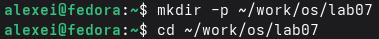
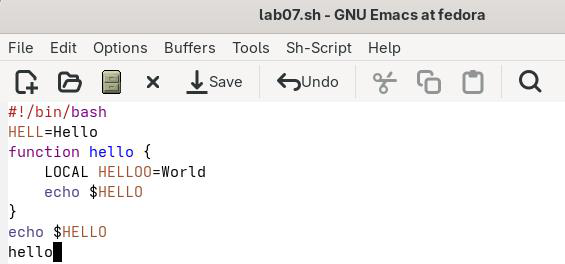

## Author
author:
name: Ромеро Гаспар Фернандо Алексей
degrees: DSC
orcid:0009-0004-8816-345X
email: 1132255520@rudn.ru
affilition:
 - name: Рщссийский университет дружбы народов
   country: Российская  Федерфция
   postal-code: 117198
   city: Москва
   address: ул. Миклухо-Маклая д. 21к3

## Title
title: "Отчёт по лабораторной работе № 11"
subtitle: "Текстовый редактор GNU Emacs"
license: "CC BY"
abstract: |
  В данном отчёте представлены результаты выполнения лабораторной работы по теме: освоение текстового редактора GNU Emacs.

  Описаны основные термины Emacs (буфер, фрейм, окно, минибуфер), команды перемещения курсора, работы с текстом, управления буферами и окнами, а также поиск и замена текста.

  Сделаны выводы о достижении поставленной цели и о преимуществах Emacs как расширяемой среды разработки.
keywords: [Emacs, GNU Emacs, буфер, окно, минибуфер, Elisp, редактирование]
---

# Введение

1. Цель работы
2. Теоретические сведения
> 2.1. Основные термины Emacs
> 2.1.1. Буфер
> 2.1.2. Фрейм
> 2.1.3. Окно
> 2.1.4. Область вывода
> 2.1.5. Минибуфер
> 2.1.6. Точка вставки
> 2.2. Основы работы en Emacs
> 2.3. Команды перемещения курсора
> 2.4. Текстовые команды
> 2.5. Текстовые команды с текстовыми областями
> 2.6. Поиск и замена текста
> 2.7. Управление файлами, буферами и окнами
3. Задание и последовательность выполнения работы
> 3.1. Создание и редактирование файлов
> 3.2. Работа с текстом (вырезание, копирование, вставка)
> 3.3. Перемещение курсора
> 3.4. Управление буфером
> 3.5. Управление окнами
> 3.6. Поиск и замена текста
4. Контрольные вопросы
5. Выводы
6. Список литературы

---

# Цель работы

Целью данной лабораторной работы является знакомство с операционной системой Linux и получение практических навыков работы с редактором Emacs.

---

# Теоретические сведения

В этом разделе представлены фундаментальные концепции редактора Emacs, его терминология и основные команды, необходимые для понимания принципов работы с этим мощным инструментом.

## 2.1 Основные термины Emacs

Emacs оперирует специфическими понятиями, которые отличаются от терминологии обычных текстовых редакторов. Понимание этих терминов является ключевым для эффективной работы .

## 2.1.1 Буфер

Буфер в Emacs — это объект, представляющий собой какой-либо текст. Буфер может содержать что угодно: текст редактируемого файла, результаты работы программы, встроенные подсказки или любую другую информацию. Важно понимать, что буфер не обязательно связан с файлом на диске — это самостоятельная сущность в памяти .

## 2.1.2 Фрейм

Фрейм соответствует окну в обычном понимании этого слова в графических средах. Каждый фрейм содержит область вывода и одно или несколько окон Emacs . При работе в терминале фрейм занимает весь экран, а в графическом режиме может быть отдельным окном системы.

## 2.1.3. Окно

Окно в Emacs — это прямоугольная область внутри фрейма, которая отображает один из буферов . Каждое окно имеет свою строку состояния (mode line), которая показывает название буфера, его основной режим, статус изменения текста и позицию курсора. Окна можно делить по горизонтали и вертикали, создавая удобную рабочую среду .

## 2.1.4. Область вывода

Область вывода — это одна или несколько строк в нижней части фрейма, где Emacs отображает различные сообщения, запрашивает подтверждения и дополнительную информацию от пользователя .

## 2.1.5. Минибуфер

Минибуфер используется для ввода дополнительной информации (например, имени файла, строки поиска или команды) и всегда отображается в области вывода.

## 2.1.6. Точка вставки

Точка вставки — это место в буфере, где Emacs вставляет или удаляет данные. В Emacs точку часто называют point. Её положение определяет, куда будут применяться команды редактирования

## 2.2. Основы работы en Emacs

Emacs использует комбинации клавиш с модификаторами для выполнения команд. Основные модификаторы:

- C- — клавиша Ctrl (Control)
- M- — клавиша Meta (Alt или Esc в зависимости от терминала)
- S- — клавиша Shift

Комбинации клавиш принято называть префиксными. Например, C-x — это префикс для команд управления файлами и буферами, а C-c — для команд, зависящих от активного режима.

Ключевая особенность Emacs — его расширяемость. Режимы (major modes) изменяют поведение редактора в зависимости от типа редактируемого файла (например, режим C, режим Lisp или режим текста), добавляя специализированные команды и подсветку синтаксиса .

## 2.3. Команды перемещения курсора

Для перемещения point используются следующие комбинации:

- C-f — переместиться на один символ вперёд
- C-b — переместиться на один символ назад
- C-n — переместиться на одну строку вниз
- C-p — переместиться на одну строку вверх
- C-a — переместиться в начало строки
- C-e — переместиться в конец строки
- M-f — переместиться на одно слово вперёд
- M-b — переместиться на одно слово назад
- M-< — переместиться в начало буфера
- M-> — переместиться в конец буфера
- C-v — переместиться на одну страницу вниз
- M-v — переместиться на одну страницу вверх

Следует отметить, что Emacs предоставляет альтернативные способы навигации, но использование этих комбинаций часто более эффективно, чем работа с мышью или клавишами стрелок.

## 2.4. Текстовые команды

- C-d — удалить символ под курсором
- M-d — удалить слово после курсора
- C-k — удалить текст от курсора до конца строки
- M-k — удалить текст от курсора до конца предложения
- C-q — вставить управляющий символ

## 2.5. Текстовые команды с текстовыми областями

Для работы с выделенными областями:

- C-space — начать выделение текста
- C-w — вырезать выделенную область
- M-w — копировать выделенную область
- C-y — вставить текст из буфера обмена

## 2.6. Поиск и замена текста

Emacs предоставляет мощные возможности поиска:

- C-s — инкрементальный поиск вперёд
- C-r — инкрементальный поиск назад
- M-% — поиск и замена с подтверждением

Инкрементальный поиск (C-s) позволяет искать текст по мере ввода, сразу показывая совпадения. Во время поиска можно переключаться между найденными совпадениями клавишей C-s. Для выхода из режима поиска используется C-g. В режиме поиска можно использовать регулярные выражения, переключаясь с помощью M-r . Команда M-% запускает режим поиска с заменой: после ввода искомого текста и текста замены, Emacs поочерёдно подсвечивает совпадения, позволяя подтвердить (y) или пропустить (n) каждую замену.

## 2.7. Управление файлами, буферами и окнами

- C-x C-f — открыть файл (find-file)
- C-x C-s — сохранить буфер в файл
- C-x C-b — показать список буферов
- C-x b — переключиться на другой буфер
- C-x 2 — разделить окно по горизонтали
- C-x 3 — разделить окно по вертикали
- C-x o — переключиться на другое окно
- C-x 0 — закрыть текущее окно
- C-x 1 — оставить только текущее окно
- C-x C-c — выйти из Emacs

При открытии файла (C-x C-f) Emacs создаёт буфер с содержимым файла. Все изменения происходят в буфере; для сохранения изменений на диск используется C-x C-s. Список активных буферов позволяет управлять несколькими одновременно открытыми файлами, а переключение между ними осуществляется с помощью C-x b. Разделение окон (C-x 2 и C-x 3) позволяет просматривать несколько буферов одновременно, а C-x o перемещает фокус между ними.

# Задание y последовательность выполнения работы

В этом разделе представлены задания, которые необходимо выполнить, и подробные инструкции по работе с редактором Emacs для создания, редактирования и управления файлами в операционной системе Linux.

## 3.1. Создание и редактирование файлов

Шаг 1: Создайте каталог для лабораторной работы

Шаг 2: Откройте Emacs

Шаг 3: Создайте файл lab07.sh

Нажмите Ctrl+x, Ctrl+f.

В мини-буфере введите: ~/work/os/lab07/lab07.sh и нажмите Enter.

Шаг 4: Запишите содержимое файла

## 2. Работа с текстом (вырезание, копирование, вставка)

Шаг 1: Вырезать всю строку

- Поместите курсор на строку с текстом `echo $HELLO` (строка 7).
- Нажмите Ctrl+K, чтобы вырезать (удалить) текст от курсора до конца строки.
- Строка будет удалена и сохранена в кольце удаления.

Шаг 2: Вставить строку в конец файла

- Переместите курсор в конец файла (M->).
- Нажмите Ctrl+Y, чтобы вставить вырезанную строку.

Шаг 3: Выделить и скопировать область

- Переместите курсор в начало строки `hello` (строка 6).
- Нажмите Ctrl+Space, чтобы начать выделение.
- Переместите курсор в конец строки `echo $HELLO` (строка 8).
- Нажмите Ctrl+W, чтобы скопировать выделенную область.

Шаг 4: Вставить область в конец файла

- Переместите курсор в конец файла (M->).
- Нажмите Ctrl+Y, чтобы вставить область.

Шаг 5: Вырезать область

- Снова выделите ту же область (строки 6-8) с помощью клавиши C-пробел.
- Нажмите C-w, чтобы вырезать область.

Шаг 6: Отменить последнее действие

- Нажмите C-/ (Ctrl+/), чтобы отменить вырезание.

## 3.3. Перемещение курсора

Шаг 1: Переместите курсор в начало текущей строки

- Поставьте курсор в любое место строки.
- Нажмите C-a.

Шаг 2: Переместите курсор в конец текущей строки

- Нажмите C-e.

Шаг 3: Переместите курсор в начало буфера

- Нажмите M-< (Alt+Shift+< или Esc <).

Шаг 4: Переместите курсор в конец буфера

- Нажмите M-> (Alt+Shift+> или Esc >).

Шаг 5: Перемещайтесь по словам

- M-f — переместитесь на одно слово вперед.
- M-b — переместитесь на одно слово назад.

## 3.4. Управление буфером

Шаг 1: Отображение списка буферов

- Нажмите C-x C-b (Ctrl+x, Ctrl+b).
- Откроется новое окно со списком активных буферов.

Шаг 2: Переключение на другой буфер

- Нажмите C-x, чтобы переключить фокус на окно буферов.
- Перейдите к нужному буферу и нажмите Enter.

Шаг 3: Закрытие окна буферов

- Когда окно буферов находится в фокусе, нажмите C-x, чтобы закрыть его.

Шаг 4: Переключение буферов без отображения списка

- Нажмите C-x.
- В поле мини-буфера введите имя буфера, на который вы хотите переключиться.
- Нажмите Enter.

## 3.5. Управление окнами

Шаг 1: Разделите окно на несколько частей

1. Разделите окно на две вертикальные части:
a) Нажмите Ctrl+x, 3.
2. Разделите каждое окно горизонтально:
a) Выберите первое окно (Ctrl+x, 0) и нажмите Ctrl+x, 2.
b) Выберите второе окно (Ctrl+x, 0) и нажмите Ctrl+x, 2.

Шаг 2: Откройте буферы в новых окнах

В каждом окне нажмите Ctrl+x и выберите другой буфер.

- Введите несколько строк текста в каждом из них.

Шаг 3: Закройте все окна, кроме одного

- Выберите окно, которое хотите оставить открытым.
- Нажмите Ctrl+x, 1.

## 3.6. Поиск и замена текста

Шаг 1: Поиск текста с помощью C-s

- Нажмите C-s (Ctrl+s).
- Введите текст для поиска (например, HELLO).
- Нажимайте C-s несколько раз, чтобы перемещаться между совпадениями.
- Нажмите C-g, чтобы выйти из режима поиска.

Шаг 2: Поиск и замена с помощью M-%

- Нажмите M-% (Alt+Shift+5 или Esc %).
- В мини-буфере введите текст для поиска (например, HELLO).
- Нажмите Enter.
- В мини-буфере введите текст для замены (например, HOLA).
- Нажмите Enter.
- Emacs отобразит каждое совпадение и спросит:
- y — заменить и перейти к следующему.
- n — пропустить и перейти к следующему.
- ! — заменить все без подтверждения.
- q — выйти.

Шаг 3: Поиск с помощью M-s o

- Нажмите M-s o (Alt+s, o).
- Введите текст, который хотите найти (например, hello).
- Все строки, содержащие искомый текст, будут отображены в отдельном окне.

# Контрольные вопросы

В этом разделе представлены ответы на контрольные вопросы о редакторе Emacs,которые позволят вам проверить ваше понимание его терминологии, команд и функций.

## 1. Кратко охарактеризуйте редактор emacs.

Emacs (GNU Emacs) — это расширяемый и настраиваемый текстовый редактор,mсозданный Ричардом Столлманом в 1970-х годах. Он написан на C и Elisp (Emacs Lisp),
диалекте языка Lisp, который позволяет пользователям расширять и изменять практически все его функции. Он работает на нескольких платформах (Linux, macOS, Windows) и может функционировать как в терминальном режиме, так и в графическом интерфейсе. Основные особенности:

- Расширяемость: Пользователи могут добавлять новые функции, используя код Elisp.
- Самодокументация: Включает в себя очень подробную встроенную систему справки.
- Многорежимность:Поддерживает различные режимы для разных языков 
- Настраиваемость: Практически каждый аспект редактора может быть настроен.

Emacs — это гораздо больше, чем просто текстовый редактор; он считается полноценной средой разработки, поскольку позволяет пользователям читать электронные письма, перемещаться по каталогам, отлаживать код и выполнять множество других задач,не выходя из программы.

## 2. Какие особенности данного редактора могут сделать его сложным для новичка?

Emacs может быть сложным для новичка по нескольким причинам:

- Крутая кривая обучения: сочетания клавиш (например, C-x и C-s для сохранения) сильно отличаются от современных редакторов и требуют запоминания.
- Уникальная терминология: такие понятия, как буфер, фрейм, окно, точка и мини-буфер,могут поначалу сбивать с толку.
- Нестандартный интерфейс: отсутствие интуитивно понятных меню (или их сложность) может дезориентировать пользователей, привыкших к графическим редакторам.
- Избыточное количество опций: большое количество команд и настроек может перегрузить нового пользователя.
- Зависимость от клавиатуры: философия Emacs отдаёт приоритет использованию клавиатуры, а не мыши, требуя от пользователей изучения множества сочетаний клавиш.

## 3. Своими словами опишите, что такое буфер и окно в терминологии emacs'a.

- Буфер (Buffer): Буфер — это область в памяти, где Emacs хранит содержимое файла,временный текст или другую информацию (например, результаты поиска или справочные сообщения). Буфер не обязательно привязан к физическому файлу. Например, при открытии файла Emacs загружает его содержимое в буфер; когда файл закрывается без сохранения, буфер может по-прежнему существовать в памяти.
- Окно (Window): Это прямоугольная область на экране (или в фрейме), которая отображает содержимое буфера. Emacs позволяет разделить экран на несколько окон для одновременного отображения нескольких буферов. Окна могут динамически изменять размер, закрываться или переставляться, и каждое может отображать разный буфер или один и тот же буфер в разных позициях.

## 4. Можно ли открыть более 10 буферов в одном кадре?

Да, можно открыть более 10 буферов в одном кадре. Emacs не ограничивает количество одновременно открытых буферов. Фактически, буфер — это объекты памяти,которых может быть множество, даже десятки или сотни. Каждый буфер занимает память,но управление памятью в Emacs эффективно, и количество открытых буферов в основном ограничено системной памятью. Управлять несколькими буферами можно с помощью команд, таких как C-x C-b (для вывода списка), C-x b (для переключения между ними) и C-x k (для закрытия буфера).

## 5. Какие буфер создаются по умолчанию при запуске emacs?

При запуске Emacs по умолчанию создаётся несколько буферов:

- *GNU Emacs* — приветственный буфер, отображающий информацию об Emacs и начальные подсказки.
- *scratch* — буфер для быстрых заметок и для оценки выражений Lisp (scratchpad).
- *Messages* — буфер, записывающий системные сообщения и взаимодействие пользователя с Emacs.
- *Help* — создается при запросе справки (C-h).
- *Completions* — отображается во время автозавершения команд или имён файлов.
- *Minibuffer-0* — мини-буфер, куда вводятся команды и ответы.

## 6. Какие клавиши вы нажмете, чтобы ввести соответственно C-c | и C-c C-|?

В нотации Emacs C-c | означает:

- Удерживайте клавишу Ctrl.
- Нажмите клавишу C.
- Отпустите обе клавиши.
- Затем нажмите клавишу | (вертикальная черта). C-c C-| означает:
- Нажмите и удерживайте клавишу Ctrl.
- Нажмите клавишу c.
- Отпустите обе клавиши.
- Снова нажмите и удерживайте клавишу Ctrl.
- Нажмите клавишу | (вертикальная черта).

На практике:

- C-c | вводится как: Ctrl+c, затем |.
- C-c C-| вводится как: Ctrl+c, затем Ctrl+| (удерживая Ctrl и нажимая вертикальную черту).

## 7. Как разделить текущее окно?

- Чтобы разделить текущее окно:
- Разделить вертикально (одно окно слева и одно справа): C-x 3 (Ctrl+x, 3).
- Разделить горизонтально (одно окно сверху и одно снизу): C-x 2 (Ctrl+x, 2).

## 8. Где хранятся настройки редактора Emacs?

Конфигурации Emacs хранятся в файле инициализации .emacs или init.el,расположенном в домашнем каталоге пользователя (~/.emacs или ~/.emacs.d/init.el). Кроме того, существуют другие файлы конфигурации:

- ~/.emacs.d/ — основной каталог для пользовательских настроек.
- ~/.emacs.d/init.el — основной файл конфигурации.
- ~/.emacs — альтернативный (более старый) файл конфигурации.
- ~/.emacs.d/custom.el—файл, в котором Emacs автоматически сохраняет пользовательские настройки, созданные через графический интерфейс.

## 9. Удаляет ли клавиша Backspace (←) символ перед курсором? Можно ли его удалить?

Клавиша Backspace (←) в Emacs обычно удаляет символ перед курсором. Однако её поведение может варьироваться в зависимости от режима редактора. Да, её функциональность можно переопределить с помощью кода Elisp в конфигурационном файле (~/.emacs.d/init.el). Например, чтобы клавиша Backspace удаляла символ перед собой (как C-d), можно добавить:

elisp
(global-set-key (kbd "DEL") 'delete-char)

Где DEL — внутреннее представление клавиши Backspace. В качестве альтернативы можно использовать:

elisp
(global-set-key (kbd "<backspace>") 'delete-char)

## 10. Какой редактор, по вашему мнению, был полезен в этой статье: did I see emacs? Поясните почему.

Я обнаружил, что Emacs более интуитивно понятен благодаря графическому интерфейсу и меню, которые упрощают поиск команд. Возможность разделить экран на несколько окон и управлять буферами оказалась очень удобной для одновременной работы с несколькими файлами. Кроме того, возможность настройки редактора с помощью Elisp является значительным преимуществом для адаптации его к моим будущим потребностям. Однако у vi тоже есть свои преимущества: его скорость и доступность практически на всех системах Linux делают его незаменимым инструментом для быстрых задач и в средах без графического интерфейса.

---

# Выводы

В ходе выполнения лабораторной работы я познакомился с операционной системой Linux и получил практические навыки работы с редактором Emacs. Я изучил основные термины редактора (буфер, фрейм, окно, область вывода, минибуфер), освоил базовые команды перемещения курсора (C-f, C-b, C-n, C-p, C-a, C-e, M-<, M->), редактирования текста (C-k, C-d, M-d), работы с областями текста (C-space, C-w, M-w, C-y), а также управления буферами (C-x C-b, C-x b), окнами (C-x 2, C-x 3, C-x o) и поиска (C-s, M-%). Я создал и отредактировал файл lab07.sh, применяя изученные команды, и научился эффективно управлять несколькими буферами и окнами одновременно. Все поставленные задачи выполнены, полученные навыки являются основой для работы с текстовыми файлами в среде Emacs.

---

## Список литературы

- [FФонд свободного программного обеспечения. (2024). Руководство по GNU Emacs.](https://www.gnu.org/software/emacs/manual/emacs.html)
- [Вики Arch Linux. (2015). Emacs (испанский).](https://wiki.archlinux.org/title/Emacs_(Espa%C3%B1ol)
- [DeepWiki. (2025). Управление файлами и буферами.](https://deepwiki.com/emacs-ng/emacs-ng/3.1-file-and-buffer-management)
- [РУДН (2025). Лабораторная работа №9: Текстильный редактор emacs.](https://esystem.rudn.ru/)
- [Фонд свободного программного обеспечения. (2024).](Руководство по Emacs: Базовые окна. https://www.gnu.org/software/emacs/manual/html_node/elisp/Basic-Windows.html)
- [Фонд свободного программного обеспечения. (2024).](Руководство по Emacs: Поиск и замена.](https://www.gnu.org/software/emacs/manual/emacs.html#Search)
- [DeepWiki. (2025). Управление файлами и буферами.](https://deepwiki.com/emacs-ng/emacs-ng/3.1-file-and-buffer-management)
