---
## Author
author:
name: Ромеро Гаспар Фернандо Алексей
degrees: DSC
orcid:0009-0004-8816-345X
email: 1132255520@rudn.ru
affilition:
 - name: Рщссийский университет дружбы народов
   country: Российская  Федерфция
   postal-code: 117198
   city: Москва
   address: ул. Миклухо-Маклая д. 21к3

## Title
title: "Отчёт по лабораторной работе № 5"
subtitle: "Менеджер паролей Pass и управление dotfiles с Chezmoi"
license: "CC BY"
abstract: |
  В данном отчёте представлены результаты выполнения лабораторной работы по теме: настройка безопасной рабочей среды с использованием менеджера паролей Pass и менеджера конфигурационных файлов Chezmoi.

  Описаны установка и настройка Pass с шифрованием GPG, синхронизация хранилища паролей с Git, интеграция с браузером через Browserpass, а также управление dotfiles с помощью Chezmoi.

  Сделаны выводы о достижении поставленной цели и о повышении безопасности и удобства работы с конфигурациями на нескольких машинах.
keywords: [Pass, GPG, Chezmoi, dotfiles, безопасность, управление паролями]
---

# Введений

1. Цельработы
2. Теоретическиесведения
> 2.1. Менеджерпаролейpass
> 2.1.1. Основныесвойства
> 2.1.2. Структурабазыпаролей}
> 2.1.3. Реализации
> 2.2. Управлениефайламиконфигурациисchezmoi
> 2.2.1. Общаяинформация
> 2.2.2. Конфигурацияchezmoi
> 2.2.3. Шаблоны
> 2.3. Общепринятыекоммиты
> 2.3.1. Описание
> 2.3.2. Типыкоммитов
3. Заданиеипоследовательностьвыполненияработы
> 3.1. Менеджерпаролейpass
> 3.1.1. Установка
> 3.1.2. Настройка
> 3.1.3. Настройкаинтерфейсасбраузером
> 3.1.4. Сохранениепароля
> 3.2.Управлениефайламиконфигурациисchezmoi
> 3.2.1. Установкадополнительногопрограммногообеспечения
> 3.2.2. Созданиесобственногорепозитория
> 3.2.3. Подключениерепозиторияксвоейсистеме
4. Выводы
5. Списоклитературы

---

# Цель работы

Целью данной лабораторной работы является освоение навыков настройки рабочей среды разработчика. В ходе работы необходимо изучить менеджер паролей `pass` для безопасного хранения и управления паролями, а также освоить инструмент `chezmoi` для управления конфигурационными файлами (dotfiles) в домашнем каталоге пользователя. Работа направлена на автоматизацию процесса развертывания рабочей среды на новых машинах и обеспечение безопасного хранения конфиденциальной информации.

---

## Теоретические сведения

В данном разделе представлены теоретические основы двух ключевых инструментов для управления системами: менеджера паролей pass и менеджера конфигурационных файлов chezmoi. Эти понятия играют важнейшую роль в понимании принципов безопасности и автоматизации в Unix/Linux-средах.

## 2.1 Менеджер паролей pass

pass — это менеджер паролей, созданный в соответствии с философией Unix и известный как «стандартный менеджер паролей для Unix». В отличие от облачных решений, pass хранит данные локально в файловой системе, структурируя их в виде иерархической иерархии каталогов и файлов, и использует ключи GPG для шифрования информации. Такая архитектура обеспечивает пользователю полный контроль над своими конфиденциальными данными.

## 2.1.1 Основные свойства

Основные функции pass включают в себя:

- Локальное хранилище в файловой системе: База данных паролей организована в виде структуры каталогов и файлов, что упрощает её понимание и управление с помощью стандартных инструментов Unix .
- Шифрование с помощью GPG: Каждый файл, содержащий пароль, шифруется индивидуально с использованием пары ключей GPG пользователя . Это гарантирует, что только владелец закрытого ключа сможет расшифровать и прочитать пароли .
- Встроенная интеграция с Git: pass поддерживает интеграцию с Git, что позволяет создавать версии, синхронизировать и создавать резервные копии базы данных паролей в удалённых репозиториях .
- Простота: будучи набором shell-скриптов, pass представляет собой лёгкое и прозрачное решение, удобное для аудита и расширения. Его работа основана на интеграции уже существующих системных инструментов, таких как gpg, git и tree.

## 2.1.2 Структура базы паролей

Хотя структура базы данных может быть свободно определена пользователем, сообщество приняло стандартную семантику для организации записей :

- example.com.gpg: Сохраняет пароль для хоста example.com без указания пользователя или порта.
- example.com/user.gpg: Сохраняет пароль для определённого пользователя на хосте example.com.
- user@example.com.gpg: Имя пользователя выражается в виде префикса, отделённого от хоста символом @.
- example.com:22.gpg: Порт (или служба) указывается после хоста, разделённый двоеточием (:).
- example.com:22/user.gpg: Объединяет спецификацию пользователя и порта.

## 2.1.3. Реализации

pass имеет несколько реализаций и расширений для разных платформ:

- Утилиты командной строки: Существует две основные реализации: классическая pass (сценарии оболочки) и gopass (написанная на Go), которая предлагает дополнительные функции, такие как поддержка OTP .
- Графические интерфейсы: qtpass- это кроссплатформенный графический клиент, gopass- пользовательский интерфейс для gopass и webpass в качестве веб-интерфейса.
- Приложение для Android: Password Store позволяет управлять базой данных с Android, а OpenKeychain: Easy PGP необходим для управления ключами GPG.
- Пакеты для Emacs: pass (основной режим), helm-pass и ivy-pass интегрируют управление паролями в Emacs.

## 2.2. Управление файлами конфигурации с chezmoi

chezmoi — это инструмент для безопасного и эффективного управления личными конфигурационными файлами (известными как dotfiles) на множестве компьютеров. Его задача — обеспечить единообразие рабочего окружения пользователя вне зависимости от используемой системы.

## 2.2.1. Общая информация

chezmoi предлагает надёжный подход к управлению точечными файлами, отличающийся от более простых методов, таких как символические ссылки. Его основными характеристиками являются :

- Управление несколькими машинами: Позволяет обрабатывать тонкие различия между различными системами (например, персональным ноутбуком и рабочим сервером) с помощью шаблонов и переменных.
- Безопасность: Предлагает встроенную поддержку менеджеров паролей (включая pass), что позволяет безопасно хранить секреты, не раскрывая их в хранилище настроек.
- Без зависимостей: Распространяется как единый статический двоичный файл без внешних зависимостей, что упрощает его установку в любую систему без необходимости прав администратора.

## 2.2.2. Конфигурация chezmoi

Рабочий процесс chezmoi основан на трёх основных концепциях:

- Исходный каталог (source directory): По умолчанию он находится в ~/.локальный/общий/личный. Это клон репозитория Git, который содержит основные файлы конфигурации . Этот каталог является общим для всех компьютеров.
- Целевой каталог (target directory) - Это каталог $HOME пользователя. Здесь chezmoi применяет файлы конфигурации.
- Локальный файл конфигурации: Обычно находится в~/. config/chezmoi/chezmoi. toml. Он содержит настройки, специфичные для локального компьютера, такие как переменные, используемые в шаблонах.

Процесс chezmoi apply сравнивает заданное в исходном каталоге состояние с текущим в целевом каталоге и применяет необходимые изменения для их синхронизации. Кроме того, chezmoi может автоматически создать локальный конфигурационный файл на новой машине, если в репозитории присутствует шаблон с именем .chezmoi.$FORMAT.tmpl.

## 2.2.3. Шаблоны

chezmoi использует систему шаблонов Go для обработки различий между машинами. Файл считается шаблоном, если его имя заканчивается на .tmpl или он находится в специальном каталоге конфигурационного .chezmoitemplates. файла под Это системные позволяетадаптироватьсодержимое переменные,такиеимя как хоста (chezmoi.хостнейм), операционная система (chezmoi.os) или архитектура — всё это делает dotfiles максимально переносимыми и настраиваемыми.

# Задание и последовательность выполнения работы

В этом разделе описаны практические шаги, необходимые для выполнения лабораторной работы: от установки и настройки менеджера паролей Pass до управления конфигурационными файлами с помощью chezmoi.

## 3.1. Менеджер паролей pass
## 3.1.1. Установка

Установка pass и pass-otp в Fedora:

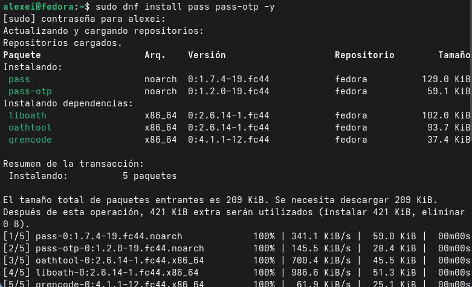

Проверка корректности установки:

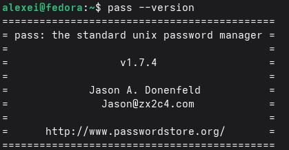

## 3.1.2.Настройка

Шаг 1. Проверьте или создайте ключ GPG

Чтобы использовать pass, вам необходимо иметь ключ GPG. Во-первых, проверяется, существует ли уже:

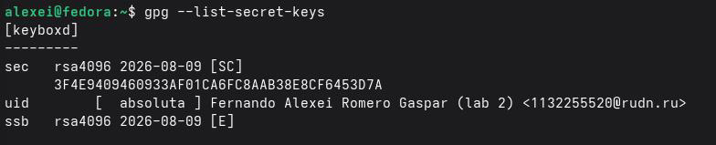

Если ключа нет, необходимо создать новый:

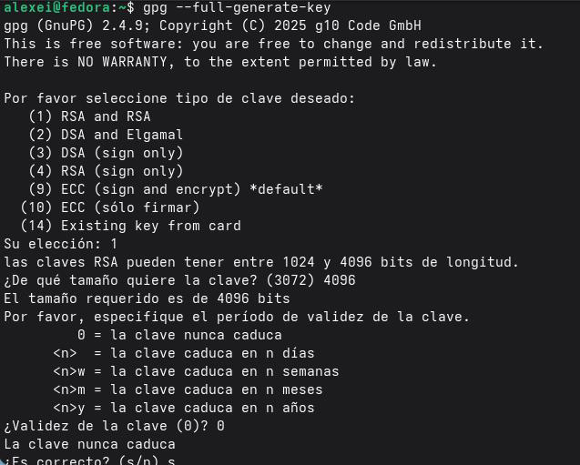

Шаг 2: Инициализация хранилища паролей

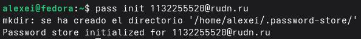

Шаг 3. Настройте синхронизацию с Git

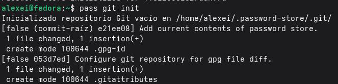

Для ссылки на удаленный репозиторий (ранее созданный на GitHub):

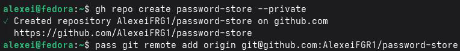

Для синхронизации:

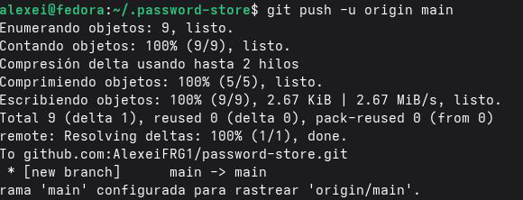

## 3.1.3. Настройка интерфейса с браузером

Чтобы использовать pass с браузером, необходимо установить плагин browserpass.

Шаг 1. Установите browserpass (собственный интерфейс обмена сообщениями)

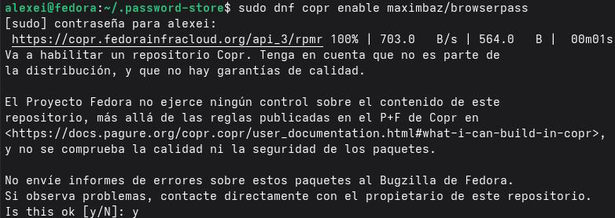
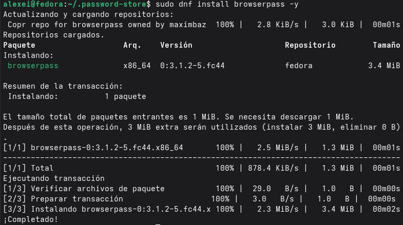

Шаг 2. Установите расширение в браузере

- Firefox: Установить из надстроек Firefox.
- Chrome/Chromium: Установите из Chrome Web Store.

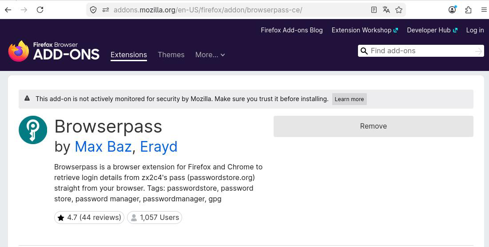

## 3.1.4. Сохранение пароля

Добавить новый пароль:

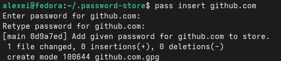

Автоматически генерировать пароль:

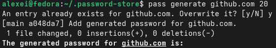

Заменить существующий пароль:

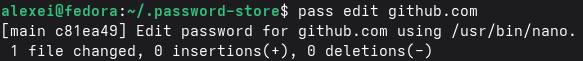

## 3.2. Управление файлами конфигурации с chezmoi
## 3.2.1. Установка дополнительного программного обеспечения

Установите дополнительные пакеты:

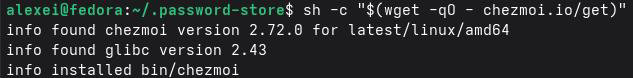
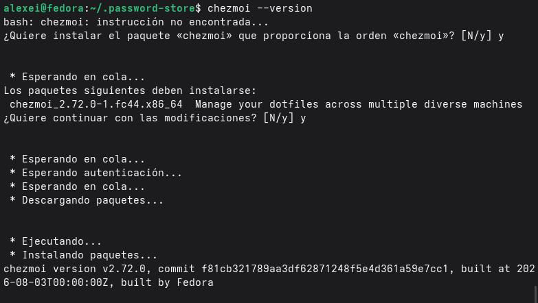
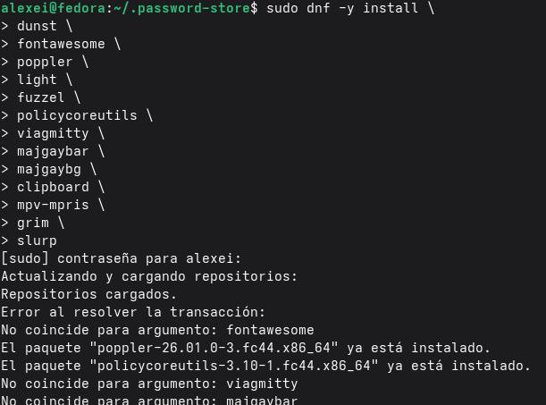

## 3.2.2. Создание собственного репозитория

Шаг 1. Создайте репозиторий на GitHub на основе шаблона

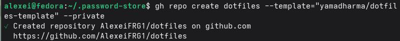

##3.2.3. Подключение репозитория к своей системе

Шаг 1. Инициализируйте chezmoi с помощью репозитория

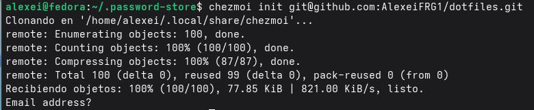

Шаг 2. Проверьте наличие изменений

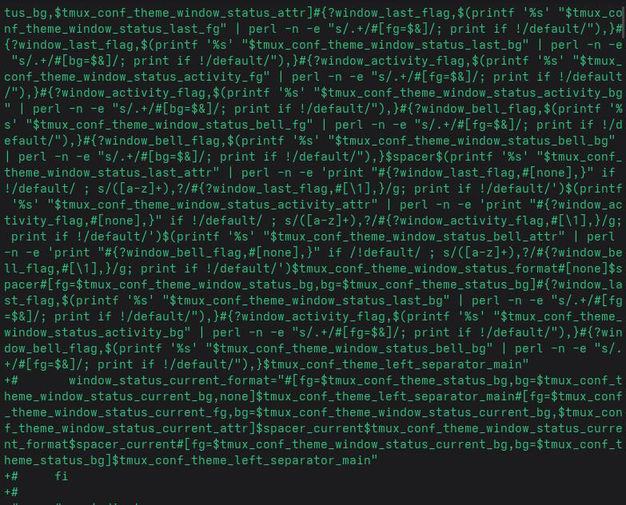

Шаг 3. Примените изменения

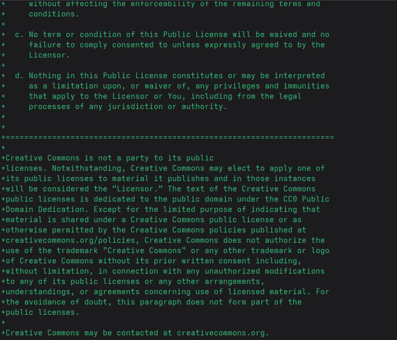

---

## Выводы

В ходе выполнения лабораторной работы я освоил инструменты для настройки безопасной и эффективной рабочей среды. Я установил и настроил менеджер паролей pass, научился инициализировать хранилище, синхронизировать его с Git и управлять паролями через командную строку. Также я изучил работу с chezmoi для управления конфигурационными файлами, создал репозиторий dotfiles и настроил его применение на системе. Все задачи выполнены, полученные навыки повышают безопасность работы и упрощают перенос конфигураций между машинами.

---

## Список литературы

- [Cylab. (2026). Избегайте утечки учетных данных с помощью Pass: стандартного менеджера паролей для Unix.](https://cylab.be/blog/503/avoid-credential-leakage-with-pass-the-standard-unix-password-manager)
- [Chezmoi. (б. д.). Настройка. https://www.chezmoi.io/user-guide/setup/)
- [Chezmoi. (б. д.). Что делает chezmoi?. https://www.chezmoi.io/)
- [Руководство по GNU Emacs. (б. д.). Хранилище паролей Unix.](https://www.gnu.org/software/emacs/manual/html_node/auth/The-Unix-password-store.html)
- [Chezmoi. (б. д.). Справочная информация — шаблоны.](https://www.chezmoi.io/reference/templates/)
- [Cylab. (2026). Избегайте утечки учетных данных с помощью Pass — стандартного менеджера паролей для Unix.](https://cylab.be/blog/503/avoid-credential-leakage-with-pass-the-standard-unix-password-manager)
- [GoPass. (2026). gopass — чуть более продвинутый стандартный менеджер паролей для Unix для команд.](https://www.gopass.pw/)
- [Password Store — Google Play. (2026). Password Store — приложение для Android.](https://play.google.com/store/apps/details?id=dev.msfjarvis.aps)
- [Хранилище паролей. (2026). Хранилище паролей: стандартный менеджер паролей для Unix.](https://www.passwordstore.org/)
- [Проект Fedora. (2026). Руководство по системному администрированию DNF.](https://docs.fedoraproject.org/en-US/fedora/latest/system-administrators-guide/package-management/DNF/Command_Reference/)
- [Chezmoi. (б. д.). Краткое руководство.](https://www.chezmoi.io/quick-start/)
- [Интерфейс командной строки GitHub. (2026). Руководство по интерфейсу команднойстроки GitHub.](https://cli.github.com/manual/)
- [*GPG. (2026). Документация по GNU Privacy Guard.](https://gnupg.org/documentation/)
