---
## Author
author:
name: Ромеро Гаспар Фернандо Алексей
degrees: DSC
orcid:0009-0004-8816-345X
email: 1132255520@rudn.ru
affilition:
 - name: Рщссийский университет дружбы народов
   country: Российская  Федерфция
   postal-code: 117198
   city: Москва
   address: ул. Миклухо-Маклая д. 21к3

## Title
title: "Отчёт по лабораторной работе № 8"
subtitle: "Перенаправление, конвейеры и управление процессами"
license: "CC BY"
abstract: |
  В данном отчёте представлены результаты выполнения лабораторной работы по теме: перенаправление ввода-вывода, использование конвейеров, поиск и фильтрация файлов, управление процессами.

  Описаны операторы >, >>, 2>, &>, команды grep и find, а также управление процессами с помощью ps, jobs и kill. Приведены примеры анализа дискового пространства с помощью df и du.

  Сделаны выводы о достижении поставленной цели и о применении полученных навыков для автоматизации задач в Linux.
keywords: [Linux, перенаправление, конвейер, grep, find, процессы, ps, kill, df, du]
---

## Введение

1. Цель работы
2. Теоретические сведения
> 2.1.Перенаправление ввода-вывода
> 2.2.Конвейеры
> 2.3. Поиск файлов (find)
> 2.4. Фильтрация текста (grep)
> 2.5. Проверка использования диска (df, du)
> 2.6. Проверка использования диска (df, du)
> 2.7. Управление процессами (ps)
3. Задание и последовательность выполнения работы
> 3.1. Запись названий файлов в файл 
> 3.2. Фильтрация файлов с расширением .conf 
> 3.3. Поиск файлов по имени
> 3.4. Постраничный вывод файлов 
> 3.5. Запуск процесса в фоновом режиме 
> 3.6. Управление процессами (ps, kill) 
> 3.7. Анализ дискового пространства (df, du) 
> 3.8. Поиск директорий (find)
4. Контрольные вопросы
5. Выводы
6. Список литературы

---

# Цель работы

Целью данной лабораторной работы является ознакомление с инструментами поиска файлов и фильтрации текстовых данных, а также приобретение практических навыков по управлению процессами (и заданиями), по проверке использования диска и обслуживанию файловых систем.

---

# Теоретические сведения

В этом разделе представлены теоретические основы перенаправления ввода/вывода, использования каналов, поиска и фильтрации файлов, управления процессами и анализа дискового пространства в системах Linux.

## 2.1 Перенаправление ввода-вывода

В Linux по умолчанию каждому процессу соответствуют три стандартных потока ввода/вывода:

- stdin (0): стандартный поток ввода (по умолчанию, клавиатура)
- stdout (1): стандартный поток вывода (по умолчанию, терминал)
- stderr (2): стандартный поток вывода ошибок (по умолчанию, терминал)

Эти потоки можно перенаправлять с помощью следующих операторов:

- >: перенаправляет стандартный вывод в файл (перезапись)
- >>: перенаправляет стандартный вывод в файл (добавление)
- 2>: перенаправляет вывод ошибок в файл
- &>: перенаправляет как stdout, так и stderr в один и тот же файл

## 2.2. Конвейеры

Конвейеры позволяют соединять вывод одной команды с вводом другой, связывая их
выполнение в цепочку. Базовый синтаксис:


Это означает, что вывод команды command1 становится вводом команды command2. Конвейеры
можноnобъединять в цепочки несколько раз и комбинировать с перенаправлением файлов.

## 2.3. Поиск файлов (find)

Команда `find` используется для поиска файлов и каталогов, соответствующих определенным критериям. Ее базовый формат:

```bash
find [путь] [параметры]
```

Некоторые полезные параметры:

- -name "pattern": поиск по имени (с учетом регистра)
- -iname "pattern": поиск по имени (без учета регистра)
- -type f: поиск только файлов
- -type d: поиск только каталогов
- -exec command {} \;: выполняет команду для каждого найденного файла

## 2.4. Фильтрация текста (grep)

Команда `grep` (глобальная команда для вывода регулярных выражений) ищет
текстовые шаблоны в файлах или в выводе других команд. Её базовый формат:

```bash
grep [параметры] pattern [файл]
```

Распространённые параметры:

- -i: игнорирует регистр
- -r: рекурсивно ищет в каталогах
- -n: отображает номер строки
- -v: выполняет поиск в обратном порядке (исключает шаблон)
- -A N: отображает N строк после совпадения
- -B N: отображает N строк до совпадения
- -C N: отображает N строк до и после совпадения

## 2.5. Проверка использования диска (df, du)

`df` (свободное место на диске) отображает доступное пространство на смонтированных файловых системах:

```bash
`df -h`
```

Опция `-h` отображает размеры в удобочитаемом формате (КБ, МБ, ГБ). `-T` добавляет тип файловой системы.

`du` (использование диска) отображает пространство, используемое файлами и
каталогами:

```bash
`du -sh [каталог]`
```

Опция `-s` суммирует общее пространство, а `-h` отображает его в удобочитаемом
формате.

## 2.6. Управление задачами (jobs, kill)

Процесс — это запущенная программа, которой система присваивает идентификатор (PID). Фоновые процессы называются заданиями.

Для управления ими:

- &: Выполняет команду в фоновом режиме
- jobs: Выводит список фоновых процессов
- fg %n: Выводит задание на передний план
- kill [signal] PID: Отправляет сигнал процессу

Распространенные сигналы:

- SIGTERM (15): Запрашивает упорядоченное завершение (по умолчанию)
- SIGKILL (9): Принудительно завершает процесс немедленно

## 2.7. Управление процессами (ps)

Команда `ps` отображает информацию о запущенных процессах:

```bash
`ps aux`
```

Отображает все процессы (включая процессы других пользователей) с подробной информацией об использовании ЦП, использовании памяти, состоянии и связанной с ними команде.

# Задание и последовательность выполнения работы

В этом разделе представлены задания, которые необходимо выполнить, и подробные инструкции по работе с перенаправлением ввода-вывода, поиском файлов, фильтрацией текста и управлением процессами в операционной системе Linux.

## 3.1. Запись названий файлов в файл

Шаг 1: Перенаправьте вывод команды `ls /etc` в файл

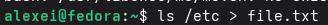

Шаг 2: Добавьте список файлов из вашего домашнего каталога в тот же файл


Шаг 3: Проверьте содержимое файла

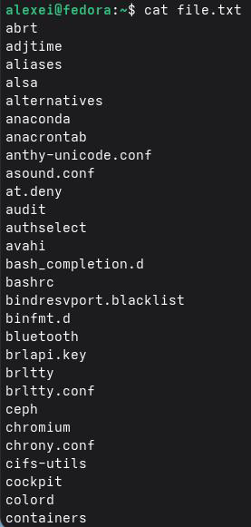

## 3.2. Фильтрация файлов с расширением .conf

Шаг 1: Отфильтруйте строки, содержащие .conf, и сохраните их в новый файл

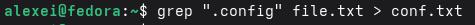

Шаг 2: Проверьте содержимое файла conf.txt

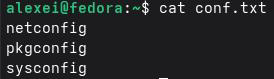

## 3.3. Поиск файлов по имени

Шаг 1: Найдите в домашнем каталоге файлы, начинающиеся с буквы c

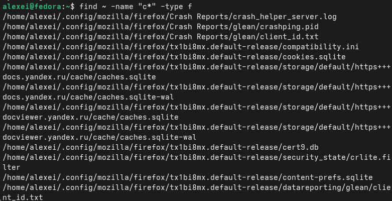

Шаг 2: Найдите в домашнем каталоге файлы, начинающиеся с буквы c, и отобразите их постранично

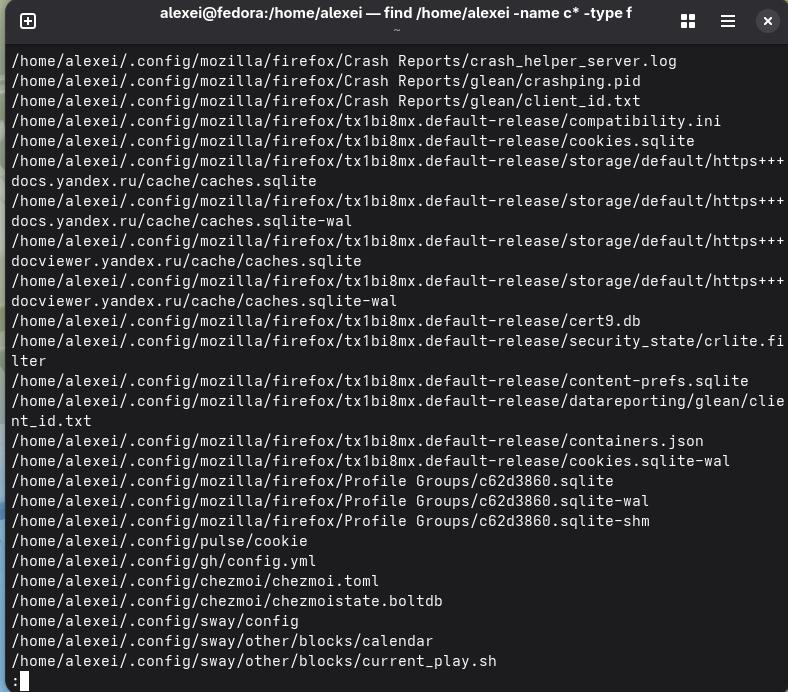

Шаг 3: Подсчитайте, сколько файлов начинается с буквы c

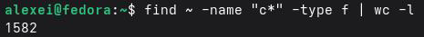

## 3.4. Постраничный вывод файлов

Шаг 1: Отобразить имена файлов в каталоге /etc, начинающиеся с буквы h, спостраничной разбивкой


Или:


## 3.5. Запуск процесса в фоновом режиме

Шаг 1: Запустите редактор gedit в фоновом режиме

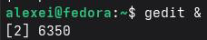

Шаг 2: Убедитесь, что gedit запущен в фоновом режиме

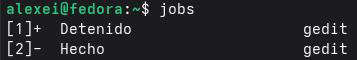

Шаг 3: Запустите процесс, который записывает имена файлов, начинающиеся с "log", в файл

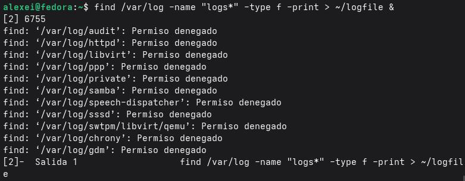

Шаг 4: Проверьте содержимое файла журнала

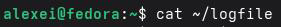

## 3.6. Управление процессами (ps, kill)

Шаг 1: Определите PID процесса gedit

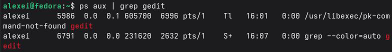

Шаг 2: См. руководство по команде `kill`

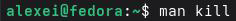

ШШаг 3: Завершите процесс gedit, используя его PID


Шаг 4: Убедитесь, что процесс завершен

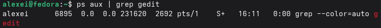

Шаг 5: Удалите файл журнала


## 3.7. Анализ дискового пространства (df, du)

Шаг 1: Просмотрите руководства по командам df и du

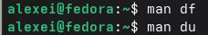

Шаг 2: Запустите df с параметрами для получения подробной информации

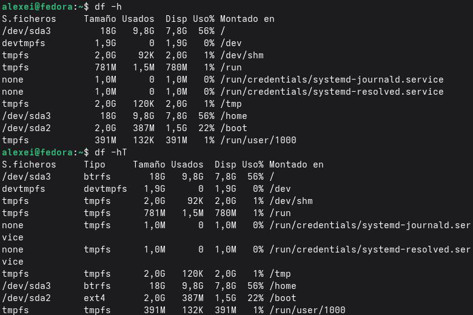

Шаг 3: Запустите du, чтобы увидеть используемое пространство в вашем домашнем каталоге

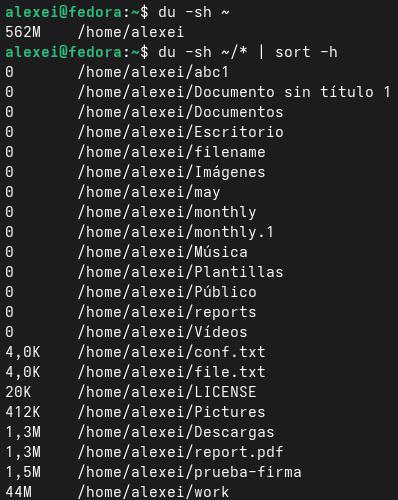

## 3.8. Поиск директорий (find)

Шаг 1: Найти все каталоги в домашнем каталоге

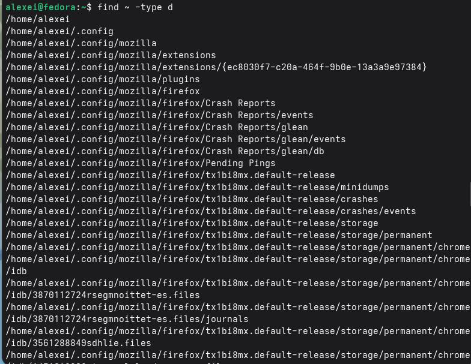

Шаг 2: Найти каталоги и отобразить их постранично


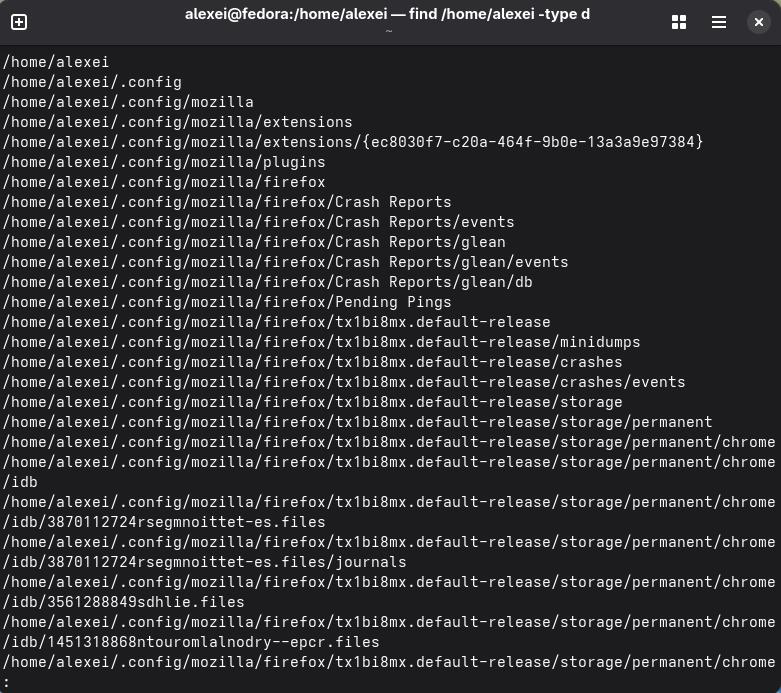

Шаг 3: Подсчитать количество каталогов в домашнем каталоге

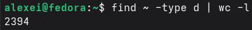

# Контрольные вопросы
В этом разделе представлены ответы на контрольные вопросы, заданные в концелабораторной работы, которые позволят вам проверить понимание основных концепций перенаправления ввода/вывода, процессов, поиска файлов и управления дисками в Linux.

## 1. Какие потоки ввода/вывода вы знаете?

В Linux каждому процессу соответствуют три стандартных потока ввода/вывода:

| Потоковая передача | Дескриптор | Устройствопоумолчанию | Функция                  |
|--------------------|------------|-----------------------|--------------------------|
| stdin              | 0          | Клавиатура            | Стандартный ввод         |
| stdout             | 1          | Терминал              | Стандартный вывод        |
| stderr             | 2          | Терминал              | Стандартный вывод ошибок |

Эти потоки могут быть перенаправлены в файлы или на другие устройства.

## 2. Использование команд > и >>.

- > — перенаправляет стандартный вывод (stdout) в файл. Если файл уже существует, он
перезаписывается.
- >> — перенаправляет стандартный вывод (stdout) в файл. Если файл уже существует, он добавляет данные в конец (не перезаписывает).

Пример:

- echo "Первая строка" > file.txt — перезаписывает
- echo "Вторая строка" >> file.txt — добавляет данные в конец

## 3. Что такое конвейер?

Конвейер — это механизм, позволяющий соединять вывод одной команды с вводом другой, связывая их выполнение в цепочку. Синтаксис:

```bash
command1 | command2
```

Вывод команды command1 становится вводом команды command2. Это позволяет комбинировать простые команды для выполнения более сложных задач.

Пример:

```bash
ls -la | sort | less
```

## 4. Что такое процесс? Какова функция программ?

| Понятие   | Определение                                                 |
|-----------|-------------------------------------------------------------|
| Программа | Исполняемый файл, хранящийся на диске (статический код)     |
| Процесс   | Запущенная программа со своим собственным адресным пространством в памяти, PID и состоянием                                                          |

Процесс — это запущенный экземпляр программы. Несколько процессов могут одновременно запускать одну и ту же программу.

## 5. Что такое PID и GID?

- PID (Process ID) — это уникальный идентификатор, присваиваемый каждому процессу в системе. Он используется для управления процессами (например, kill, ps).

- GID (Group ID) — это идентификатор группы, к которой принадлежит процесс или пользователь. Он определяет права доступа к файлам и ресурсам.

## 6. Что представляют собой эти задачи и какие команды я могу использовать?

Задачи — это процессы, которые выполняются в фоновом режиме из терминала. Ими можно управлять с помощью следующих команд:

| Команда | Функция                                          |
|---------|--------------------------------------------------|
| jobs    | Отображаетсписокфоновыхзадач                     |
| fg%n     | Выводитзадачуnнапереднийплан                    |
| bg%n    | Возобновляетвыполнениезадачиnвфоновомрежиме kill |
| %n      | Завершаетзадачуn                                 |

## 7. Найдите информацию о командах top и http. Каковы их функции?

top — отображает актуальный список запущенных процессов в реальном времени, отсортированный по использованию ЦП. Позволяет отслеживать производительность системы.

http — не является стандартной командой в Linux. Если вы имеете в виду httpd или htop:

- htop — улучшенная версия top с более удобным интерфейсом (цвета, полосы прокрутки).
- httpd — веб-сервер Apache (демон HTTP).

## 8. Используйте и отдавайте команды своему персонажу. Пожалуйста, сначалаnпроверьте эту команду.

Основная команда для поиска файлов — `find`:

```bash
find [путь] [параметры]
```
| Параметр| Функция                                  | Пример                                 |
|---------|------------------------------------------|----------------------------------------|
| -name   | Поиск по имени                           | find ~ - name "*.txt"                  |
| -iname  | Поиск по имени (без учета регистра)      | find ~ -iname "*.jpg"                  |
| -type f | Поиск только файлов                      | find /etc - type f                     |
| -type d | Поиск только каталогов                   | find ~ - type d                        |
| -size   | Поиск по размеру                         | find ~ - size +10M                     |
| -exec   | Выполнить команду над найденными файлами |find ~ - name "*.log" -execute rm {} \; |

## 9. Можно ли выполнить поиск содержимого в файле? Если да, то как?

Да, вы можете искать файлы по их содержимому, используя команду grep с опцией -r (рекурсивный поиск):

``` bash
grep -r "text_to_search" /path/to/directory/
```

Пример: Поиск слова "error" во всех файлах в каталоге /var/log:

```bash
grep -r "error" /var/log/
```

## 10. Какой параметр является предпочтительным для свободного дискового пространства?

Чтобы просмотреть свободное дисковое пространство, используйте команду df:

```Bash
df -h
```

Опция -h отображает размеры в удобочитаемом формате (КБ, МБ, ГБ). Чтобы просмотреть данные по конкретному диску:

```Bash
df -h /dev/sda1
```

## 11. Каково назначение каталога домашних файлов?

Чтобы увидеть размер домашнего каталога, используйте команду `du`:

```Bash
du -sh ~
```

Опция `-s` отображает общий размер и размер подкаталога в удобочитаемом формате. Чтобы увидеть размер подкаталогов:

```Bash
du -sh ~/* | sort -h
```

## 12. Как завершить зависший процесс?

Для завершения зависшего процесса выполните следующие действия:

1. Определите идентификатор процесса (PID):

```bash
ps aux | grep process_name
```

2. Завершите процесс:

```bash
kill -9 <PID>
```

Сигнал -9 (SIGKILL) принудительно завершает процесс немедленно.

Альтернативные варианты:

| Команда             | Описание                                             |
|---------------------|------------------------------------------------------|
| kill<PID>           | Отправляет сигнал SIGTERM (упорядоченное завершение) |
| kill-9<PID>         | Принудительно завершает процесс (SIGKILL)            |
| pkillprocess_name   | Завершает процессы по имени                          |
| killallprocess_name | Завершает все процессы с этим именем                 |

---

# Выводы

В ходе выполнения лабораторной работы я ознакомился с инструментами поиска файлов и фильтрации текстовых данных в Linux. Я освоил перенаправление потоков ввода-вывода с использованием операторов >, >>, а также работу с конвейерами (|) для объединения команд. Я изучил команды find и grep для поиска файлов по имени и содержимому, а также команды df и du для анализа использования дискового пространства. Кроме того, я приобрел навыки управления процессами с помощью команд ps, jobs и kill,включая запуск процессов в фоновом режиме. Все поставленные задачи выполнены, полученные навыки являются основой для эффективной работы в командной строке Linux.

---

# Списоклитературы

- [CCNRS.(с.ф.).Сеанс 4: Процесс](.https://perso.liris.cnrs.fr/pierre-antoine.champin/enseignement/linux/s4.html)
- [Ясчитаю.(2026, 31марта).Командаgrepв Linux: полноеруководствоспримерами.](https://contabo.com/blog/es/comando-grep-de-linux-tutorial-completo-con-ejemplos/)
- [Страницыруководства Debian. (2026). df (1) manpages-esтриксибэкпорты Debian.](https://manpages.debian.org/trixie-backports/manpages-es/df.1.es.html)
- [Страницыруководства Debian. (2025). grep (1) manpages-es Debiantrixie.](https://manpages.debian.org/trixie/manpages-es/grep.1.es.html)
- [Hostinger. (2025, 12февраля).Какпроверитьсвободноеместонадискев Linuxс помощьюdfиdu.](https://www.hostinger.com/mx/tutoriales/revisar-espacio-en-el-disco-linux)
- [Lab Ex.(2026).Управлениеимониторингпроцессовв Linux|Comp TIALinux+.](https://labex.io/es/tutorials/comptia-manage-and-monitor-linux-processes-590864)
- [Справочныйцентр Oracle.(бездаты).Новыепараметрыдляdf, duиls.](https://docs.oracle.com/cd/E19683-01/816-3920/6ma5 tbt 1c/index.html)
- [Contabo.(2026, 31марта).Командаgrepв Linux: полноеруководствоспримерами.](https://contabo.com/blog/es/comando-grep-de-linux-tutorial-completo-con-ejemplos/)
- [Страницыруководства Debian. (2026). df (1) manpages-es Debiantrixie-backports.](https://manpages.debian.org/trixie-backports/manpages-es/df.1.es.html)
